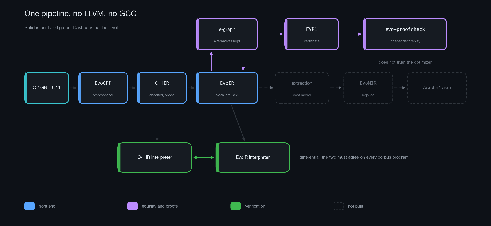
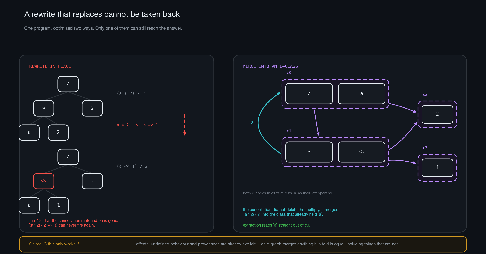
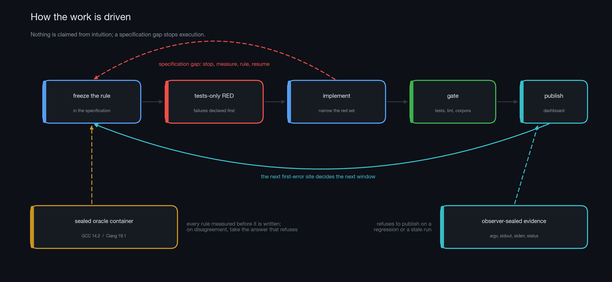

# EvoCC

**A C compiler that never throws away an equivalent form of your program, proves every optimization it makes, and is aiming at booting Linux — with no LLVM or GCC anywhere inside.**

Most compilers optimize by rewriting: each pass replaces code with something it believes is better, and the original is gone. EvoCC keeps all of them. Its optimizer is an [e-graph](https://egraphs-good.github.io/) — every rewrite *adds* an equivalent form instead of replacing one, a cost model picks the best at the end, and every union carries a certificate that a separate checker replays without trusting the optimizer. The target is a real one: a pinned Linux 6.18.44 `arm64 virtconfig` kernel, compiled, linked, and booted under QEMU by this compiler alone.

- **From scratch.** Preprocessor, parser, IR, optimizer, and backend are all EvoCC's own. The only external tools are the platform assembler and linker.
- **Built by AI, governed by a spec.** The compiler is written by AI agents that may not guess: every language rule is frozen in a versioned specification, measured against sealed GCC-14 and Clang-19 before it is written, and a spec gap stops the work instead of being papered over.
- **Every number is measured.** What the kernel does and does not accept is published from sealed evidence by a script that refuses to run on a regression. There is no status here that a command did not produce.



## Four questions

This is an experiment as much as a compiler. It exists to find out:

1. **Can a specification be the sole authority for an AI that writes a compiler?** Not guidance — authority. The AI proposes, the oracles and the checker dispose, and the AI may refuse to proceed when the spec is silent.
2. **Can AI build, from nothing, a compiler that is *correct* on industrial code?** Not fast, not elegant — correct, on the Linux kernel, checked layer by layer against compilers that are.
3. **Can an e-graph replace the optimization pipeline?** Within a fixed, deterministic budget, on kernel code, with a proof for every rewrite — matching GCC `-O2`, not just a benchmark suite.
4. **Can the optimizer improve itself?** Its rule set, cost model, and schedule are all hand-written today. The e-graph makes the search space *safe* — anything it offers is equivalent by construction — so a language model can propose and evolution can select without ever being able to make the compiler wrong.

One idea runs through all four: separate what must be *true* from what must be *found*. Give the first to machines that cannot be persuaded. Give the second to machines that are good at proposing and bad at being right.

## Try it

```sh
cargo build --release
```

Write something with a bit of GNU in it:

```c
// demo.c
struct point { int x, y; };

static inline int dot(struct point a, struct point b) {
    return a.x * b.x + a.y * b.y;
}

int main(void) {
    struct point p = { .x = 3, .y = 4 };
    int n = ({ int t = dot(p, p); t + 1; });          /* statement expression: 26 */
    return __builtin_choose_expr(__builtin_constant_p(1), n / 2, 0);
}
```

Run it through both interpreters — they are independent implementations and must agree:

```sh
$ target/release/evocc --interpret-c-hir demo.c     # high-level IR, checked semantics
13
$ target/release/evocc --interpret-evoir demo.c     # after lowering to SSA
13
```

Look at the IR. Memory and effects are explicit tokens, and undefined behaviour is an obligation the program carries rather than a thing that silently happens:

```sh
$ target/release/evocc --emit=evoir demo.c | head -12
func @dot(%arg0: ptr<generic>, %arg1: ptr<generic>, %arg2: mem<all>, %arg3: world) -> (bits<32>, mem<all>, world)
^entry(%v0: ptr<generic>, %v1: ptr<generic>, %v2: mem<all>, %v3: world):
    %v4 = access_in_bounds %v2, %v0 [size=4, align=4]
    (%v5, %v6, %v7) = load %v4, %v3, %v0 : bits<32>
    ...
    %v12 = signed_mul_defined %v5, %v9
    ub.assume.signed_overflow %v12
    %v13 = mul.bits<32> %v5, %v9
```

Optimize through the e-graph and watch a rewrite land. The multiply disappears and the function returns its argument — but the overflow obligation it carried stays, because an optimization may remove work, never a fact the program must still satisfy:

```sh
$ echo 'int f(int x) { return x * 1; }' > opt.c
$ target/release/evocc --emit=evoir opt.c | tail -6
    %v1 = const.bits<32> 1
    %v2 = signed_mul_defined %v0, %v1
    ub.assume.signed_overflow %v2
    %v3 = mul.bits<32> %v0, %v1
    ret %v3
}
$ target/release/evocc --emit=evoir -Oeq-scalar opt.c | tail -5
    %v1 = const.bits<32> 1
    %v2 = signed_mul_defined %v0, %v1
    ub.assume.signed_overflow %v2
    ret %v0
}
```

Every such rewrite emits an EVP1 certificate. `evo-proofcheck before.evoir after.evoir proof.evp1` replays it independently; the corpus replay is a test you can run:

```sh
cargo test -p evocc-proofcheck --test day8_corpus_replay
```

Other useful flags: `-E` (preprocess), `--parse-only`, `--emit=c-hir`, and `--survey`, which reports *every* diagnostic in a file instead of the first.

## How it works



- **Semantics first.** C is lowered to EvoIR, a block-argument SSA where memory and observable effects are explicit `mem` and `world` tokens, undefined behaviour is an `ub.assume` obligation, and pointers carry provenance. The e-graph only ever sees a program whose dangerous parts are already spelled out, so it cannot "optimize" them away.
- **Equivalence is state.** Rewrites merge e-classes rather than replacing nodes. Nothing is lost, phase order stops mattering, and a cost model chooses at extraction time from everything the rules could prove equal.
- **Proofs are the product.** Each union records why it was allowed. A standalone binary, `evo-proofcheck`, replays those certificates against the before and after programs and shares no code with the optimizer that produced them.

## How the work is done



- The specification (`docs/evoir-spec.md`, revision 1.9.23) is the only authority. Any rule about observable behaviour is measured in a sealed GCC-14.2 / Clang-19.1 container *before* it is written down. Where the two compilers disagree, the spec records it and takes the answer that refuses rather than voting.
- Every change opens with a tests-only commit whose failures are declared in advance, and closes with a dashboard published from observer-sealed evidence. The dashboard names the next thing the kernel needs.
- An AI executor that hits a gap in the spec stops and asks. That has happened six times; five times the gap was an error by the architect, caught by a machine before it became code.

## Status

**What the kernel says today:** 16 of 16 cohort units preprocess clean; 2 of 16 parse clean under both reference compilers. That second number lags badly — a unit counts only when its *last* unsupported construct falls, and more than ten distinct blockers have been cleared with zero regressions while it read 2/16. The current one is a single lvalue form, 26 lanes wide.

| Capability | Status |
|---|---|
| Preprocessor — full C11 pp-token grammar, GCC-compatible predefined set, feature queries, `#pragma pack` | done |
| Parser — C11 plus the GNU dialect the kernel uses: attributes, `typeof`, `_Generic`, statement expressions, `asm` and `asm goto`, builtins, designated initializers, `__auto_type`, case ranges | done |
| Layout — bit-exact against sealed GCC and Clang on 150 frozen cases | done |
| Checked high-level IR and interpreter — typed UB, provenance, per-byte initializedness | done |
| EvoIR block-argument SSA, semantic lowering, second interpreter | done |
| E-graph, reviewed scalar rewrite set, EVP1 certificates, standalone checker | done |
| Kernel telemetry and sealed publication | done |
| Diagnostic survey mode | partial |
| Kernel parse closure | in progress |
| Analysis lattices, bounded scheduler | not started |
| Randomized semantic gate | not started |
| EvoMIR, register allocation, AArch64 | not started |
| Linux ABI, kernel codegen, link, boot | not started |

The compiler emits no machine code yet. Everything above the backend is deep and measured; the backend is the next stage.

## Layout

```
crates/evocc            driver                  crates/evocc-evoir       EvoIR, validator, interpreter, text
crates/evocc-cpp        preprocessor            crates/evocc-egraph      e-graph core
crates/evocc-lex        lexer                   crates/evocc-eqopt       rewrites, EVP1 certificates
crates/evocc-parser     C11 + GNU parser        crates/evocc-proof       certificate format
crates/evocc-types      types and layout        crates/evocc-proofcheck  evo-proofcheck
crates/evocc-chir       checked IR, interpreter crates/evocc-lower       C-HIR -> EvoIR
docs/evoir-spec.md      the specification       tests/contracts/         frozen corpora and receipts
tests/acceptance/       sealed-oracle harnesses tools/                   survey, routing, figures
```

Every commit passes workspace tests, `clippy -D warnings`, `rustfmt`, Ruff, both layout corpora against the sealed oracles, and an isolated offline clone replay. The receipts in `tests/contracts/` record which commit each published number came from.

---

## Where the four questions stand

**1. Spec as sole authority — the only one with real evidence so far.** 72 dashboard publications, zero regressions. Six executor stops at spec gaps; five architect errors overturned by an oracle or the executor before they became code; one commit whose message did not match its diff, caught by the executor reviewing upstream. A failure taxonomy is emerging — the unprobed assertion, the reference to a construct nobody defined, one rule implemented on one code path but not another — and each entry has a mechanical countermeasure that has since fired. The cost is real too: roughly one round in five went to fixing the spec.

**2. Correct on the kernel — partial.** Preprocessing is closed. Parsing is one construct from closed. Layout is bit-exact. Two interpreters agree on every corpus. Missing: any machine code, the full ~2,500-unit sweep, and the flight lab that boots the result. The open bet is whether a loop that converges on 16 units converges on 2,500.

**3. E-graph instead of a pipeline — not yet measurable.** The e-graph, the rule set, and the checker exist, but the cost model counts instructions and there is no target. This question is blocked on the backend, which makes the backend an instrument rather than a deliverable. Two hard points are already on the record: inlining, which the kernel depends on and a single-function e-graph cannot do; and constructs the kernel expects answered *after* optimization, which EvoCC answers conservatively in the front end.

**4. A self-improving optimizer — not started, and not blocked.** The cost model and the schedule can be learned before the backend exists, with the interpreter's dynamic step count as a fitness signal that is measured rather than estimated. Two lines will not be crossed: no rule enters the release set without machine verification, and the kernel cohort is the acceptance gate and never a training set.

<details>
<summary>What would settle each question against us</summary>

- **1** — a semantic divergence that passes every gate and reaches a published dashboard; or governance that costs more than the errors it prevents.
- **2** — a class of construct the loop cannot specify and measure; or a kernel that compiles, passes every gate, and does not boot, which would mean the oracle stack has a blind spot.
- **3** — budget exhaustion on a material share of kernel functions; extracted code outside a margin of GCC `-O2` that is fixed *before* the first measurement; or memory rewrites that cannot carry a checkable proof.
- **4** — evolved policies that do not beat hand-written ones on held-out corpora; or proposed rules whose survival rate does not justify the cost of verifying them.

</details>
