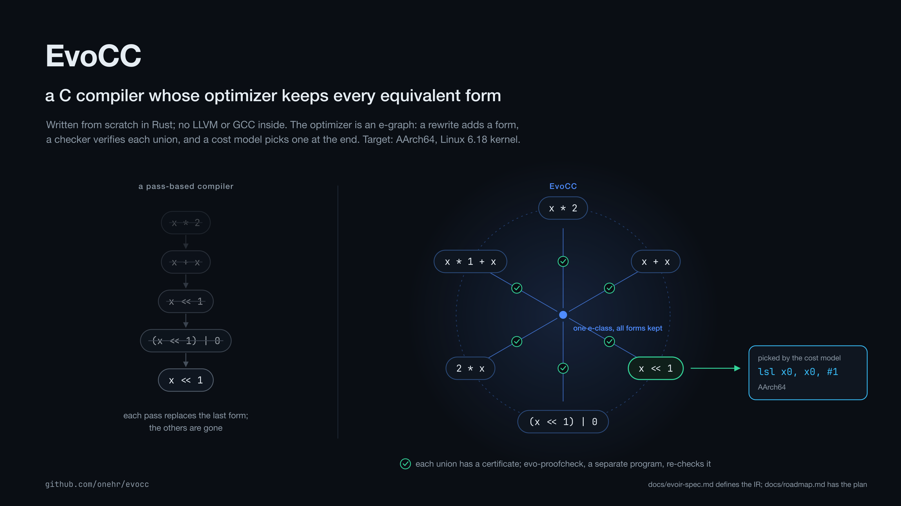

<p align="center"></p>
<h1 align="center">EvoCC</h1>
<p align="center">a C compiler with checked equality-saturation optimization</p>

EvoCC is an experimental C compiler written in Rust, targeting AArch64 Linux
and macOS. It has its own preprocessor, parser, checked IR, SSA lowering,
optimizer, register allocator and assembly emitter. Native builds use platform
assemblers, linkers and runtime libraries. Linux 6.18.44 is the kernel target;
the application ladder below measures progress beyond kernel boot.

Its bounded scalar optimizer uses an [e-graph](https://egraphs-good.github.io/):
rewrites retain equivalent alternatives, extraction chooses a form, and a
separate checker verifies the rewrite certificate. This is not a proof of the
whole compiler or a claim that every program is optimized through EqSat.



The illustration describes the design, not a live completion counter.
The authoritative language and machine profiles are
[EvoIR 1.9.111](docs/evoir-spec.md) and [EvoMIR 0.48](docs/evomir-spec.md).
GCC 14.2 and Clang 19.1 in the sealed AArch64 lab provide reference measurements;
documented profile decisions resolve supported disagreements, and remaining
unsupported forms have explicit refusal boundaries.

## Status — 2026-09-23

**Full kernel boot is working; full kernel testing and the complete application
ladder are not yet closed.** The latest recorded application lanes contain
**7 PASS, 2 PROFILE_CLEAN, 5 INCOMPLETE and 1 FAIL**.

This is an audit of existing measurements, not a new run of today's checkout.
Most application results come from the September 19–20 campaign, TinyCC has a
later lane replay, and September 23 targeted repairs are identified separately.
Each receipt retains its compiler and input identity. See the generated
[status dashboard](docs/status.md), [pinned roadmap](docs/roadmap.md),
[application ledger](docs/notebook/benchmark-evaluation-20260915.md) and
[kernel issue ledger](docs/notebook/kernel-selftest-gaps-20260914.md).
The Git-tracked [TODO list](TODO.md) gives each remaining task a stable ID,
priority, next action and evidence-based closure condition.

### Application benchmarks

`PASS` is bounded by the recorded build and test selection. `PROFILE_CLEAN`
means zero compiler failures after evidenced deferrals, inapplicability and
unusable-oracle cases are separated; it does **not** mean all originals passed.
TU counts are EvoCC translation units retained in the lane's tested build,
not test counts. Mixed-link builds can still contain reference-built code.

| Benchmark | Status | Recorded result | Scope or remaining issue |
|---|---|---:|---|
| GCC torture | PROFILE_CLEAN | 1,522/1,692 programs PASS | 0 compiler failures; 21 FP-deferred, 146 not applicable, 3 oracle-unusable; September 27 full replay |
| c-testsuite | PASS | 220/220 programs PASS | Fresh full population, zero exclusions or deferrals |
| Csmith | INCOMPLETE | 932/1,000 checksum agreements | All 1,000 compile; 0 mismatches; 68 unusable-oracle cases are not passes |
| zlib | PASS | 19/19 TU | Recorded original program tests |
| zstd | PASS | 44/44 TU | Recorded original tests; build adjustments remain in the receipt |
| cJSON | PASS | 23/23 TU | Both libraries + all 21 Unity/private-helper programs; 161 cases PASS, 1 upstream IGNORE; public-API controls also pass |
| Mbed TLS | PASS | 382/382 TU | Default configuration selftest and 148/148 CTest |
| TinyCC | PASS | 11/11 TU | Original `make test`; relink/test exits and installed objects audited |
| toybox | FAIL (shared upstream assertion) | 203/203 TU installed; all 1,669 test occurrences complete | Both builds: 1,648 PASS / 1 FAIL / 20 SKIP; tar expected-hash contradiction reproduced; zero EvoCC regressions |
| musl + libc-test | FAIL | Historical 0/1,339 TU | Strict fenv now has targeted tests; original ARM64 math units expose the still-excluded scalar FP asm constraint |
| PolyBench/C | PASS | 30/30 kernels | MINI_DATASET array-output correctness, not performance; reference-built allocation utility |
| LLVM test-suite | INCOMPLETE | 1,014/1,735 programs PASS | Frozen account: 44 compiler failures, 17 FP-deferred, 659 not applicable, 1 oracle-unusable; follow-ups below |
| jq | PASS | 69/69 TU; original `make check` PASS | Real binary128 interface; original `-pthread` preserved; no object fallback |
| Lua | PASS | 34/34 TU | Matching official `all.lua`, without soft skips |
| SQLite | PASS | 86/86 TU | Public Tcl `veryquick`: 329,803 assertions; not proprietary TH3 |

The [benchmark receipt](tests/contracts/bench-receipt.json) and individual
`ladder-*-receipt.json` files bind these results to their measured subjects.
The historical LLVM 44-failure count is not a claim that all 44 remain broken:
later original-program replays pass `compare-fp-1`, `compare-fp-3`,
`compare-fp-4`, `pr50310` and `20020720-1`. On September 23, unchanged LARGE
`lu` and `ludcmp` also pass in **59.2533 s / 48.8197 s** under the original
60-second limit. On September 24, unchanged LARGE `floyd-warshall` passes its
original output/hash checks in **52.0360 s** after removal of redundant loop
transport copies. A new full LLVM campaign has not run, so these targeted
repairs do not increase its frozen numerator.

### Linux boot, kselftest and KUnit

All kernel rows use Linux 6.18.44 ARM64, but the configurations and Images
differ. Target-C objects come from EvoCC; assembly, host build tools and
userspace test dependencies are accounted for separately.

| Scope | Verified result | Limit |
|---|---|---|
| K6 locked configuration | **2,799/2,799 target-C**, complete link, real boot and normal shutdown PASS; uniform EvoCC rebuild, zero GCC target-C fallback | Not every Linux configuration or subsystem |
| BPF/module configuration | **6,765/6,765 target-C**, complete link/boot PASS; 745 modules relinked, signed and installed | Latest composition: 1 repaired + 6,764 retained EvoCC objects, not a fresh one-compiler survey; not every driver loaded |
| K7 selected kselftests | Both kernels: **9/9 programs, 125/125 subtests PASS**, no skip/failure | Not all kselftests or KUnit |
| Full installed kselftest population | All **970 programs started on each kernel**; aggregate INCOMPLETE; counts below | Unbuilt collections and unavailable hardware remain; latest Image needs a full rerun |
| Expanded built-in KUnit | Of 1,504 cases: EvoCC **1,432 PASS / 12 FAIL / 60 SKIP**; GCC **1,438 / 7 / 59** | Subsequent filtered repairs are not a new full result |
| Expanded KUnit modules | Both kernels actually loaded all **31 test modules**, **765/765 cases PASS** | This retained 6,916-target-C composition differs from later filtered FORTIFY Images; its 809-module configuration disables module signing |

The last full 970-program pair (September 22) records these **program-level**
verdicts, not individual nested assertions:

| Kernel | PASS | FAIL | SKIP | TIMEOUT | INVALID_OUTPUT | INCOMPLETE |
|---|---:|---:|---:|---:|---:|---:|
| GCC control | 532 | 121 | 302 | 11 | 2 | 2 |
| EvoCC | 529 | 114 | 302 | 19 | 3 | 3 |

Later BPF repairs changed the subject Image; the September 22 totals remain
historical. The latest September 23 checkpoint is explicitly a **one-program
BPF replay**, not a new 970-program campaign: GCC completes with 651/5644
successful test/subtest counts, 127 skip counts and 11 failed tests; EvoCC
times out at the unchanged 300-second limit after group 482. Both shut down
normally. No test is still running from that flight. Nested `sched_ext` and
BPF summaries are checked without rewriting historical counts.

Boot acceptance audits installed object hashes and generated-input stability,
then starts the actual Image in QEMU, checks the ordered `/init` markers and
per-run nonce, and requires normal poweroff. Kselftests compare the two kernels
with matching test payloads in fresh per-program VMs. CPU/EL2 requirements and
explicit timeout policies are recorded for both sides. KUnit executes in the
kernel, with built-in and module results kept separate.

Targeted repairs bring FORTIFY to **25/26 PASS** (failed assertions **96 → 2**),
IOMMU to **218 PASS / 6 FAIL / 5 SKIP** on both kernels, and ALSA timer tests
to **2/2 PASS** on both. Three BPF variants each pass the selected 10 groups /
51 module/BTF subtests. Remaining work includes the nonliteral `strlen`
constant-expression rule, two KVM timeouts, intermittent `sched_ext` and `ublk`
failures, PM runtime timing, shared breakpoint failures, IOPF/config coverage
and the full BPF program. Not every shared failure is diagnosed. A fresh
complete 970-program pair and 1,504-case KUnit run after those repairs remain
outstanding.

Evidence: [locked K6](tests/contracts/kernel-full-receipt.json),
[BPF/module K6](tests/contracts/kernel-bpf-full-receipt.json),
[selected K7](tests/contracts/kernel-selftest-receipt.json),
[full kselftest](tests/contracts/kernel-selftest-full-receipt.json),
[expanded KUnit](tests/contracts/kernel-expanded-kunit-receipt.json).

### Language and research boundaries

Scalar `float`/`double` execution, both interpreters, AAPCS64 HFA/varargs,
integer vectors, TLS, lifecycle registration and the approved GNU extensions
are implemented with targeted tests. The scalar FP engine has **661,848**
independent numerical checks across 32 operations. The strict FP adapter and
world-threaded IR/backend, dynamic-rounding source mode and non-trapping lexical
`FENV_ACCESS` now have [targeted value/status and native checks](docs/notebook/strict-floating-implementation-20260927.md).
The original musl campaign is not yet closed. Binary128 source/IR, both
interpreters and hosted native helpers/ABI now have targeted tests; jq's fresh
69/69-object original test replay also passes. Floating complex/vectors and other explicitly refused forms remain outside
the current source profile. FP is not the only
remaining application or kernel-test blocker.

Other measured dialect boundaries, including tiny-vector external ABI,
integer-complex division, pointer-to-VLA type queries and nonzero-depth return
addresses, are itemized in the [remaining-semantics brief](docs/notebook/remaining-semantics-research-brief-20260921.md).

Whole-kernel EqSat reproducibility/certificate acceptance (G2), the GCC `-O2`
performance comparison (Q2), measured self-improvement (Q3), x86/release gates
and a pinned Doom integration still have no accepted completion result.
Scalar proof results and successful boot do not close those milestones.

## Try it

### Evaluate the roadmap

Read receipts without launching builds or VMs:

```sh
python3 tools/render-status.py --ascii
python3 tools/render-status.py --check
python3 tools/bench.py --list
```

Run selected lanes through the common entry point:

```sh
python3 tools/bench.py csmith cjson
python3 tools/bench.py torture zlib toybox --jobs 2 --budget 45
python3 tools/bench.py llvm-test-suite jq lua sqlite --jobs 2
python3 tools/bench.py kernel-full --jobs 2 --low-disk --allow-qemu-drift
python3 tools/bench.py kernel-selftest --allow-qemu-drift
python3 tools/bench.py kernel-selftest-all --jobs 2 --reuse-selftest-build --allow-qemu-drift
python3 tools/bench.py kernel-kunit --allow-qemu-drift --dry-run
python3 tools/bench.py kernel-kunit --status
```

Preview an expensive all-lane campaign before executing it:

```sh
python3 tools/bench.py all --programs 500 --jobs 2 --budget 45 --allow-qemu-drift --dry-run
```

`all` runs available lanes sequentially. It is a long native evaluation, not a
unit-test shortcut. Csmith's default is 500 programs **per campaign** (1,000
total); `--budget` limits toybox/musl bisection probes, not corpus size.
`--allow-qemu-drift` explicitly acknowledges the installed QEMU digest for
kernel lanes. `--dry-run` prints commands; `--evocc PATH` measures an existing
compiler without rebuilding it.

`kernel` is the historical mixed-link ramp; use `kernel-full` for complete
target-C compilation, installation, link and boot. Selftest commands do not
rebuild the kernel. These examples select the locked default configuration;
expanded configurations need explicit matching receipt, source and runtime
arguments (`--help` and the kernel ledger describe them). `kernel-kunit` reuses
the boot/init workflow and pinned upstream parser for the separate expanded
configuration: 1,504 built-in cases plus 31 actually loaded modules / 765 cases
on **each** kernel. It is included in `all`, not in `kernel-selftest-all`.
It does not rebuild Images or copy test disks. Supply matching audited artifacts
with `--kunit-kernel-receipt`, `--kunit-reference-boot`,
`--kunit-reference-runtime`, `--kunit-subject-runtime`, `--kunit-source-root`
and `--kunit-builtin-initramfs`. The current incremental Image and retained
module disk do not match the older full-composition receipt; preflight rejects
that combination until T04's final composition/runtime rebuild. The adapter's
tests and historical-log replay are **not** a fresh KUnit execution.
`python3 tools/k1/kunit.py --check` performs that read-only preflight;
`bench.py ... --status` shows retained receipts without revalidating artifacts.

`kernel-selftest` uses one shared reference-compiled userspace payload on both
kernels. `kernel-selftest-all` attempts upstream `TARGETS` and `TARGETS_HOTPLUG`
with `SKIP_TARGETS` empty, then runs installed programs/scripts in fresh VM
disk snapshots, at most two concurrently. It requires the provisioned lab
and additional dependencies, and can take hours. `--reuse-selftest-build`
requires a matching installed payload and still executes tests again; omit
it for initial preparation. Upstream timeouts are retained except for recorded
per-program budgets applied equally to both kernels. Unlimited programs
otherwise have a 300-second safety watchdog, plus cleanup/boot allowances.

The script streams lane output, keeps a summary under `.evidence/bench/`,
updates `tests/contracts/bench-receipt.json`, and renders `docs/status.md`.
Single-lane runs retain older measurements with their original compiler
identity; a dashboard refresh is not a fresh full run. Existing evidence is
referenced, not copied into another archive. Exit 0 means selected gates are
PASS or evidenced PROFILE_CLEAN, **not necessarily that every original passed**;
1 means measured gaps/failures; 2 means a runner, usage or evidence error.

Native lanes require the sealed flight-lab image and pinned source/build
inputs. Do not run legacy lane scripts concurrently against the same build
directories. Reuse existing trees and `--low-disk` for kernel work instead of
making duplicate workspaces. Partial mixed-link coverage or reduced
`--programs` experiments do not close a full milestone.

### Compile a program

Reuse the benchmark's target directory rather than creating a second build tree:

```sh
CARGO_TARGET_DIR=target/frontend cargo build --release --offline -j 2 -p evocc -p evocc-proofcheck
```

Save this as `demo.c`:

```c
struct point { int x, y; };
static inline int dot(struct point a, struct point b) {
    return a.x * b.x + a.y * b.y;
}
int main(void) {
    struct point p = { .x = 3, .y = 4 };
    int n = ({ int t = dot(p, p); t + 1; });
    return __builtin_choose_expr(__builtin_constant_p(1), n / 2, 0);
}
```

The independent interpreters should both print `13`; the final command emits
Linux AArch64 assembly, not a linked executable:

```sh
target/frontend/release/evocc --interpret-c-hir demo.c
target/frontend/release/evocc --interpret-evoir demo.c
target/frontend/release/evocc --target=aarch64-unknown-linux-gnu --emit=asm demo.c > demo.s
```

Other flags include `-E`, `--parse-only`, `--emit=c-hir`, `--emit=evoir`,
`-Oeq-scalar` and `--survey`. The standalone
`target/frontend/release/evo-proofcheck before.evoir after.evoir proof.evp2` checks a scalar rewrite
certificate; an optimization may remove work without discarding the original
undefined-behavior obligations.

## How it works

- C lowers to EvoIR, block-argument SSA with explicit `mem` and `world`
  tokens, `ub.assume` obligations and pointer provenance. Ordinary cross-block
  values travel through explicit edge arguments.
- Within admitted scalar regions, rewrites merge e-classes instead of replacing
  nodes. Extraction chooses among alternatives found within explicit budgets;
  this does not eliminate every phase-ordering or optimization limitation.
- `evo-proofcheck` independently replays certificates against the before/after
  modules. Floating operations and other excluded forms do not acquire an
  optimization license merely because they parse or execute.
- All **55 scalar rule theorems** are machine-checked in Lean 4. The rule and
  known-bits model is compared with Rust implementations on **1,325,045 vectors**.
  The [proof audit](tests/contracts/lean-p0-receipt.json) records assumptions;
  the front end, backend and memory model are not proved by these results.
- EvoMIR allocation has an independent verifier. Recorded scalar and MIR gates
  each cover **21,000 generated IR programs** with zero mismatches; native C
  corpora separately pass **384/384 on Linux and 384/384 on Darwin**. These are
  different populations, not 21,000 native cross-platform C programs.
- Kernel bring-up uses original Kbuild inputs, then requires every target-C
  object from EvoCC, retained through generated-input convergence and linking.
  Actual boot and runtime selftests are separate acceptance steps.

## Layout and development

```text
crates/evocc            driver                      crates/evocc-egraph      e-graph core
crates/evocc-cpp        preprocessor                crates/evocc-eqopt       rewrites, certificates
crates/evocc-lex        lexer                       crates/evocc-proof       certificate format
crates/evocc-parser     C11 + GNU parser            crates/evocc-proofcheck  proof checker
crates/evocc-types      types and layout            crates/evocc-policy      cost and schedule policies
crates/evocc-chir       checked IR, interpreter     crates/evocc-randgate    randomized semantic gate
crates/evocc-lower      C-HIR -> EvoIR              crates/evocc-mir         allocation and emission
crates/evocc-evoir      EvoIR, validator, interp    crates/evocc-memory      object and provenance model
lean/                  Lean 4 proofs               tools/lean/             proof audit, vectors
tools/bench.py         benchmark entry point       tools/k1/               kernel build/runtime lanes
docs/                  specifications and status   tests/contracts/        corpora and receipts
```

Changes follow RED → shared implementation → targeted tests → affected original
program replay → gate → receipt. `tools/gate-changed.sh <base-commit>` selects
changed crates and their dependents for Cargo tests, Clippy and fmt; relevant
Python/Ruff, layout corpora and isolated offline checks run separately. A passing
changed gate is not a new application or kernel measurement. Regenerate the
dashboard with `python3 tools/render-status.py`; `--check` detects receipt drift.
Update [TODO.md](TODO.md) in each relevant implementation commit; a targeted fix
does not close its full benchmark or kernel acceptance task without that replay.
Figures come from `tools/render-figures.py` and are not live status indicators.
