<p align="center">
  
</p>

<h1 align="center">EvoCC</h1>

<p align="center">
  <b>A C compiler that shows its work.</b><br>
  Built by agents. Built for agents.
</p>

<p align="center">
  <a href="https://github.com/onehr/evocc/actions/workflows/ci.yml"></a>
  <a href="https://github.com/onehr/evocc/releases"></a>
  <a href="LICENSE"></a>
</p>

EvoCC is a C compiler for AArch64 Linux and macOS, written from scratch in Rust. Use it in place of
`cc`. When your program breaks a rule of C on a path that it runs, `evo check` shows you the line and
the reason. For the supported `core-v1` subset, EvoCC can also check a compilation with Lean 4,
from typed Core source to final assembly text.

<p align="center">
  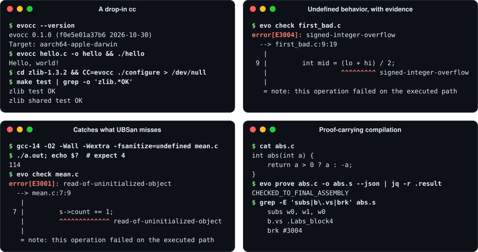
</p>

## Highlights

- **A drop-in `cc`.** Existing Makefiles build with `CC=evocc`. CMake projects use
  [`cmake/evocc.cmake`](cmake/evocc.cmake).
- **Real software.** EvoCC builds zlib, SQLite, Lua, jq, Mbed TLS, Doom, three games and a Linux
  kernel. Kbuild builds that kernel with `make CC=evocc`, and the kernel boots.
- **Undefined behavior, with evidence.** `evo check` runs your program on the rules of C. It stops
  at the first operation that breaks one and shows the line.
- **Catches what UBSan misses.** Uninitialized reads, dangling pointers and out-of-bounds accesses
  that GCC's warnings and UBSan do not report.
- **Every error explained.** Each diagnostic has a stable code, a tested explanation
  (`evo explain E3001`) and a JSON form.
- **Proof-carrying compilation.** For the supported `core-v1` subset, `evo prove` writes assembly
  only when Lean 4 checks every stage from typed Core source to final assembly text.
- **Made for agents.** JSON output, safe automatic repairs and an MCP server. On bugs that GCC and
  UBSan miss, a coding agent needs about a third fewer steps with EvoCC.

## Install

On macOS with Apple silicon, download the archive and the checksum file, check the archive and
unpack it:

```sh
curl -LO https://github.com/onehr/evocc/releases/download/v0.1.0/evocc-0.1.0-aarch64-apple-darwin.tar.gz
curl -LO https://github.com/onehr/evocc/releases/download/v0.1.0/SHA256SUMS
grep evocc-0.1.0-aarch64-apple-darwin.tar.gz SHA256SUMS | shasum -a 256 -c -
tar xzf evocc-0.1.0-aarch64-apple-darwin.tar.gz
export PATH="$PWD/evocc-0.1.0-aarch64-apple-darwin/bin:$PATH"
```

On Linux (AArch64), use `aarch64-unknown-linux-gnu` in the file name and `sha256sum -c -` to check
the archive. The `bin/` directory of each archive holds four programs: `evo` (the commands),
`evocc` (the compiler), `evocc-checker` (the certificate checker) and `evoir-sem` (the Lean
checker).

To build from source, run `cargo build --release --offline --locked -p evocc -p evocc-proofcheck`
and `(cd lean && lake build)`. For a cross compile from macOS, `tools/export-sysroot.sh` exports the
Linux headers. [Installation](book/src/install.md) gives the details. It also shows how to clear
the quarantine attribute of a browser download on macOS.

## Quick start

The example programs are in [`examples/`](examples/).

### Compile, as with `cc`

```console
$ evocc hello.c -o hello && ./hello
Hello, world!
$ make CC=evocc
```

### Find a famous bug

[`first_bad.c`](examples/first_bad.c) has the binary-search bug that broke Java's
`Arrays.binarySearch` in 2006:

```c
int mid = (lo + hi) / 2;
```

GCC 14 and Apple Clang compile it with `-O2 -Wall -Wextra` and give no warning. The GCC program
does not finish. The Clang program stops with a trap. `evo check` shows the cause:

```console
$ evo check first_bad.c
error[E3004]: signed-integer-overflow
  --> first_bad.c:9:19
   |
 9 |         int mid = (lo + hi) / 2;
   |                   ^^^^^^^^^ signed-integer-overflow
   |
   = note: this operation failed on the executed path
```

Change the line to `int mid = lo + (hi - lo) / 2;`, and the check passes.

### See what UBSan misses

In [`mean.c`](examples/mean.c), the declaration `struct stats s;` gives `count` and `total` no
value. GCC with `-Wall -Wextra -fsanitize=undefined` gives no warning and no report. The program
returns 0 at `-O0`. At `-O2`, it returns a wrong value that changes from run to run. The right
answer is 4.

```console
$ evo check mean.c
error[E3001]: read-of-uninitialized-object
  --> mean.c:7:9
   |
 7 |         s->count += 1;
   |         ^^^^^^^^^^^^^ read-of-uninitialized-object
   |
   = note: this operation failed on the executed path
$ evo explain E3001 | head -n 3
# E3001: read-of-uninitialized-object

The executed path reads object bytes that have not been initialized.
```

### Prove a compilation

```console
$ evo prove abs.c -o abs.s
checked from typed Core source to final assembly text: …/checked/record.json
```

This program is in the `core-v1` proof profile for `aarch64-unknown-linux-gnu`. Lean 4 checks each
stage from typed Core source to assembly text; this does not prove parsing or every C program
that EvoCC accepts. If a check
fails, `evo prove` writes no output. `abs(INT_MIN)` has no valid result in C, so the checked
assembly traps instead of returning a wrong value:

```asm
    subs w0, w2, w0
    b.vs .Labs_block4
    ...
.Labs_block4:
    brk #3004
```

`subs` computes `0 - a` and sets the overflow flag. On overflow, `b.vs` jumps to the trap.

### Give it to your agent

```console
$ claude mcp add evo -- evo mcp
```

The `evo` commands also write JSON with `--json`. In a
[registered experiment](book/src/evaluation-agents.md#experiment-5-repair-effort-and-program-size),
a coding agent fixed bugs that GCC's warnings and UBSan miss with about a third fewer steps and
tokens when it used EvoCC. [Agents](book/src/agents.md) shows the setup for Claude Code and Codex.

## What it compiles correctly

EvoCC compiled each program below. Each caption names the check, and each results link opens its
record.

<table>
  <tr>
    <td width="33%" align="center" valign="top"><a href="docs/images/showcase/doom.png">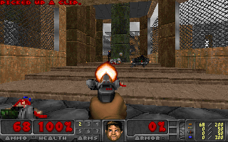</a><br><b>Doom / Freedoom</b><br>Headless replay<br><a href="tests/contracts/ladder-doom-receipt.json">results</a></td>
    <td width="33%" align="center" valign="top"><a href="docs/images/showcase/tinycc.svg">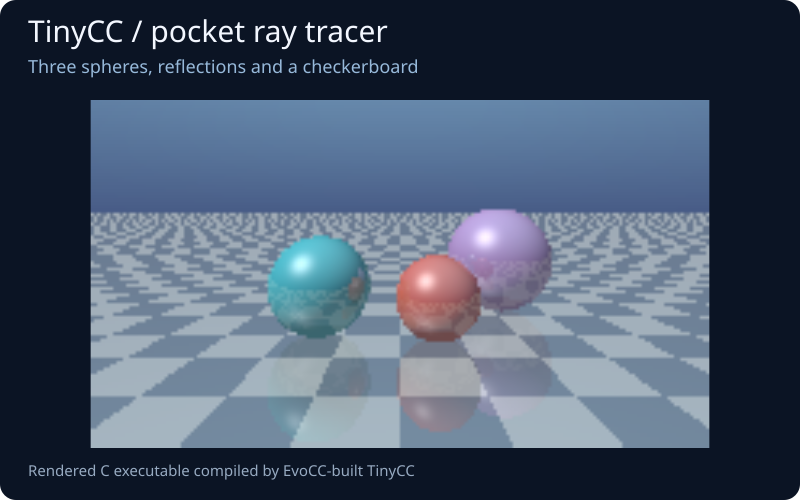</a><br><b>TinyCC paints reflections</b><br>Compiles a ray tracer<br><a href="tests/contracts/ladder-tinycc-receipt.json">results</a></td>
    <td width="33%" align="center" valign="top"><a href="docs/images/showcase/lua.svg">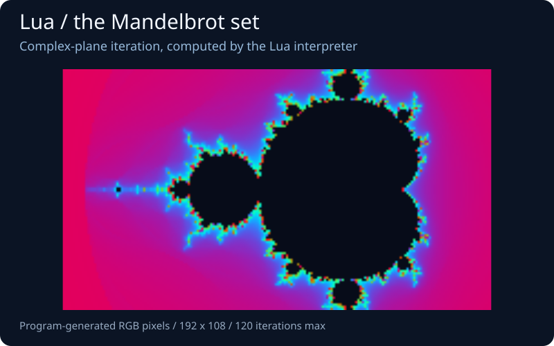</a><br><b>Lua explores a fractal</b><br>Floating-point pixels<br><a href="tests/contracts/ladder-lua-receipt.json">results</a></td>
  </tr>
  <tr>
    <td width="33%" align="center" valign="top"><a href="docs/images/showcase/sqlite.svg">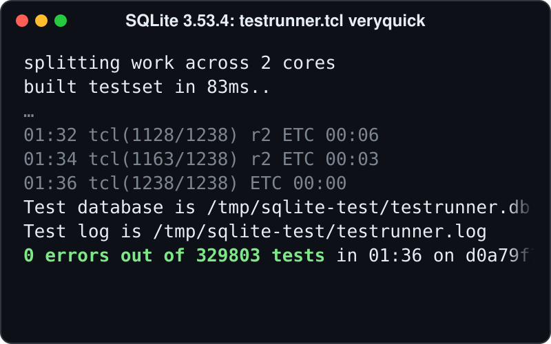</a><br><b>SQLite</b><br>0 errors in 329,803 tests<br><a href="tests/contracts/ladder-sqlite-receipt.json">results</a></td>
    <td width="33%" align="center" valign="top"><a href="docs/images/showcase/jq.svg">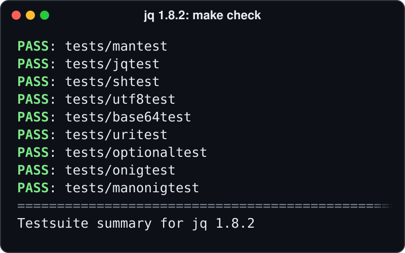</a><br><b>jq</b><br>make check passes<br><a href="tests/contracts/ladder-jq-receipt.json">results</a></td>
    <td width="33%" align="center" valign="top"><a href="docs/images/showcase/cjson.svg">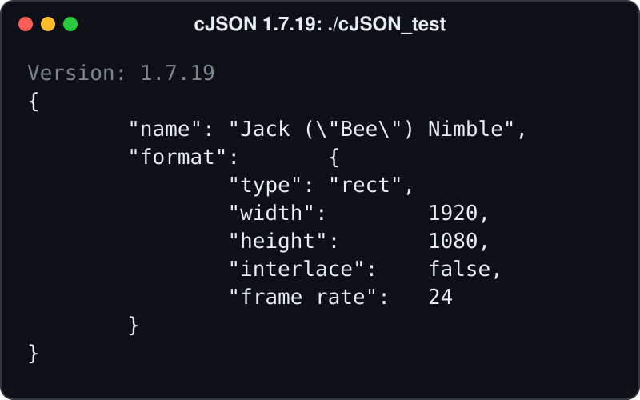</a><br><b>cJSON</b><br>216 unit tests, 0 failures<br><a href="tests/contracts/ladder-cjson-receipt.json">results</a></td>
  </tr>
  <tr>
    <td width="33%" align="center" valign="top"><a href="docs/images/showcase/linux.svg">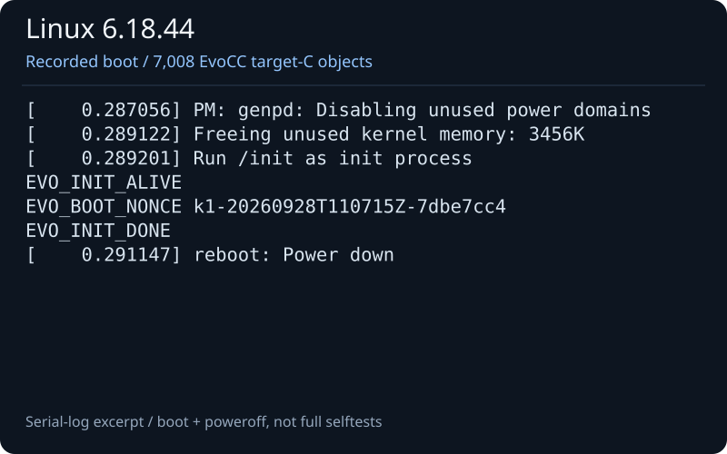</a><br><b>Linux 6.18</b><br>make CC=evocc; boots on 4 CPUs<br><a href="tests/contracts/kernel-direct-virt-receipt.json">results</a></td>
    <td width="33%" align="center" valign="top"><a href="docs/images/showcase/toybox.svg">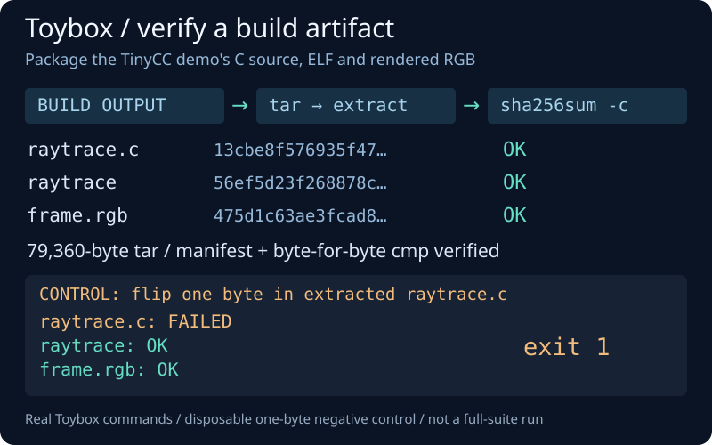</a><br><b>Toybox</b><br>1,669 tests, same results as GCC<br><a href="tests/contracts/ladder-toybox-receipt.json">results</a></td>
    <td width="33%" align="center" valign="top"><a href="docs/images/showcase/mbedtls.svg">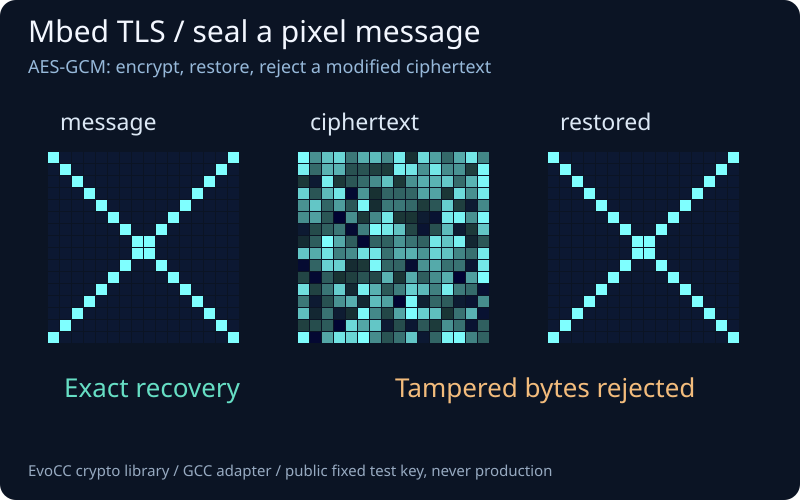</a><br><b>Mbed TLS seals pixels</b><br>Encrypt, restore, reject<br><a href="tests/contracts/ladder-mbedtls-receipt.json">results</a></td>
  </tr>
  <tr>
    <td width="33%" align="center" valign="top"><a href="docs/images/showcase/zstd.svg">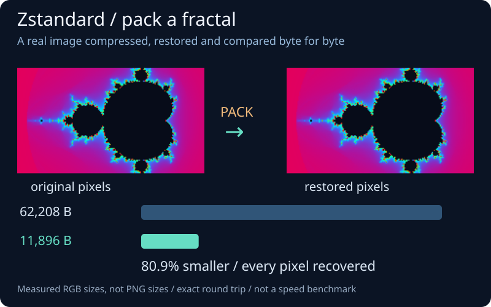</a><br><b>Zstandard packs a fractal</b><br>Identical pixels<br><a href="tests/contracts/ladder-zstd-receipt.json">results</a></td>
    <td width="33%" align="center" valign="top"><a href="docs/images/showcase/zlib.svg">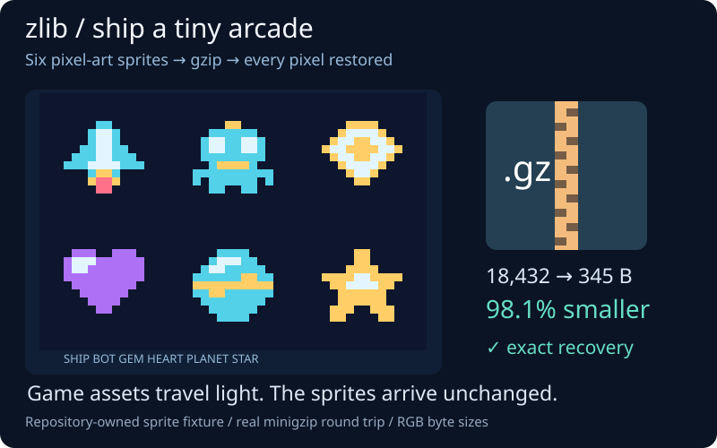</a><br><b>zlib ships a tiny arcade</b><br>Sprites restored intact<br><a href="tests/contracts/ladder-zlib-receipt.json">results</a></td>
    <td width="33%" align="center" valign="top"><a href="docs/images/showcase/polybench.svg">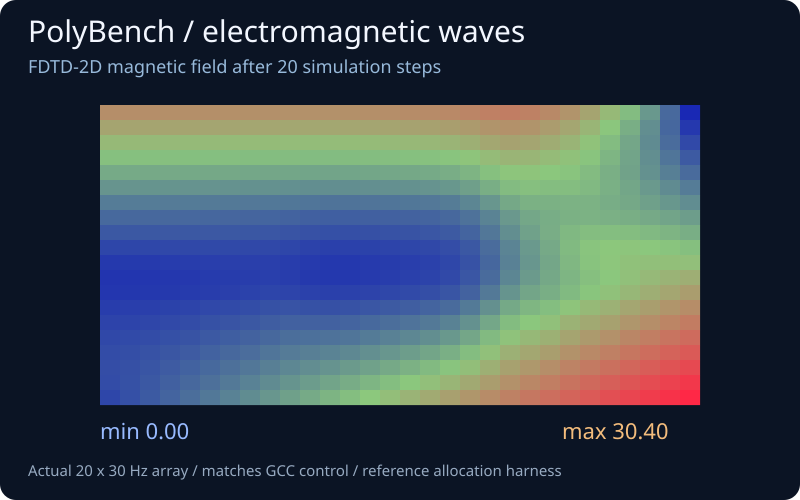</a><br><b>PolyBench models a field</b><br>FDTD-2D simulation<br><a href="tests/contracts/ladder-polybench-receipt.json">results</a></td>
  </tr>
  <tr>
    <td width="33%" align="center" valign="top"><a href="docs/images/showcase/opentyrian.png">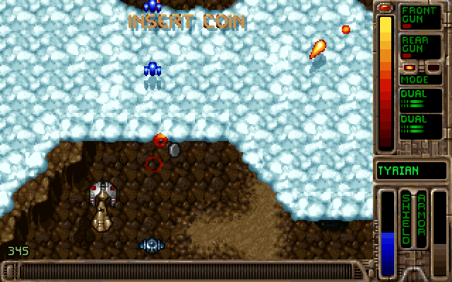</a><br><b>OpenTyrian</b><br>Three frames match GCC<br><a href="docs/images/showcase/README.md#three-native-c-games">results</a></td>
    <td width="33%" align="center" valign="top"><a href="docs/images/showcase/neverball.png">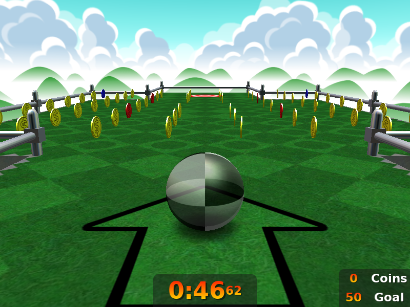</a><br><b>Neverball</b><br>One disclosed source fix<br><a href="docs/images/showcase/README.md#three-native-c-games">results</a></td>
    <td width="33%" align="center" valign="top"><a href="docs/images/showcase/quakespasm.png">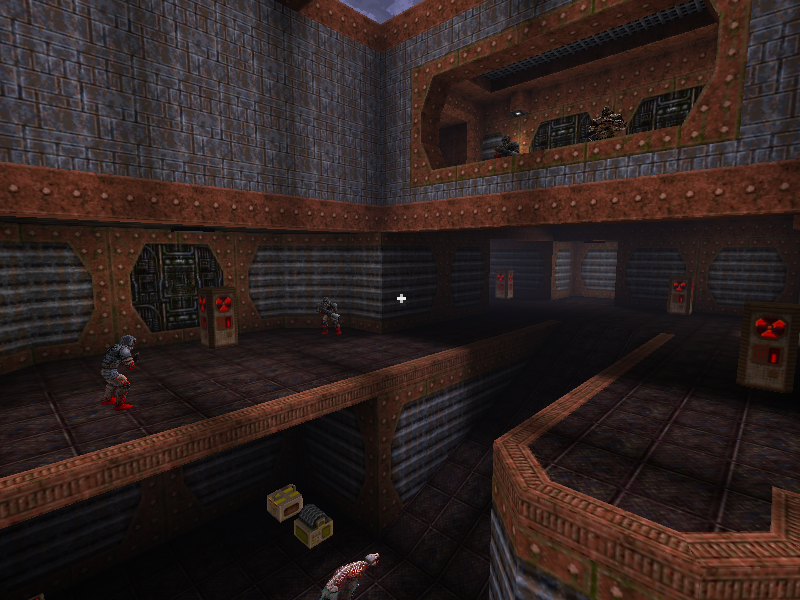</a><br><b>Quakespasm / LibreQuake</b><br>3D demo replay<br><a href="docs/images/showcase/README.md#three-native-c-games">results</a></td>
  </tr>
</table>

Each image is real program output, a plot of it, or an excerpt of a recorded test log. See the
[capture notes and credits](docs/images/showcase/README.md) and the
[compatibility table](book/src/compatibility.md).

## How it works

<p align="center">
  <picture>
    <source media="(prefers-color-scheme: dark)" srcset="docs/images/readme/pipeline-dark.svg">
    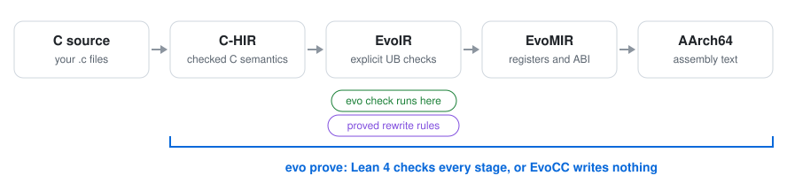
  </picture>
</p>

- **C-HIR** keeps the meaning of C: types, evaluation order, which bytes are initialized and what
  each pointer may point to. `evo check` runs at this level.
- **EvoIR** turns the undefined-behavior rules of C into explicit checks. An optimization can
  remove work, but never a check.
- **EvoMIR** treats the machine as data. Registers, calling conventions and instruction encodings
  are tables in [`targets/aarch64/`](targets/aarch64/).
- **Lean 4** proves the 62 rewrite rules of the optimizer. For `core-v1` on AArch64 Linux, five
  Lean checkers compare the input and output of each stage, and one theorem covers that chain.

AI agents wrote EvoCC in about two months, under the direction of one engineer.
[The paper](docs/paper.md) tells that story and describes the design and the evaluation.

## Build your first optimization

Start with `x + 0 → x`. In EqSat mode, you specify an equality instead of writing a new pass
over the whole program. Lean proves the rule. A separate checker checks each use of it.

This tutorial follows a rule that EvoCC **already ships**. You can run it without changing the
compiler. It also shows the source changes needed to add a different rule. There is no rule
plugin or automatic Rust matcher generator yet: a new rule needs both a producer implementation
and an independent checker implementation.

### 1. Choose an equality with a clear scope

The rule in [the registry](spec/evoir.md#116-what-is-shared-and-what-is-not) is:

```text
p0_001_add_zero_rhs add(?x,const_like(?x,0)) => ?x when true
```

`?x` matches a value. `const_like(?x,0)` matches zero with the same bit width. `when true` means
this rule needs no extra fact. It does not bypass the type or eligibility checks. The integer
EqSat profile admits widths from 1 to 64 bits; floating-point values, memory operations and
poison-tainted regions are outside this rule's scope.

Here is the function from [`examples/add_zero.c`](examples/add_zero.c):

```c
unsigned int add_zero(unsigned int x)
{
    return x + 0u;
}
```

Use unsigned arithmetic for this first example. Its result wraps modulo `2^32` on both supported
targets. The rule holds for every input, including `4294967295u`. The example's `main` checks 0,
42 and that maximum value. These checks show that the program runs; they do not prove the rule.

### 2. Prove the registered rule

[`examples/AddZero.lean`](examples/AddZero.lean) contains this proof:

```lean
import EvoIR.Proofs.Rules

open EvoIR

theorem add_zero_example : RuleCovered rule_p0_001_add_zero_rhs := by
  intro Γ out σ F R lhs hl hF hR hc
  by_cases hw : Γ "x" = out
  · subst hw
    simp_all [rule_p0_001_add_zero_rhs, denotePat, denoteRhs, elabPat,
      denoteOp, CondHolds]
  · simp [rule_p0_001_add_zero_rhs, denotePat, elabPat, hw] at hl

#print axioms add_zero_example
```

[`RuleCovered`](lean/EvoIR/Rule.lean) states that the two patterns have the same value for every
well-typed substitution that meets the rule's conditions. The proof handles two cases. If `x`
has the result width, bit-vector addition by zero is the identity. If it does not, the left
pattern cannot be well typed. This is a proof for all widths, not a loop over test values.

After the [source build](CONTRIBUTING.md#build), run from the repository root:

```sh
(cd lean && lake env lean ../examples/AddZero.lean)
```

Expected output:

```text
'add_zero_example' depends on axioms: [propext, Quot.sound]
```

There is no `sorry`, new axiom or `native_decide` in this proof.

### 3. Connect the rule to the compiler and checker

These are the existing integration points for this rule. Use them as a model for your own rule;
do not add the same rule a second time.

| Part | Where to look | What it does |
|---|---|---|
| Contract | [EvoIR registry](spec/evoir.md#116-what-is-shared-and-what-is-not) | Gives the rule a stable ID, patterns and conditions. The registry has a version and digest. |
| Producer | [`rewrite_opportunity`](crates/evocc-eqopt/src/scalar_eq.rs) | Recognizes addition by zero and proposes an alias of the other operand. |
| Certificate | [`exact_rule`](crates/evocc-eqopt/src/evp1.rs) | Records `p0_001_add_zero_rhs` and the binding of `?x`. |
| Independent replay | [`replay.rs`](crates/evocc-proofcheck/src/replay.rs) | Checks the operation, operand order, same-width zero and replacement without trusting the producer. |
| Theorem | [`sound_p0_001_add_zero_rhs`](lean/EvoIR/Proofs/Rules.lean) | Proves `RuleCovered` for the registered rule. The example above expands its proof template. |

For example, the producer's right-zero case proposes:

```rust
if is_constant(right, facts, 0) {
    alias(ScalarRewrite::AddZero, left)
}
```

The checker separately uses `identity_binary` with `operation: "add"`, `constant_left: false`
and `constant: 0`. It also checks the binding, types and replacement. The producer does not get
to declare its own proposal correct.

For a **new** rule, first add a failing test. Add the rule to a new reviewed registry revision;
keep previous IDs and meanings unchanged. Update the producer, certificate mapping, independent
checker and registry digests. Generate `lean/EvoIR/Registry.lean` with
[`registry_to_lean.py`](tools/lean/registry_to_lean.py); do not edit that generated file. Add the
`RuleCovered` theorem and tests that reject a wrong constant, width, binding or replacement.
Keep `ScalarRewrite`, its admission checks and the rule-ID lists in sync. If the rule must also
work in the proof-required Core path, its separate Lean certificate checker must support it.
Update the specification pins as described in [Contributing](CONTRIBUTING.md#specifications).
Before accepting the rule, run both `tools/gate-changed.sh --full-workspace --offline` and
`tools/gate-lean.sh`. A proof file alone does not install an optimization.

### 4. See the change in a real program

On an AArch64 macOS or Linux host, compile the same C file with `-O0`, then with
`-O0 -Oeq-scalar`. Both builds keep native UB checks enabled. `-O0` holds the other optional
optimizations off so this comparison isolates EqSat. Set `target` to
`aarch64-unknown-linux-gnu` on Linux. Run from the repository root after the source build:

```sh
export PATH="$PWD/target/frontend/release:$PATH"
target=aarch64-apple-darwin
out=$(mktemp -d)
checker="$PWD/target/frontend/release/evocc-checker"
checker_sha=$(shasum -a 256 "$checker" | awk '{print $1}')
evo check examples/add_zero.c
evocc --target="$target" -O0 --emit=evoir examples/add_zero.c > "$out/before.evo"
evocc --target="$target" -O0 -Oeq-scalar --eq-checker="$checker" \
  --eq-checker-sha256="$checker_sha" --eq-proof-dir="$out/proof" \
  --emit=evoir examples/add_zero.c > "$out/after.evo"
```

The digest selects the checker from your trusted local build. Hashing an untrusted download
does not make it trusted. The proof directory must be new for each compilation.

Inside `add_zero`, the result changes from:

```text
%v3 = const.bits<32> 0
%v4 = add.bits<32> %v0, %v3
ret %v4, %v1, %v2
```

to:

```text
%v3 = const.bits<32> 0
ret %v0, %v1, %v2
```

The unused constant remains in EvoIR. The shared backend removes it. The memory and world
tokens are unchanged. `proof/000.proof.evp` names `p0_001_add_zero_rhs`;
`proof/chain.json` records `CHANGED`, then `UNCHANGED`, with publication `VERIFIED`.

The driver already checked each transaction. You can replay its certificates separately:

```sh
for before in "$out"/proof/*.before.evo; do
    prefix=${before%.before.evo}
    "$checker" "$before" "$prefix.after.evo" "$prefix.proof.evp" || exit 1
done
```

Both checker calls exit 0 without output. Now emit assembly and run both programs. `cc` only
assembles and links these files; EvoCC compiled the C source:

```sh
evocc --target="$target" -O0 --emit=asm examples/add_zero.c > "$out/before.s"
evocc --target="$target" -O0 -Oeq-scalar --eq-checker="$checker" \
  --eq-checker-sha256="$checker_sha" --emit=asm examples/add_zero.c > "$out/after.s"
diff -u "$out/before.s" "$out/after.s" || test "$?" -eq 1
cc "$out/before.s" -o "$out/before"
cc "$out/after.s" -o "$out/after"
"$out/before"; echo "before: $?"
"$out/after"; echo "after: $?"
```

On the tested AArch64 macOS build, the complete assembly diff removes just this instruction
from `add_zero`:

```diff
-    add w0, w0, #0
```

`add_zero` goes from five instructions to four. Both executables report:

```text
before: 0
after: 0
```

This is four bytes of instructions removed from one function, not a claim about executable file
size or speed. Alignment and linking can change the final size. `-Oeq-scalar` checks the EvoIR
rewrite chain; it does **not** by itself prove C lowering or machine-code emission. The separate
[proof-required path](spec/verification.md) checks those stages within its supported Core profile.
The example adds no new rule and makes no claim about AI rule discovery. When you finish,
remove the temporary directory printed by `echo "$out"`; no generated files belong in Git.

## Status

EvoCC 0.1.0 is experimental.

- It targets AArch64 only, on Linux and macOS.
- Its code is 2 to 2.7 times the size of GCC `-O2` output, and it is not tuned for speed.
- `evo check` runs programs that do not call the C library.
- Proofs cover `core-v1`: integer functions without pointers, arrays or recursion. See the
  [exact profile and trust boundary](spec/verification.md), including the typed Core input and
  final assembly text boundary. Assembly, linking and arbitrary accepted C programs are not proved.
- GNU C support is broad but not complete.

## Learn more

- [The EvoCC Book](book/src/SUMMARY.md): installation, a first program, undefined behavior, proofs
  and agents.
- [The paper](docs/paper.md): how agents built EvoCC, its design and its evaluation.
- [Specifications](spec/README.md): EvoIR, EvoMIR, the target tables and the verification contract.

## Contributing

Read [CONTRIBUTING.md](CONTRIBUTING.md). To report wrong code, follow [SECURITY.md](SECURITY.md).

## License

Apache License 2.0. Copyright 2026 Haoran Wang, NexRidge. See [LICENSE](LICENSE), [NOTICE](NOTICE)
and [THIRD-PARTY-NOTICES.md](THIRD-PARTY-NOTICES.md).
