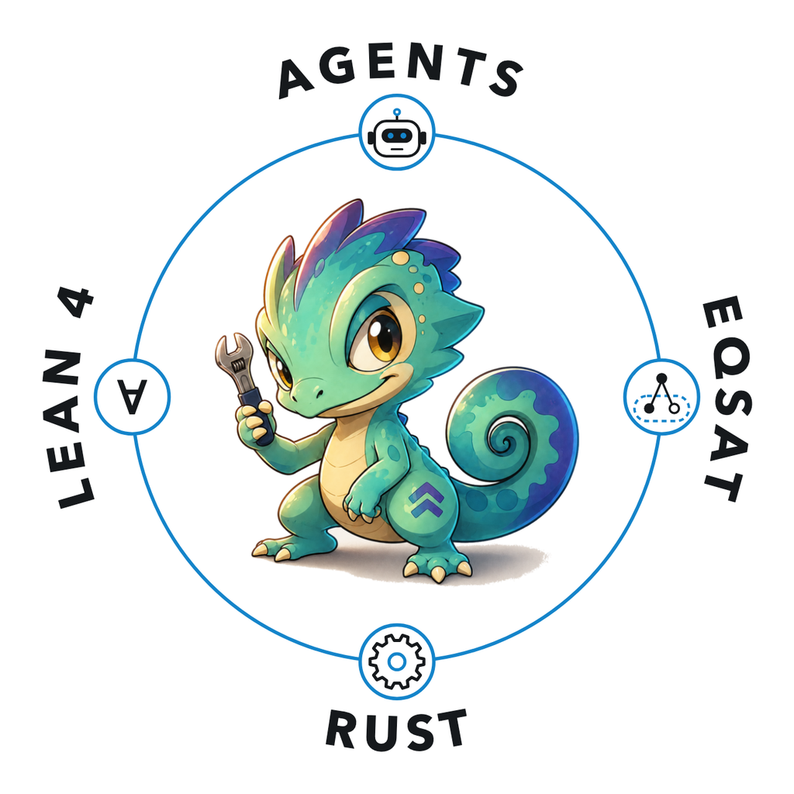
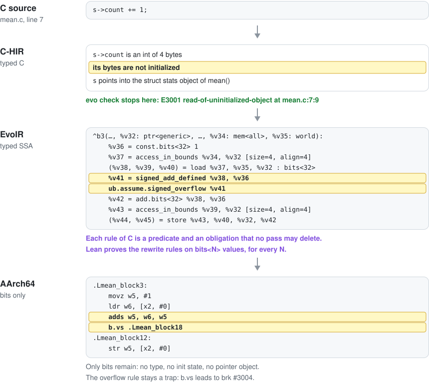

<p align="center">
  
</p>

<h1 align="center">EvoCC</h1>

<p align="center">
  <b>An experimental C compiler, written by AI agents.</b><br>
  Agents propose. Checkers decide.
</p>

<p align="center">
  
  
  
  <a href="https://github.com/onehr/evocc/releases"></a>
  <a href="LICENSE"></a>
</p>

EvoCC is an experimental C compiler for AArch64 Linux and macOS. AI agents wrote it from scratch
in Rust and Lean 4, in under three months, under the direction of one engineer. By release 0.1.0
that came to about 2,300 commits, 350,000 lines of Rust and 69,000 lines of Lean. EvoCC has its
own preprocessor, parser, three intermediate representations, optimizer, register allocator and
assembly emitter. It builds a Linux kernel that boots, SQLite, Doom and many other de-facto
standard C bench/programs.

One rule runs through the whole compiler: an untrusted part proposes, and a small checker
decides. Agents propose code; a test written first, two interpreters and sealed GCC and Clang
oracles decide whether it lands. The EqSat optimizer proposes rewrites; an independent checker
replays each one against rules that Lean 4 proves. For a subset of C, each stage proposes its
output, and Lean checkers decide. When a check fails, nothing is accepted.

The same checks serve your programs. EvoCC's typed IRs keep each rule of C as an explicit check,
so `evo check` names the exact operation that breaks one, also when GCC's warnings and UBSan miss
it. Use `evocc` in place of `cc`, and give `evo mcp` to your coding agent.

<p align="center">
  <picture>
    <source media="(prefers-color-scheme: dark)" srcset="docs/images/readme/highlights-dark.svg">
    
  </picture>
</p>

## Why EvoCC

<p align="center">
  <picture>
    <source media="(prefers-color-scheme: dark)" srcset="docs/images/readme/propose-check-dark.svg">
    
  </picture>
</p>

- **Written from scratch by AI agents.** [The paper](docs/paper.md#8-how-agents-built-evocc)
  tells how one engineer directed them, what they got wrong, and which checks caught it.
- **Typed IRs that keep the rules of C.** C-HIR keeps C's types, which bytes are initialized and
  which object each pointer may point to. EvoIR is typed SSA: each rule of C is a predicate and
  an obligation that no pass may delete, and memory and I/O travel on explicit tokens. See
  [one line through the typed IRs](#one-line-through-the-typed-irs).
- **`evo check` finds undefined behavior.** It runs your program on the rules of C and stops at
  the first operation that breaks one, with the line. It finds bugs that GCC's warnings and UBSan
  miss, such as uninitialized reads. ([Undefined behavior](book/src/undefined-behavior.md))
- **Rust for the compiler, Lean 4 for the proofs.** The EqSat optimizer (`-Oeq-scalar`) uses only
  rewrite rules that Lean 4 proves for every bit width. For the `core-v1` subset, `evo prove` has
  Lean 4 check every stage, from typed Core source to the final assembly text.
  ([Checked optimization](book/src/optimization.md), [compiling with proof](book/src/proof.md))
- **Built for agents.** Where GCC's warnings and UBSan are silent, `evo check` gives an agent a
  stable code and the line in a JSON record, and `evo mcp` serves it. In registered experiments, a
  coding agent needed about a third fewer steps with EvoCC, and three chat models needed fewer
  tokens ([Built for agents](#built-for-agents)). Agents can also change it: in EqSat mode a new
  optimization is an equality with a Lean proof, not a new pass, the target is a set of tables,
  the specifications are pinned, and each result has a receipt.
- **Experimental, at real scale.** A Linux kernel built with `make CC=evocc` boots, and 15
  application lanes and Doom run with no compiler failure. The [scope of 0.1.0](#scope-of-010)
  lists what is not done yet.

### One line through the typed IRs

In C-HIR and EvoIR, the program stays typed, and the types carry the rules of C. So `evo check`
can name the exact rule that a line breaks, and the optimizer and the Lean proofs work on the same
rules. Here is one line of [`mean.c`](examples/mean.c) at four stages of the release compiler:

<p align="center">
  <picture>
    <source media="(prefers-color-scheme: dark)" srcset="docs/images/readme/stages-dark.svg">
    count += 1;, at four stages of the release compiler. C-HIR, typed C: s->count is an int of 4 bytes, its bytes are not initialized, and s points into the struct stats object of mean(); evo check stops here with E3001 read-of-uninitialized-object at mean.c:7:9. EvoIR, typed SSA: the block passes the values ptr<generic>, mem<all> and world, and the line becomes access_in_bounds, a load of bits<32>, signed_add_defined with ub.assume.signed_overflow, add.bits<32> and a store; each rule of C is a predicate and an obligation that no pass may delete, and Lean proves the rewrite rules on bits<N> values for every N. AArch64, bits only: movz, ldr, adds, b.vs and str, with no type, no init state and no pointer object; the overflow rule stays a trap, because b.vs leads to brk #3004." width="860">
  </picture>
</p>

## Proven on real code

<p align="center">
  <picture>
    <source media="(prefers-color-scheme: dark)" srcset="docs/images/readme/scoreboard-dark.svg">
    
  </picture>
</p>

The release compiler of commit `08bf09bd` measured these results on 2026-10-27. Records:
[Linux kernel](tests/contracts/kernel-direct-virt-receipt.json),
[SQLite test log](docs/images/showcase/captures.json),
[application lanes, Doom and c-testsuite](tests/contracts/bench-receipt.json),
[Csmith](tests/contracts/ladder-csmith-receipt.json) and
[Lean 4 rules](tests/contracts/lean-p0-receipt.json). The [status page](docs/status.md) and the
[evidence](docs/evidence.md) give each count with its limits.

## Built for agents

An agent repairs C in a loop: it builds, runs, reads the output and edits. It can act only on what
the tools report, and each turn costs tokens and time. When the tools report nothing, the agent
must find the bug in the source alone. In 18 programs of our experiments, GCC 14's warnings and
UBSan reported nothing for an uninitialized read, a dangling pointer or an out-of-bounds access.
The build was clean, and the run gave the same output as the fixed program.

EvoCC is made for that loop. `evo check` runs the program on the rules of C and stops at the first
operation that breaks one. It checks the path that ran, not all inputs. It gives the agent a stable
code and the line in a JSON record. `evo explain` gives the rule, and `evo fix --plan` gives the
repairs.

### What the agent sees

In this program from the experiments, `prepare()` keeps a pointer to its local array, and
`byte_at()` reads through it after `prepare()` returns. This is the record that the agent got from
GCC 14 with `-O0 -Wall -Wextra -fsanitize=undefined`. The fixed program gives the same record, byte
for byte:

```text
=== build exit 0
=== run exit 16
--- stdout
--- stderr
```

EvoCC's record adds the `evo check` result as JSON. Its `rendered` field names the rule and the
line (path shortened):

```text
error[E3010]: dangling-pointer-access
  --> input.c:43:12
   |
43 |     return view->data[index];
   |            ^^^^^^^^^^^^^^^^^ dangling-pointer-access
   |
   = note: this operation failed on the executed path
```

On the six dangling-pointer programs, Qwen3.8 27B repaired 3 of 18 trials with the GCC record and
18 of 18 with the EvoCC record.

### What an agent gets

- **Stable codes with explanations.** Each finding has a code, such as `E3010`, and a line.
  `evo explain E3010` gives the rule, with examples that a test runs against the compiler.
- **JSON records and fixed exit rules.** `evo run`, `check`, `explain`, `fix`, `prove` and `build`
  each have one exit-status rule. With `--json`, each writes one JSON object per line.
- **Repairs as data, with a human gate.** `evo fix --plan` lists repairs and edits nothing.
  `evo fix --apply` applies only safe repairs; a review repair needs a human.
- **The same bytes for the same input.** A test runs `run`, `check`, `explain`, `fix --plan` and
  `prove` twice on fixed inputs. It requires the same JSON records, apart from temporary paths.
- **Ready to connect.** `evo mcp` gives `run`, `check`, `explain`, `prove` and `fix_plan` to an
  agent ([setup](#give-it-to-your-agent)). [`AGENTS.md`](AGENTS.md), also as
  [`llms.txt`](llms.txt), and the [EvoCC skill](skills/evocc/SKILL.md) give the commands, the exit
  codes and the review rule.

### What we measured

We gave agents the same bugs with GCC and UBSan or with EvoCC. We registered the predictions before
each measured run.

<p align="center">
  <picture>
    <source media="(prefers-color-scheme: dark)" srcset="docs/images/readme/agent-results-dark.svg">
    
  </picture>
</p>

- **Kimi K3, 144 sessions:** p < 0.001 for each step saving and for 40% fewer tokens on short programs.
- **Three chat models, 432 trials of one answer:** p < 0.01 for each token saving.
- **Repairs:** more with EvoCC for Qwen3.8 27B, p = 0.004. The others repaired nearly all with both.
- **Control bugs,** which GCC and UBSan report: about the same repairs with both.

The gain appears where the usual tools are silent. Not every experiment gave a clear answer. We
report all six that had a measured run; protocols 6 and 7 have pilots only:

| # | Model and programs | Result |
|---|---|---|
| 1 | DeepSeek V4.1 Flash, as a chat model; 30 short programs | no difference: 91 to 98% repaired on the first try with each toolchain, a ceiling |
| 2 | DeepSeek V4.1 Flash and Qwen3.5 9B; 30 longer programs | inconclusive: most answers ran out of output tokens or time, and the spending limit stopped the run |
| 3 | Kimi K3, as a coding agent; pilots | without a sandbox, the agent downloaded the original sources; with one, a ceiling again |
| 4 | Kimi K3, sandboxed; 18 silent bugs, 6 controls | the same repairs, 23 of 24 with each toolchain; fewer steps with EvoCC, found after the run |
| 5 | Kimi K3, registered replication; 18 short and 12 longer programs | fewer steps and fewer tokens with EvoCC, p < 0.001 |
| 8 | DeepSeek V4.1 Flash, MiniMax M3.1 Flash and Qwen3.8 27B, as chat models; the bugs of 4 | fewer tokens with EvoCC for all three, p < 0.01; more repairs with Qwen3.8 27B, 54 against 30 of 54 |

[Agent experiments](book/src/evaluation-agents.md) gives each protocol, receipt and transcript, and
the commands that reproduce each analysis without a model call.

### Agents can change it, too

Agents wrote EvoCC, and its design keeps their changes checkable. In EqSat mode, a new optimization
is an equality with a Lean proof, not a new pass. The target is a set of tables, the specifications
are pinned, and each result has a receipt. [Add a proved optimization](#add-a-proved-optimization)
shows the steps.

## Quick start

### Install

On macOS with Apple silicon, download the archive and the checksum file, check the archive and
unpack it:

```sh
curl -LO https://github.com/onehr/evocc/releases/download/v0.1.0/evocc-0.1.0-aarch64-apple-darwin.tar.gz
curl -LO https://github.com/onehr/evocc/releases/download/v0.1.0/SHA256SUMS
grep evocc-0.1.0-aarch64-apple-darwin.tar.gz SHA256SUMS | shasum -a 256 -c -
tar xzf evocc-0.1.0-aarch64-apple-darwin.tar.gz
export PATH="$PWD/evocc-0.1.0-aarch64-apple-darwin/bin:$PATH"
```

On Linux (AArch64), use `aarch64-unknown-linux-gnu` in the file name and `sha256sum -c -`. The
`bin/` directory of each archive holds `evo` (the commands), `evocc` (the compiler),
`evocc-checker` (the certificate checker) and `evoir-sem` (the Lean checker).
[Installation](book/src/install.md) shows the source build and the macOS quarantine attribute.

The example programs below are in [`examples/`](examples/).

### Compile, as with `cc`

```console
$ evocc hello.c -o hello && ./hello
Hello, world!
$ make CC=evocc
```

### Find a famous bug

[`first_bad.c`](examples/first_bad.c) has the binary-search bug that broke Java's
`Arrays.binarySearch` in 2006:

```c
int mid = (lo + hi) / 2;
```

GCC 14 and Apple Clang compile it with `-O2 -Wall -Wextra` and give no warning. The GCC program
does not finish. The Clang program stops with a trap. `evo check` shows the cause:

```console
$ evo check first_bad.c
error[E3004]: signed-integer-overflow
  --> first_bad.c:9:19
   |
 9 |         int mid = (lo + hi) / 2;
   |                   ^^^^^^^^^ signed-integer-overflow
   |
   = note: this operation failed on the executed path
```

Change the line to `int mid = lo + (hi - lo) / 2;`, and the check passes.

### See what UBSan misses

In [`mean.c`](examples/mean.c), the declaration `struct stats s;` gives `count` and `total` no
value. GCC with `-Wall -Wextra -fsanitize=undefined` gives no warning and no report. The program
returns 0 at `-O0`. At `-O2`, it returns a wrong value that changes from run to run. The right
answer is 4.

```console
$ evo check mean.c
error[E3001]: read-of-uninitialized-object
  --> mean.c:7:9
   |
 7 |         s->count += 1;
   |         ^^^^^^^^^^^^^ read-of-uninitialized-object
   |
   = note: this operation failed on the executed path
$ evo explain E3001 | head -n 3
# E3001: read-of-uninitialized-object

The executed path reads object bytes that have not been initialized.
```

### Prove a compilation

```console
$ evo prove abs.c -o abs.s
checked from typed Core source to final assembly text: …/checked/record.json
```

Lean 4 checks each stage of this compilation, from typed Core source to assembly text. If a check
fails, `evo prove` writes no output. `abs(INT_MIN)` has no valid result in C, so the checked
assembly traps instead of returning a wrong value:

```asm
    subs w0, w1, w0
    b.vs .Labs_block4
    ...
.Labs_block4:
    brk #3004
```

`subs` computes `0 - a` and sets the overflow flag. On overflow, `b.vs` jumps to the trap.

### Give it to your agent

```console
$ claude mcp add evo -- evo mcp
```

The `evo` commands also write JSON with `--json`. [Agents](book/src/agents.md) shows the setup for
Claude Code and Codex.

## What it compiles correctly

EvoCC compiled each program below. Each caption names the check, and each results link opens its
record.

<table>
  <tr>
    <td width="33%" align="center" valign="top"><a href="docs/images/showcase/doom.png"></a><br><b>Doom / Freedoom</b><br>Headless replay<br><a href="tests/contracts/ladder-doom-receipt.json">results</a></td>
    <td width="33%" align="center" valign="top"><a href="docs/images/showcase/tinycc.svg"></a><br><b>TinyCC paints reflections</b><br>Compiles a ray tracer<br><a href="tests/contracts/ladder-tinycc-receipt.json">results</a></td>
    <td width="33%" align="center" valign="top"><a href="docs/images/showcase/lua.svg"></a><br><b>Lua explores a fractal</b><br>Floating-point pixels<br><a href="tests/contracts/ladder-lua-receipt.json">results</a></td>
  </tr>
  <tr>
    <td width="33%" align="center" valign="top"><a href="docs/images/showcase/sqlite.svg"></a><br><b>SQLite</b><br>0 errors in 329,803 tests<br><a href="tests/contracts/ladder-sqlite-receipt.json">results</a></td>
    <td width="33%" align="center" valign="top"><a href="docs/images/showcase/jq.svg"></a><br><b>jq</b><br>make check passes<br><a href="tests/contracts/ladder-jq-receipt.json">results</a></td>
    <td width="33%" align="center" valign="top"><a href="docs/images/showcase/cjson.svg"></a><br><b>cJSON</b><br>216 unit tests, 0 failures<br><a href="tests/contracts/ladder-cjson-receipt.json">results</a></td>
  </tr>
  <tr>
    <td width="33%" align="center" valign="top"><a href="docs/images/showcase/linux.svg"></a><br><b>Linux 6.18</b><br>make CC=evocc; boots on 4 CPUs<br><a href="tests/contracts/kernel-direct-virt-receipt.json">results</a></td>
    <td width="33%" align="center" valign="top"><a href="docs/images/showcase/toybox.svg"></a><br><b>Toybox</b><br>1,669 tests, same results as GCC<br><a href="tests/contracts/ladder-toybox-receipt.json">results</a></td>
    <td width="33%" align="center" valign="top"><a href="docs/images/showcase/mbedtls.svg"></a><br><b>Mbed TLS seals pixels</b><br>Encrypt, restore, reject<br><a href="tests/contracts/ladder-mbedtls-receipt.json">results</a></td>
  </tr>
  <tr>
    <td width="33%" align="center" valign="top"><a href="docs/images/showcase/zstd.svg"></a><br><b>Zstandard packs a fractal</b><br>Identical pixels<br><a href="tests/contracts/ladder-zstd-receipt.json">results</a></td>
    <td width="33%" align="center" valign="top"><a href="docs/images/showcase/zlib.svg"></a><br><b>zlib ships a tiny arcade</b><br>Sprites restored intact<br><a href="tests/contracts/ladder-zlib-receipt.json">results</a></td>
    <td width="33%" align="center" valign="top"><a href="docs/images/showcase/polybench.svg"></a><br><b>PolyBench models a field</b><br>FDTD-2D simulation<br><a href="tests/contracts/ladder-polybench-receipt.json">results</a></td>
  </tr>
  <tr>
    <td width="33%" align="center" valign="top"><a href="docs/images/showcase/opentyrian.png"></a><br><b>OpenTyrian</b><br>Three frames match GCC<br><a href="docs/images/showcase/README.md#three-native-c-games">results</a></td>
    <td width="33%" align="center" valign="top"><a href="docs/images/showcase/neverball.png"></a><br><b>Neverball</b><br>One disclosed source fix<br><a href="docs/images/showcase/README.md#three-native-c-games">results</a></td>
    <td width="33%" align="center" valign="top"><a href="docs/images/showcase/quakespasm.png"></a><br><b>Quakespasm / LibreQuake</b><br>3D demo replay<br><a href="docs/images/showcase/README.md#three-native-c-games">results</a></td>
  </tr>
</table>

Each image is real program output, a plot of it, or an excerpt of a recorded test log. See the
[capture notes and credits](docs/images/showcase/README.md) and the
[compatibility table](book/src/compatibility.md).

## How it works

<p align="center">
  <picture>
    <source media="(prefers-color-scheme: dark)" srcset="docs/images/readme/pipeline-dark.svg">
    
  </picture>
</p>

- **C-HIR** keeps the meaning of C: types, evaluation order, which bytes are initialized and what
  each pointer may point to. `evo check` runs at this level.
- **EvoIR** turns the undefined-behavior rules of C into explicit checks. An optimization can
  remove work, but never a check.
- **EvoMIR** treats the machine as data. Registers, calling conventions and instruction encodings
  are tables in [`targets/aarch64/`](targets/aarch64/).
- **Lean 4** proves the 62 rewrite rules of the optimizer. For `core-v1` on AArch64 Linux, five
  Lean checkers compare the input and output of each stage, and one theorem covers that chain.

Here is one rule of C on its way through the compiler. The release compiler made this EvoIR and
this assembly from [`abs.c`](examples/abs.c):

<p align="center">
  <picture>
    <source media="(prefers-color-scheme: dark)" srcset="docs/images/readme/explicit-check-dark.svg">
    
  </picture>
</p>

AI agents wrote EvoCC in under three months, under the direction of one engineer.
[The paper](docs/paper.md) tells that story and describes the design and the evaluation.

## Where EvoCC fits

Sanitizers instrument one optimized build. They report a bug when that build reaches it and
their instrumentation covers it. Verified compilers such as CompCert prove their compilation
passes correct once, for every program in the C subset that they accept. EvoCC sits between the
two. It compiles large real programs and keeps the rules of C explicit in every stage.
`evo check` checks the path that a program runs. Lean 4 proves the rewrite rules of its EqSat
optimizer and, for a smaller subset, checks whole compilations.

## Add a proved optimization

In EqSat mode, a new optimization is an equality, not a new pass. Lean 4 proves the rule once, for every
bit width. The compiler then proposes each use of the rule with a certificate, and an independent
checker replays it before the rewrite reaches the output.

<p align="center">
  <picture>
    <source media="(prefers-color-scheme: dark)" srcset="docs/images/readme/proved-rewrite-dark.svg">
    
  </picture>
</p>

[Your First Proved Optimization](book/src/first-optimization.md) follows the rule `x + 0 → x`
through the registry, its Lean proof, the compiler and the checker, and runs it on a real program.

## Scope of 0.1.0

EvoCC 0.1.0 is experimental.

- It targets AArch64 only, on Linux and macOS. Its code is 1.8 to 2.3 times the size of GCC `-O2`
  output on five library files, and it is not tuned for speed ([evaluation](book/src/evaluate.md)).
- `evo check` runs programs that do not call the C library
  ([undefined behavior](book/src/undefined-behavior.md)).
- Proofs cover `core-v1`: integer functions without pointers, arrays or recursion, from typed Core
  source to assembly text. Parsing, assembly, linking and other C programs are not proved
  ([verification contract](spec/verification.md)).
- GNU C support is broad but not complete, and full kernel test acceptance is open. The changelog
  lists each [known limit](CHANGELOG.md#known-limits).
- The agent results use injected bugs in programs adapted from zlib, Zstandard and cJSON. The
  coding-agent result comes from one model, Kimi K3 at low reasoning effort, with two repetitions.
  The chat-model result comes from three models, one response for each trial and three
  repetitions. On bugs that UBSan also reports, DeepSeek V4.1 Flash did not do better with EvoCC.
  The results do not rank models or toolchains in general
  ([limits](book/src/evaluation-agents.md)).

## Learn more

- [The EvoCC Book](book/src/SUMMARY.md): installation, a first program, undefined behavior, proofs
  and agents.
- [The paper](docs/paper.md): how agents built EvoCC, its design and its evaluation.
- [Specifications](spec/README.md): EvoIR, EvoMIR, the target tables and the verification contract.

## Contributing

Read [CONTRIBUTING.md](CONTRIBUTING.md). To report wrong code, open a pull request with a failing
test, or use the wrong-code issue template.

## License

Apache License 2.0. Copyright 2026 Haoran Wang, NexRidge. See [LICENSE](LICENSE), [NOTICE](NOTICE)
and [THIRD-PARTY-NOTICES.md](THIRD-PARTY-NOTICES.md).
