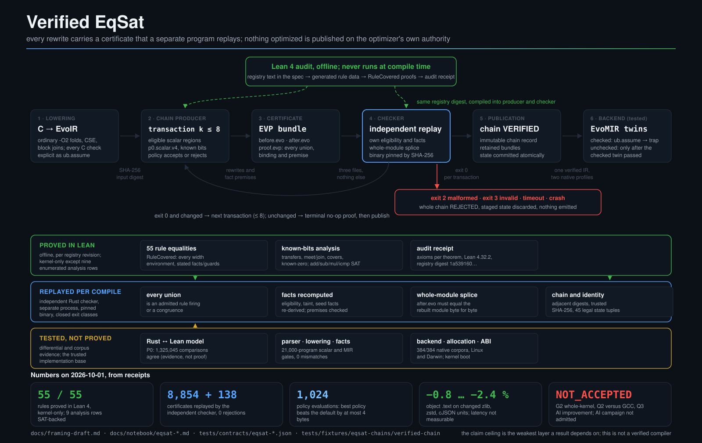

<p align="center"></p>
<h1 align="center">EvoCC</h1>
<p align="center">a C compiler with checked equality-saturation optimization</p>

EvoCC is an experimental C compiler written in Rust, targeting AArch64 Linux
and macOS. It has its own preprocessor, parser, checked IR, SSA lowering,
optimizer, register allocator and assembly emitter. Native builds use platform
assemblers, linkers and runtime libraries. Linux 6.18.44 is the kernel target;
the application ladder below measures progress beyond kernel boot.

Its bounded scalar optimizer uses an [e-graph](https://egraphs-good.github.io/):
rewrites retain equivalent alternatives, extraction chooses a form, and a
separate checker verifies the rewrite certificate. This is not a proof of the
whole compiler or a claim that every program is optimized through EqSat.
The design separates **semantic equivalence in EvoIR**, **machine constraints in
EvoMIR**, and **rule soundness in Lean 4**. [Why this split, and what is proved](#why-evoir-and-evomir).

For a restricted integer profile on Linux AArch64, a proof-required driver mode
checks the compilation result with proved Lean checkers, from typed Core source
to the final assembly text. If a check fails, the mode publishes no output. The
assembler, the linker and the hardware stay outside the proofs.
See [Verification of compilation results](#verification-of-compilation-results).

The authoritative language and machine profiles are
[EvoIR 1.9.116](docs/evoir-spec.md) and [EvoMIR 0.64](docs/evomir-spec.md).
GCC 14.2 and Clang 19.1 in the sealed AArch64 lab provide reference measurements;
documented profile decisions resolve supported disagreements, and remaining
unsupported forms have explicit refusal boundaries.

## Built with EvoCC

From a game engine to a compiler painting reflections, an island made by SQL,
and a fractal computed in Lua. These are program-generated images or
visualizations of actual output—not invented GUI screenshots.
Click an image to enlarge it; **results** links to the underlying build/test scope.

<table>
  <tr>
    <td width="33%" align="center" valign="top"><a href="docs/images/showcase/doom.png"></a><br><b>Doom / Freedoom</b><br>A real game engine · headless replay<br><a href="tests/contracts/ladder-doom-receipt.json">results</a></td>
    <td width="33%" align="center" valign="top"><a href="docs/images/showcase/tinycc.svg"></a><br><b>TinyCC paints reflections</b><br>EvoCC → TinyCC → a C ray tracer<br><a href="tests/contracts/ladder-tinycc-receipt.json">results</a></td>
    <td width="33%" align="center" valign="top"><a href="docs/images/showcase/lua.svg"></a><br><b>Lua explores a fractal</b><br>Floating-point iteration → RGB pixels<br><a href="tests/contracts/ladder-lua-receipt.json">results</a></td>
  </tr>
  <tr>
    <td width="33%" align="center" valign="top"><a href="docs/images/showcase/sqlite.svg"></a><br><b>SQLite builds an island</b><br>2,304 cells · rollback keeps the world<br><a href="tests/contracts/ladder-sqlite-receipt.json">results</a></td>
    <td width="33%" align="center" valign="top"><a href="docs/images/showcase/jq.svg"></a><br><b>jq follows a Mars rover</b><br>Simulated telemetry → mission charts<br><a href="tests/contracts/ladder-jq-receipt.json">results</a></td>
    <td width="33%" align="center" valign="top"><a href="docs/images/showcase/cjson.svg"></a><br><b>cJSON carries a city</b><br>Scene data → a neon harbor<br><a href="tests/contracts/ladder-cjson-receipt.json">results</a></td>
  </tr>
  <tr>
    <td width="33%" align="center" valign="top"><a href="docs/images/showcase/linux.svg"></a><br><b>Linux: boot, load, stress</b><br>Kernel/user FPU state isolation · 4,000 worker OKs<br><a href="tests/fixtures/fpu-worker-verdict.out">results</a></td>
    <td width="33%" align="center" valign="top"><a href="docs/images/showcase/polybench.svg"></a><br><b>PolyBench models a field</b><br>20 simulation steps · FDTD-2D<br><a href="tests/contracts/ladder-polybench-receipt.json">results</a></td>
    <td width="33%" align="center" valign="top"><a href="docs/images/showcase/mbedtls.svg"></a><br><b>Mbed TLS seals pixels</b><br>Encrypt → restore → reject tampering<br><a href="tests/contracts/ladder-mbedtls-receipt.json">results</a></td>
  </tr>
  <tr>
    <td width="33%" align="center" valign="top"><a href="docs/images/showcase/zstd.svg"></a><br><b>Zstandard packs a fractal</b><br>Smaller bytes · identical pixels<br><a href="tests/contracts/ladder-zstd-receipt.json">results</a></td>
    <td width="33%" align="center" valign="top"><a href="docs/images/showcase/zlib.svg"></a><br><b>zlib ships a tiny arcade</b><br>Pixel-art sprites → gzip → intact<br><a href="tests/contracts/ladder-zlib-receipt.json">results</a></td>
    <td width="33%" align="center" valign="top"><a href="docs/images/showcase/toybox.svg"></a><br><b>Toybox verifies a build artifact</b><br>C + ELF + RGB → tar → verify → detect change<br><a href="docs/images/showcase/README.md#toybox-build-artifact-demo">results</a></td>
  </tr>
  <tr>
    <td width="33%" align="center" valign="top"><a href="docs/images/showcase/opentyrian.png"></a><br><b>OpenTyrian</b><br>52 C units · three frames match GCC exactly<br><a href="docs/images/showcase/README.md#three-native-c-games">results</a></td>
    <td width="33%" align="center" valign="top"><a href="docs/images/showcase/neverball.png"></a><br><b>Neverball</b><br>Physics + OpenGL · one disclosed source fix<br><a href="docs/images/showcase/README.md#three-native-c-games">results</a></td>
    <td width="33%" align="center" valign="top"><a href="docs/images/showcase/quakespasm.png"></a><br><b>Quakespasm / LibreQuake</b><br>77 C units · real 3D demo replay<br><a href="docs/images/showcase/README.md#three-native-c-games">results</a></td>
  </tr>
</table>

Doom is a bounded headless replay, not interactive gameplay. Kernel boot is not
full kernel-test completion. Library demos use explicitly labeled reference-built
adapters; charts are renderings of captured data, not native application UIs.
The three new games use reference SDL/OpenGL libraries; their screenshots are
bounded native runs, not full-game acceptance or graphics-driver compilation.
The [capture notes, exact commands and limitations](docs/images/showcase/README.md)
keep these small examples separate from full benchmark acceptance.

## Status — 2026-09-28

**Full kernel boot is working; full kernel testing and the complete application
ladder are not yet closed.** The latest recorded application lanes contain
**10 PASS, 1 PROFILE_CLEAN and 4 INCOMPLETE**.

Application rows are an audit of existing measurements, not a new run of today's checkout.
Unchanged-program September 27 replays cover torture, c-testsuite, TinyCC,
toybox, LLVM SingleSource, jq, cJSON and musl. Other lanes retain their earlier measurements;
this is not a completed fresh 15-lane campaign or a kernel-test rerun.
Each receipt retains its compiler and input identity. See the generated
[status dashboard](docs/status.md), [pinned roadmap](docs/roadmap.md),
[application ledger](docs/notebook/benchmark-evaluation-20260915.md) and
[kernel issue ledger](docs/notebook/kernel-selftest-gaps-20260914.md).
The Git-tracked [TODO list](TODO.md) gives each remaining task a stable ID,
priority, next action and evidence-based closure condition.

### Application benchmarks

`PASS` is bounded by the recorded build and test selection. `PROFILE_CLEAN`
means zero compiler failures after evidenced deferrals, inapplicability and
unusable-oracle cases are separated; it does **not** mean all originals passed.
TU counts are EvoCC translation units retained in the lane's tested build,
not test counts. Mixed-link builds can still contain reference-built code.

| Benchmark | Status | Recorded result | Scope or remaining issue |
|---|---|---:|---|
| GCC torture | PROFILE_CLEAN | 1,522/1,692 programs PASS | 0 compiler failures; 21 FP-deferred, 146 not applicable, 3 oracle-unusable; September 27 full replay |
| c-testsuite | PASS | 220/220 programs PASS | Fresh full population, zero exclusions or deferrals |
| Csmith | INCOMPLETE | 932/1,000 checksum agreements | All 1,000 compile; 0 mismatches; 68 unusable-oracle cases are not passes |
| zlib | PASS | 19/19 TU | Recorded original program tests |
| zstd | PASS | 44/44 TU | Recorded original tests; build adjustments remain in the receipt |
| cJSON | PASS | 23/23 TU | Both libraries + all 21 Unity/private-helper programs; 161 cases PASS, 1 upstream IGNORE; public-API controls also pass |
| Mbed TLS | PASS | 382/382 TU | Default configuration selftest and 148/148 CTest |
| TinyCC | PASS | 11/11 TU | Original `make test`; relink/test exits and installed objects audited |
| toybox | INCOMPLETE (shared test FAIL retained) | 203/203 TU installed; all 1,669 test occurrences complete | Both builds: 1,648 PASS / 1 FAIL / 20 SKIP; tar expected-hash contradiction reproduced; zero EvoCC regressions |
| musl + libc-test | INCOMPLETE | 1,271/1,339 TU retained in the mixed build | Two complete runtime replays: zero added failures or replaced objects; 68 floating-complex refusals and 17 shared reference failures remain, with option omissions separately recorded |
| PolyBench/C | PASS | 30/30 kernels | MINI_DATASET array-output correctness, not performance; reference-built allocation utility |
| LLVM test-suite | INCOMPLETE | 1,039/1,735 programs PASS | Fresh full run: 1 unresolved compiler failure, 30 FP-deferred, 664 not applicable, 1 oracle-unusable; no installed object rebuilt |
| jq | PASS | 69/69 TU; original `make check` PASS | Real binary128 interface; original `-pthread` preserved; no object fallback |
| Lua | PASS | 34/34 TU | Matching official `all.lua`, without soft skips |
| SQLite | PASS | 86/86 TU | Public Tcl `veryquick`: 329,803 assertions; not proprietary TH3 |

The [benchmark receipt](tests/contracts/bench-receipt.json) and individual
`ladder-*-receipt.json` files bind these results to their measured subjects.
The September 27 complete LLVM replay adds 25 original-program passes over
the old full run, including the earlier targeted FP repairs and all three
LARGE `lu`, `ludcmp` and `floyd-warshall` workloads under the unchanged
60-second limit. All 1,048 installed objects survive the final build unchanged.
The remaining compiler-failure classification is `pr23135` (L10 in TODO),
pending its integer-vector source-definedness ruling; it is not FP-deferred.

### Linux boot, kselftest and KUnit

All kernel rows use Linux 6.18.44 ARM64, but the configurations and Images
differ. Target-C objects come from EvoCC; assembly, host build tools and
userspace test dependencies are accounted for separately.

| Scope | Verified result | Limit |
|---|---|---|
| K6 locked configuration | **2,799/2,799 target-C**, complete link, real boot and normal shutdown PASS; uniform EvoCC rebuild, zero GCC target-C fallback | Not every Linux configuration or subsystem |
| BPF/module configuration | **7,008/7,008 target-C**, pinned current compiler, generated-input fixed point, complete link/boot PASS; 848 modules linked/BTF/signed/installed | Not all installed modules runtime-tested; fresh full kselftest/KUnit still pending; QEMU drift explicitly recorded |
| Current FPU and connector follow-up | Both kernels: FPU **1/1 + 4,000/4,000 workers PASS**; bounded connector controls **20/20 each** | Actual signed FPU module loaded; unchanged persistent connector listener still times out under its original 45-second runner, not counted PASS |
| K7 selected kselftests | Both kernels: **9/9 programs, 125/125 subtests PASS**, no skip/failure | Not all kselftests or KUnit |
| Full installed kselftest population | All **970 programs started on each kernel**; aggregate INCOMPLETE; counts below | Unbuilt collections and unavailable hardware remain; latest Image needs a full rerun |
| Expanded built-in KUnit | Of 1,504 cases: EvoCC **1,432 PASS / 12 FAIL / 60 SKIP**; GCC **1,438 / 7 / 59** | Subsequent filtered repairs are not a new full result |
| Expanded KUnit modules | Both kernels actually loaded all **31 test modules**, **765/765 cases PASS** | This retained 6,916-target-C composition differs from later filtered FORTIFY Images; its 809-module configuration disables module signing |

The last full 970-program pair (September 22) records these **program-level**
verdicts, not individual nested assertions:

| Kernel | PASS | FAIL | SKIP | TIMEOUT | INVALID_OUTPUT | INCOMPLETE |
|---|---:|---:|---:|---:|---:|---:|
| GCC control | 532 | 121 | 302 | 11 | 2 | 2 |
| EvoCC | 529 | 114 | 302 | 19 | 3 | 3 |

The latest September 28 [uniform composition](tests/fixtures/kernel-current-composition.out)
uses pinned Rust 1.97.1 compiler `ab2eeb7b…` and Image `18b36fee…`. All 7,008
actual-header consumers, 849 generated export/module units, the full link,
848 module links/BTF and installed-object audits pass. Actual boot/poweroff
passes; zero GCC target-C replacements. Its matching signed runtime preserves
all 4,396 original non-module userspace files. Actual
[FPU execution](tests/fixtures/fpu-worker-verdict.out) and
[connector delivery](tests/fixtures/connector-process-events.out) close those
two prerequisite gaps, not the complete 970-program campaign or expanded KUnit.

The preceding September 28 composition used subject Image `62c29ae4…`;
the September 22 totals remain historical. Its real boot/poweroff and zero
GCC replacement are verified, not a full kselftest or KUnit result. The frozen
`65035621…` compiler contains Rust 1.98.0 std code; it is not retroactively
credited with the newly pinned Rust 1.97.1 build or subsequent compiler fixes.
Its [new matching module runtimes](tests/fixtures/kernel-uniform-module-runtime.out)
pass NCI's 8/8 cases, both splice programs and IOMMU's 224/0/5 inner results
on both kernels. This six-program selection also retains FPU SKIP (TEST_FPU
not enabled) and BPF test_kmod TIMEOUT on both sides; 964 programs remain NOT_RUN.
The September 23 checkpoint remains explicitly a **one-program
BPF replay**, not a new 970-program campaign: GCC completes with 651/5644
successful test/subtest counts, 127 skip counts and 11 failed tests; EvoCC
times out at the unchanged 300-second limit after group 482. Both shut down
normally. No test is still running from that flight. Nested `sched_ext` and
BPF summaries are checked without rewriting historical counts.

Boot acceptance audits installed object hashes and generated-input stability,
then starts the actual Image in QEMU, checks the ordered `/init` markers and
per-run nonce, and requires normal poweroff. Kselftests compare the two kernels
with matching test payloads in fresh per-program VMs. CPU/EL2 requirements and
explicit timeout policies are recorded for both sides. KUnit executes in the
kernel, with built-in and module results kept separate.

Targeted repairs bring FORTIFY to **25/26 PASS** (failed assertions **96 → 2**),
IOMMU on the new uniform pair to **224 PASS / 0 FAIL / 5 SKIP**, and ALSA timer tests
to **2/2 PASS** on both. Three BPF variants each pass the selected 10 groups /
51 module/BTF subtests. Remaining work includes the nonliteral `strlen`
constant-expression rule, two KVM timeouts, intermittent `sched_ext` and `ublk`
failures, PM runtime timing, shared breakpoint failures, remaining config coverage
and the full BPF program. Not every shared failure is diagnosed. A fresh
complete 970-program pair and 1,504-case KUnit run after those repairs remain
outstanding.

Evidence: [locked K6](tests/contracts/kernel-full-receipt.json),
[BPF/module K6](tests/contracts/kernel-bpf-full-receipt.json),
[selected K7](tests/contracts/kernel-selftest-receipt.json),
[full kselftest](tests/contracts/kernel-selftest-full-receipt.json),
[expanded KUnit](tests/contracts/kernel-expanded-kunit-receipt.json).

### Language and research boundaries

Scalar `float`/`double` execution, both interpreters, AAPCS64 HFA/varargs,
integer vectors, TLS, lifecycle registration and the approved GNU extensions
are implemented with targeted tests. The scalar FP engine has **661,848**
independent numerical checks across 32 operations. The strict FP adapter and
world-threaded IR/backend, dynamic-rounding source mode and non-trapping lexical
`FENV_ACCESS` now have [targeted value/status and native checks](docs/notebook/strict-floating-implementation-20260927.md).
The September 27 musl replay retains 1,271 EvoCC objects through two complete
libc-test runs with no added failures; it is still a mixed build, not full musl
acceptance. The scalar `w` asm extension and its original pthread regressions
are repaired. Binary128 source/IR, both
interpreters and hosted native helpers/ABI now have targeted tests; jq's fresh
69/69-object original test replay also passes. Floating complex/vectors and other explicitly refused forms remain outside
the current source profile. FP is not the only
remaining application or kernel-test blocker.

Other measured dialect boundaries, including tiny-vector external ABI,
integer-complex division, pointer-to-VLA type queries and nonzero-depth return
addresses, are itemized in the [remaining-semantics brief](docs/notebook/remaining-semantics-research-brief-20260921.md).

Whole-kernel EqSat reproducibility/certificate acceptance (G2), the GCC `-O2`
performance comparison (Q2), measured self-improvement (Q3), x86/release gates
still have no accepted completion result.
Scalar proof results and successful boot do not close those milestones.

### Doom integration

The separate headless Doom lane builds all **80 engine C units plus one platform
adapter with EvoCC**, without target-C object fallback. It pins doomgeneric
`dcb7a8dbc7a16ce3dda29382ac9aae9d77d21284` and Freedoom 0.13.0 Phase 1.
Two bundled demos, two repetitions each, run under EvoCC/GCC14/Clang19:
**12 executions, 350 frames each**, with exact corresponding framebuffer SHA-256
sequences. Runtime libraries, assembler and linker remain the sealed target's
existing tools; this is not a self-contained EvoCC libc build.

The declared profile is GNU11/O2 with **`-fwrapv`**: the original signed `ANG45`
multiplication overflows before conversion to unsigned. A separately recorded
one-line port repair initializes the previous screen before the initial melt;
without it GCC's own repeated runs have nondeterministic initial frames.
Neither compiler guards nor mismatching frames are skipped. The profile replaces
Xlib with a deterministic 320x200 headless adapter; audio, live keyboard/window
play and other maps/ports are **not tested**. This additional R06 lane does not
change the frozen 15-lane application campaign.

```sh
python3 tools/bench.py doom --evocc target/pinned-check/release/evocc --jobs 2
python3 tools/bench.py doom --status
```

The first command requires the existing sealed Apple Container image and
exported ARM64 headers, and downloads about 26 MiB of pinned source/data if
absent. No kernel VM disk is created. Binaries, a few PPM snapshots and detailed
frame hashes stay in `.build/ladder/doom`; the Linux ARM64 executable is
`.build/ladder/doom/evocc/doom`. It streams frames rather than opening a window.
See the [receipt](tests/contracts/ladder-doom-receipt.json) and
[scope, failed attempts and checks](tests/fixtures/doom-headless.out).

## Try it

### Evaluate the roadmap

Read receipts without launching builds or VMs:

```sh
python3 tools/render-status.py --ascii
python3 tools/render-status.py --todo
python3 tools/render-status.py --check
python3 tools/bench.py --list
```

Run selected lanes through the common entry point:

```sh
python3 tools/bench.py csmith cjson
python3 tools/bench.py torture zlib toybox --jobs 2 --budget 45
python3 tools/bench.py llvm-test-suite jq lua sqlite --jobs 2
python3 tools/bench.py kernel-full --jobs 2 --low-disk --allow-qemu-drift
python3 tools/bench.py kernel-selftest --allow-qemu-drift
python3 tools/bench.py kernel-selftest-all --jobs 2 --reuse-selftest-build --allow-qemu-drift
python3 tools/bench.py kernel-kunit --allow-qemu-drift --dry-run
python3 tools/bench.py kernel-kunit --status
```

Preview an expensive all-lane campaign before executing it:

```sh
python3 tools/bench.py all --programs 500 --jobs 2 --budget 45 --allow-qemu-drift --dry-run
```

`all` runs available lanes sequentially. It is a long native evaluation, not a
unit-test shortcut. Csmith's default is 500 programs **per campaign** (1,000
total); `--budget` limits toybox/musl bisection probes, not corpus size.
`--allow-qemu-drift` explicitly acknowledges the installed QEMU digest for
kernel lanes. `--dry-run` prints commands; `--evocc PATH` measures an existing
compiler without rebuilding it.

`kernel` is the historical mixed-link ramp; use `kernel-full` for complete
target-C compilation, installation, link and boot. Selftest commands do not
rebuild the kernel. These examples select the locked default configuration;
expanded configurations need explicit matching receipt, source and runtime
arguments (`--help` and the kernel ledger describe them). `kernel-kunit` reuses
the boot/init workflow and pinned upstream parser for the separate expanded
configuration: 1,504 built-in cases plus 31 actually loaded modules / 765 cases
on **each** kernel. It is included in `all`, not in `kernel-selftest-all`.
It does not rebuild Images or copy test disks. Supply matching audited artifacts
with `--kunit-kernel-receipt`, `--kunit-reference-boot`,
`--kunit-reference-runtime`, `--kunit-subject-runtime`, `--kunit-source-root`
and `--kunit-builtin-initramfs`. The current incremental Image and retained
module disk do not match the older full-composition receipt; preflight rejects
that combination until T04's final composition/runtime rebuild. The adapter's
tests and historical-log replay are **not** a fresh KUnit execution.
`python3 tools/k1/kunit.py --check` performs that read-only preflight;
`bench.py ... --status` shows retained receipts without revalidating artifacts.

`kernel-selftest` uses one shared reference-compiled userspace payload on both
kernels. `kernel-selftest-all` attempts upstream `TARGETS` and `TARGETS_HOTPLUG`
with `SKIP_TARGETS` empty, then runs installed programs/scripts in fresh VM
disk snapshots, at most two concurrently. It requires the provisioned lab
and additional dependencies, and can take hours. `--reuse-selftest-build`
requires a matching installed payload and still executes tests again; omit
it for initial preparation. Upstream timeouts are retained except for recorded
per-program budgets applied equally to both kernels. Unlimited programs
otherwise have a 300-second safety watchdog, plus cleanup/boot allowances.

The script streams lane output, keeps a summary under `.evidence/bench/`,
updates `tests/contracts/bench-receipt.json`, and renders `docs/status.md`.
Single-lane runs retain older measurements with their original compiler
identity; a dashboard refresh is not a fresh full run. Existing evidence is
referenced, not copied into another archive. Exit 0 means selected gates are
PASS or evidenced PROFILE_CLEAN, **not necessarily that every original passed**;
1 means measured gaps/failures; 2 means a runner, usage or evidence error.

Native lanes require the sealed flight-lab image and pinned source/build
inputs. Do not run legacy lane scripts concurrently against the same build
directories. Reuse existing trees and `--low-disk` for kernel work instead of
making duplicate workspaces. Partial mixed-link coverage or reduced
`--programs` experiments do not close a full milestone.

### Compile a program

Reuse the benchmark's target directory rather than creating a second build tree:

```sh
CARGO_TARGET_DIR=target/frontend cargo build --release --offline -j 2 -p evocc -p evocc-proofcheck
```

Save this as `demo.c`:

```c
struct point { int x, y; };
static inline int dot(struct point a, struct point b) {
    return a.x * b.x + a.y * b.y;
}
int main(void) {
    struct point p = { .x = 3, .y = 4 };
    int n = ({ int t = dot(p, p); t + 1; });
    return __builtin_choose_expr(__builtin_constant_p(1), n / 2, 0);
}
```

The independent interpreters should both print `13`; the final command emits
Linux AArch64 assembly, not a linked executable:

```sh
target/frontend/release/evocc --interpret-c-hir demo.c
target/frontend/release/evocc --interpret-evoir demo.c
target/frontend/release/evocc --target=aarch64-unknown-linux-gnu --emit=asm demo.c > demo.s
```

To check one executed path without producing a native executable:

```sh
target/frontend/release/evocc --check --error-format=json demo.c
target/frontend/release/evocc --explain E3002
```

Completion is bounded by the existing interpreter and its execution budget;
unsupported calls and exhausted fuel are incomplete checks, not passes. See
the [C checker workflow](docs/checker.md) for diagnostics and scope.

Other flags include `-E`, `--parse-only`, `--emit=c-hir`, `--emit=evoir`,
`-Oeq-scalar` and `--survey`. The standalone
`target/frontend/release/evo-proofcheck before.evoir after.evoir proof.evp2` checks a scalar rewrite
certificate; an optimization may remove work without discarding the original
undefined-behavior obligations.

`-Oeq-scalar` now uses the same policy-aware persistent chain as the policy
evaluator and independently replays every transaction before emitting output.
Building/installing the `evocc` package also produces `evocc-checker`, its
default independent companion (the standalone package still provides
`evo-proofcheck`). Supply `--eq-checker-sha256=TRUSTED_SHA256` or
`EVOCC_CHECKER_SHA256`, taken from the build/release you trust. An observed sibling
binary or a certificate's self-declared digest is not a trust anchor. An explicit
`--eq-checker=PATH` must match the same pin. Missing/mismatched pins refuse
compilation; EqSat-off needs no checker. The admitted checker deadline is recorded
and configurable with `--eq-checker-timeout-ms=1..300000`.
To retain the ordered proof bundles, add `--eq-proof-dir=NEW_DIR`; to recheck
them later, use `python3 tools/bench.py --verify-eqsat-chain NEW_DIR --checker PATH`.
An existing proof directory is never overwritten. See the
[implementation receipt](docs/notebook/verified-eqsat-implementation-20260929.md)
for tested scope; this does not close whole-kernel G2 or performance milestones.
Without `-Oeq-scalar`, the same export option records an explicit identity chain
(zero rewrite transactions). Audit it with `--verify-eqsat-chain NEW_DIR` and
no checker; byte identity is reported separately from proof replay.

## Why EvoIR and EvoMIR?

EvoCC's design goal is **an optimizer whose decisions can be inspected and
checked separately from the search that found them**, with a conventional native
backend. The two IRs separate two different correctness problems:

```text
C source → checked C-HIR → EvoIR → EqSat search + extraction → EvoIR → EvoMIR → assembly
                            │              │                  │        │
                            └─ before ─────┴─ certificate ────┘        └─ allocation verifier
                                         evo-proofcheck

Lean 4:          rule proofs and restricted compilation-result checkers
Native tests:     C lowering, machine code, ABI and real-program behavior
```

### EvoIR: make semantic obligations inspectable

| Design choice | Problem it addresses | Cost / boundary |
|---|---|---|
| Block-local SSA; every cross-block value is an explicit edge argument | Dependencies, including object addresses, can be checked locally. A branch cannot quietly refer to an entry-block value. | More explicit edge plumbing; complete successor bindings are essential. |
| Explicit memory state, `world`, pointer provenance and `ub.assume` obligations | A numeric identity alone cannot justify deleting a volatile event, inventing a valid pointer, or discarding a C-definedness check. | More semantic bookkeeping. These models are specified and tested, not all formally proved. |
| Bounded equality saturation over an admitted scalar subset | Equivalent alternatives coexist until extraction, so finding one rewrite need not destroy another useful choice. | Search/extraction budgets and cost models still matter; this does not solve all phase ordering or promise faster code. |
| Persistent equality state with transactional updates | Class identity and proof history survive extraction and value renumbering; failed optimization rolls back both the graph and module. | Reuse is identity-bound. A retained alternative is not automatically an admissible witness in a new certificate. |
| A separate certificate checker consumes the before/after modules | The optimizer's own verdict is not sufficient: the checker replays the claimed rewrites and rejects unauthorized changes. | The checker, parser and eligibility logic remain part of the trusted implementation. |

For example, `(x + 0) * 1 → x` is a scalar bit-vector identity under the
registry's premises. It is **not** permission to remove the evaluation that
produced `x`, or to apply the same rule to floating point. FP execution support
does not put FP rewrites into the P0 optimization allowlist.
See the [EvoIR contract](docs/evoir-spec.md) and
[independent checker](crates/evocc-proofcheck/src).

### EvoMIR: expose the constraints of the machine

[EvoMIR](docs/evomir-spec.md) makes virtual/physical registers, ABI locations,
call clobbers, spills, flags and parallel copies explicit. Semantic rewriting
does not have to reason in physical registers; conversely, the allocator cannot
ignore that an argument must reach a particular register or that a call clobbers
a live value. Scalar FP and SIMD share the same physical register bank.

A separate allocation verifier checks defined register reads, live-value
conflicts and flags dependencies. The EvoMIR interpreter provides another
lowering check on its executable subset; inline assembly requires native tests
instead. This split localizes failures: wrong expression, wrong lowering and
wrong allocation are different checks, not one final wrong exit code.

These are **advantages for EvoCC's auditability goals**, not evidence that its
IRs universally outperform LLVM/GCC or that multiple IR levels are novel.
More explicit state and checks also cost compiler complexity and compile time.
Performance and coverage remain measured roadmap work.

### What Lean 4 proves—and what it does not

Lean is an **offline proof tool**, not EvoCC's code generator and not a runtime
dependency of compiled C programs. It has two roles: prove rewrite rules and
prove compilation-result checkers. The table below covers the rewrite layer.
The [compilation verification section](#verification-of-compilation-results)
describes the separate compilation theorems, from typed source to final
assembly text.

| Layer | What it establishes |
|---|---|
| [Lean rule proofs](lean/EvoIR/Proofs/Rules.lean) | The retained audit covers all **55 rules in `p0.scalar.v4`** and [**7 rules in `g0.ub.v1`**](lean/EvoIR/Proofs/GuardRules.lean), parametrically over the admitted 1–64-bit widths and stated premises. These rule proofs are classified **kernel-only**. |
| [Lean known-bits proofs](lean/EvoIR/Proofs/Transfer.lean) | Soundness of the modeled transfer functions, lattice operations and side conditions. Some proofs are **native-backed** and have additional Lean compiler / SAT-LRAT trust dependencies, recorded per theorem. |
| Rust `evo-proofcheck` | Whether a particular before/after rewrite certificate follows the allowed rules and reconstruction checks. It does not invoke Lean for each compilation. |
| [Rust–Lean correspondence tests](tests/contracts/lean-correspondence-receipt.json) | **1,487,689 / 1,487,689** recorded comparisons agree: **1,325,045** across the five P0 groups plus **162,644** guards. All six groups were rerun together on 2026-10-01. Differential agreement is not a proof that the Rust implementation equals the Lean model. |

The [proof audit and trust list](tests/contracts/lean-p0-receipt.json) bind the
registry digest and historical proof subject; they are not a blanket theorem
about every feature in the latest specification. The semantic definitions,
registry decoder, checker and correspondence to Rust remain explicit trust
boundaries. These results **do not prove the C front end, memory model, backend,
entire compiler, or Linux kernel correct as a whole**. The restricted
compilation theorems below do not remove these wider limits.
Reproduce the separate proof gate
with [`tools/gate-lean.sh`](tools/gate-lean.sh).

The [Q2/Q3 implementation design](docs/framing-draft.md) separates rule
soundness from measured benefit and gates any AI search behind measured
opportunity ceilings. What has actually been built and measured under that
design is summarized in [Verified EqSat](#verified-eqsat-pipeline-trust-layers-and-evidence)
below; none of it is an AI optimization or speedup claim.

Implementation evidence stays separate: recorded scalar and MIR gates each
cover **21,000 generated IR programs** with zero mismatches; native C corpora
separately pass **384/384 on Linux and 384/384 on Darwin**. Kernel acceptance
additionally checks original Kbuild inputs, EvoCC object provenance through
generated-input convergence and linking, then actual boot and runtime tests.

### Verified EqSat: pipeline, trust layers and evidence

EvoCC's optimizer is a bounded equality-saturation engine whose every change
to a translation unit is accompanied by a certificate that a separate program
replays. Nothing optimized is published unless that replay succeeds. The
diagram shows the P0 path one translation unit takes under `-Oeq-scalar`.

<p align="center"><a href="docs/images/evocc-eqsat.svg"></a></p>

Top: the P0 path one translation unit takes under `-Oeq-scalar`. The Lean audit
runs offline and pins the registry digest that both the producer and the
checker are compiled with. Middle: trust is layered, and each layer has a
different kind of evidence, so an optimizer bug, a checker bug and a proof gap
are three different failures caught by three different mechanisms. Bottom:
the numbers, each from a receipt. The figure is generated by
[`tools/render-figures.py`](tools/render-figures.py).

**Evidence collected so far.** Every row is receipt-backed; the right column
is the claim ceiling, not a summary.

| Date | What ran | Numbers | What it does and does not establish |
|---|---|---|---|
| 2026-09-09 | Lean audit of `p0.scalar.v4` | 55 / 55 rules proved, kernel-only; [receipt](tests/contracts/lean-p0-receipt.json) | Rules are sound equalities of the modeled semantics. Not a proof of the compiler. |
| 2026-09-29 | Shared verified chain ([R01a](docs/notebook/verified-eqsat-implementation-20260929.md), [requalification](docs/notebook/eqsat-review-closure-20260929.md)) | Driver and evaluator run one chain; 45 legal transaction states; checker pinned by SHA-256; full workspace 2,850 tests, 0 failures | Optimized output cannot be emitted without independent replay. Integration found and fixed two real producer defects. |
| 2026-09-30 | Bounded Linux pilot ([protocol and results](docs/notebook/eqsat-r02-linux-pilot-20260930.md), [receipt](tests/contracts/eqsat-r02-pilot-receipt-20260930.json)) | 576 / 576 result-checked executions; 138 certificates replayed, 0 rejections; 108 checked/unchecked twins; default search and certificate caps hit 0 times | The pipeline runs end to end on zlib, zstd and cJSON. Millisecond fresh-process timing was uninformative by construction. |
| 2026-09-30 | Steady-state timing ([protocol](docs/notebook/eqsat-r02-steady-protocol-20260930.md)) | A/A 10 / 10 admitted; A/B run once: 10 / 10 **INCONCLUSIVE** at a 5% floor; frozen, not rerun | No latency improvement, regression or equivalence is claimed. Latency is `NOT_MEASURABLE_ON_THIS_LANE`; size is the V1 objective. |
| 2026-09-30 | Deterministic preflight ([adjudication](docs/notebook/eqsat-r02-review-repair-20260930.md)) | 1,024 policy evaluations, 6,144 chains, 8,854 proofs replayed; 1,222 candidate rules attempted: 1,174 proved, 48 unknown, **0 installed** | Policy, rule and shortcut tracks are all **INCONCLUSIVE / NOT_ADMITTED**. No AI campaign is admitted; proving rules was never the bottleneck. |
| 2026-10-01 | Object-level size ([S1–S4 ledger](docs/notebook/eqsat-size-work-packages-20261001.md), [DCE control](tests/contracts/eqsat-size-dce-20261001.json), [policy ranking](tests/contracts/eqsat-size-policy-ranking-20261001.json)) | see table below; exhaustive best policy beats the default by at most 4 bytes | Verified rewrites shrink object `.text` by 0.8–2.4% on the changed subject TUs. The policy weight space is `FINITE_ENUMERATION_SUFFICIENT` for size. |
| 2026-10-01 | Guard-folding ceiling ([result](tests/contracts/eqsat-size-guards-result-20261001.json), [guard contract](docs/eqsat-guard-folding-draft.md)) | Unverified diagnostic recovers 952 / 1,608 / 80 bytes (zlib / zstd / cJSON) from provably-true UB checks | A diagnostic ceiling for R02e, not a certified benefit. Nothing from the diagnostic is installed. |
| 2026-10-01 | Certified guard first slice ([acceptance](docs/notebook/eqsat-certified-guards-20261001.md)) | Seven g0 rules and seven new A2 rows are kernel-only; ten certificates replay; checked text saves 256 / 984 / 28 bytes in zlib / zstd / cJSON | First-slice acceptance on six original TUs. Maximum per-TU saving is 0.800%; unchecked sizes are unchanged. Diagnostic and P0 savings remain separate. |

Verified P0 EqSat effect on the subject translation units, checked profile,
object `.text` bytes with the common dead-code elimination enabled on both
sides (A: EqSat off, B: EqSat on, same lowering, same backend):

| Subject | A | B | Change | Changed TUs / eligible roots |
|---|---:|---:|---:|---|
| P0 integer mix | 128 | 128 | 0 | 0 / 13 |
| zlib `deflate.c` + `inflate.c` | 58,920 | 58,448 | −472 (−0.8%) | 2 / 3,356 |
| zstd `zstd_compress.c` + `zstd_decompress.c` | 157,712 | 156,272 | −1,440 (−0.9%) | 2 / 10,298 |
| cJSON `cJSON.c` | 30,228 | 29,496 | −732 (−2.4%) | 1 / 1,787 |

What these numbers mean: the verified P0 domain is sound and reproducible,
and its measured effect is small, because the domain is small. P0 cannot touch
the checked UB guards (0.4–5.5% of object `.text` on these TUs, measured as
checked minus unchecked), memory operations, inlining or control flow. The design response is to grow the verified domain
one reviewed slice at a time, measuring the ceiling before proving anything;
the first guard slice is now accepted. The [six-TU GCC/Clang size comparison](docs/notebook/eqsat-size-references-20261001.md)
is complete and records larger EvoCC objects. G2 whole-kernel reproducibility,
full Q2 acceptance and any Q3 self-improvement claim remain **NOT_ACCEPTED**.
None of these test populations substitutes for the others.

## Verification of compilation results

As of **2026-10-06**, every checked stage passes its frozen acceptance profile:
typed source to EvoIR, EvoIR rewrites, EvoIR to post-SSA EvoMIR, register
allocation, and frame layout and emission to the final assembly text.
[Proof-required compilation](#proof-required-compilation) composes these
stages. The result is a proved, fail-closed compilation path for the listed
Core C-HIR subset and target, with an explicit trusted boundary. Existing
scalar rewrites compose with that path. Each stage checks the actual compiler
output. No stage proves that every program accepted by EvoCC is compiled
correctly.

The method is *translation validation*: check each supplied compilation
result, instead of proving the compiler algorithm. The compiler and proof
search can propose a correspondence. An independent checker must establish it.
The checker is written in Lean, and its soundness theorem is checked by the
Lean kernel.

```text
Typed Core C-HIR                complete selected functions and callees
        |
        | source-to-EvoIR checker                       V01
        v
Actual EvoIR
        |
        | rewrite-step checker, only with -Oeq-scalar   V05
        v
Rewritten EvoIR                 the same program if no rewrite ran
        |
        | instruction-selection checker                 V02
        v
SSA EvoMIR                      virtual registers and block arguments
        |
        | edge and copy checker                         V02
        v
Post-SSA EvoMIR                 virtual registers and explicit copies
        |
        | allocation checker                            V03
        v
Allocated EvoMIR                physical registers and spill slots
        |
        | frame, emission and print checker             V04
        v
Final assembly text             the published output.s
        ---------------------  current formal boundary
        |
        | assembler, linker and runtime libraries
        v
Native program                  tested; not covered by these theorems
```

Here, *SSA* means static single assignment. Each SSA value has one definition.
Removing SSA replaces block-argument transfers with explicit copies. It does
not assign physical registers.

### The checked source profile

The proof input is typed Core C-HIR, not raw C text. It retains complete
function bodies, types, evaluation order and local bindings. The frozen
profile uses checked integer operations on AArch64 Linux LP64. Its acceptance
inputs use `-O0 -fno-builtin`, with optional optimizations off.

| Area | Included in this proof profile |
|---|---|
| Integer types | `int`, `unsigned int`, `long`, `unsigned long`, `long long` and `unsigned long long`. Type rank and signedness remain distinct. |
| Expressions | Integer arithmetic, bitwise operations, comparisons, conversions, conditional expressions and short-circuit evaluation. Unsigned left shift and signed or unsigned right shift are included. Signed left shift is excluded. |
| Control flow | Branches, joins, `while`, `do-while`, `for`, `break`, `continue` and value returns. Loops do not need a fixed iteration bound. |
| Calls | Direct calls to defined, prototyped, nonvariadic functions. The selected call graph has no recursion. |
| Local storage | Private scalar automatic objects, initialization, assignment and lifetime. Their addresses cannot escape. The IR proof tracks private bytes and object identities. |
| Observable results | Return type and bits, or the first admitted arithmetic diagnostic: `E3002`, `E3003`, `E3004` or `E3005`. Infinite execution is also covered. |

Floating point, general pointer access, heap objects, shared or global memory,
external calls, volatile or atomic access, inline assembly and other GNU C
features are outside this proof profile. Some of these features work in the
ordinary compiler. That does not make them formally verified.

Uninitialized reads and unsupported memory faults must be excluded by source
validation and the proved invariants. They are not extra successful outcomes.
This is not a claim that all C undefined behavior becomes a checked native
diagnostic.

### Source-to-EvoIR verification

This layer proves two different properties.

First, the independent source validator checks types, bindings, definite
initialization, sequencing, scopes and the direct-call graph.
The [`checked_source_safety` theorem](lean/EvoIR/Core/ValidatorSafety.lean)
states that an accepted source program can start with any correctly typed
arguments. Each reachable state then has a typed result, an admitted
diagnostic, or a next step. It cannot stop in a malformed state. This theorem
does not assume that a compilation result has already passed another checker.

Second, the [source-to-EvoIR checker](lean/EvoIR/Core/SourceTargetCheck.lean)
compares that source tree with the supplied EvoIR program. Its
`check_source_target_refines` theorem covers every accepted pair and all typed
arguments. It preserves return bits and the first admitted diagnostic. For
example, the checked `abs(INT_MIN)` case must report `E3004`; it cannot become
a successful return of `INT_MIN`.

The checker covers expression order, integer conversions, branch arguments,
loop backedges, calls and returns. Private-storage proofs cover allocation,
byte contents, initialization, lifetime end and preservation of the caller's
objects. A callee result alone is not enough to establish correct call behavior.

Loop checks establish relations at control-flow checkpoints and check their
successor paths. They do not unroll the program to a test limit. Proof search
has a finite resource budget, but the accepted theorem has no execution bound.
A failed proposal is a refusal, not evidence that the two programs agree.

### EvoIR-to-virtual-machine verification

The [`checkLowering` checker](lean/EvoIR/MachineLowering.lean) takes three actual
programs: EvoIR, SSA EvoMIR and post-SSA EvoMIR. It checks two connected steps.

1. **Instruction selection.** The selected virtual instructions must implement
   the supplied EvoIR operations. Checks include integer widths, conditions,
   arithmetic guards, calls, return values and private storage.
2. **SSA removal.** Edge transfers and explicit copy sequences must preserve
   the same values. The proof covers complete edge argument lists, forwarding,
   split edges and copy cycles. A sequence that destroys a value before its
   last required copy must be refused.

Both checks refer to the **same SSA program and entry state**. A proof about
one compilation cannot justify a different machine snapshot.

Always-on transformations also need justification. The current checker covers
dead-code elimination and independently checked normalization of dead poison
definitions. Poison marks an undefined value; it is not an ordinary zero.
The final theorem still starts from the original supplied EvoIR.
It also checks the compiler's substitution of zero for unused private-call
arguments. That substitution requires an independent proof that the callee
does not need those values.

Private-call checks preserve saved caller state and private memory across
return. They keep full argument lists and distinct object identities. The
combined acceptance cases include a loop with repeated private calls and a
pointer carried through a backedge.

The [composition theorem](lean/EvoIR/MachineCorrespondence.lean) connects this
result to an accepted source-to-EvoIR result. The intermediate EvoIR program,
entry states and result type must match. Under those premises, the complete
typed-source-to-post-SSA result preserves the defined observations for all
typed arguments. It also preserves divergence and excludes a stuck target
state. Administrative copies cannot introduce an infinite silent loop.

### Recorded acceptance evidence

The [acceptance receipt](tests/contracts/core-v1-pilot.json) separates original
inputs, added controls and historical failures. Read `source_to_ir_completion`
for the source result and `machine_lowering_checkpoint` for the later machine
result. Earlier partial records remain in the file; they are not the current
completion status.

| Check | Recorded result | Limit of this evidence |
|---|---|---|
| Source-to-EvoIR replay | 32 positive pairs and 36 integer-conversion pairs accepted. One retained negative pair refused. | Acceptance of these inputs, not every C function. The general theorem applies to every pair the checker accepts. |
| Original machine-lowering replay | 68 entries from 17 modules accepted; no refusal or input/tool failure. | Actual EvoIR-to-post-SSA results. Not allocated or emitted code. |
| Private-storage machine controls | Eight entries accepted by the public checker. Separately, 108 bounded executions passed. | The added IR fixtures exercise storage. They are not presented as original C lowering. The bounded runs are tests, not universal proofs. |
| Clean Lean gate | 118 audited Core declarations, all `kernel-only`, with no native axioms in their recorded dependencies. | The modeled semantics and checker theorems. Not a kernel replay of each CLI invocation. |
| Full Rust workspace gate | 402 suites; 3,085 passed, zero failed, five pre-existing ignored campaigns. Clippy and formatting passed. | Implementation regression evidence, not a semantic theorem. Ignored campaigns are not passes. |

The final combined gates bind implementation commit `56af3157`. The
[Lean audit](tests/contracts/lean-p0-receipt.json) records the clean source
identity, Lean 4.32.2 and theorem dependencies. The source fixtures include
unchanged `FixedMul` from doomgeneric and `abs` from musl, plus synthetic
control-flow and call cases. This does not prove either complete application.

Negative controls include wrong conversions, changed diagnostics, incorrect
edge arguments, broken copy sequences, missing effects and corrupt caller
storage. A successful sample run cannot override a refused proof check.

To rebuild the Lean checker, run its tests and regenerate its audit receipt,
run this command from the repository root with the pinned Lean toolchain
installed:

```sh
tools/gate-lean.sh
```

The public checker also accepts exported files directly:

```sh
lean/.lake/build/bin/evoir-sem --check-core-leaf-pair source.json target.evo
lean/.lake/build/bin/evoir-sem --check-core-loop-pair source.json target.evo proposal.json
lean/.lake/build/bin/evoir-sem --check-core-machine-pair source.json target.evo ssa.json postssa.json
```

These file names are placeholders for the actual exports and, for loops, the
proposed checkpoints. The machine command uses `source.json` to select an entry
and its signature. It does **not** replace the source-to-EvoIR check. Normal
compilation does not automatically obtain this complete proof chain.

### Proof-required compilation

A separate driver mode connects the compiler to these checkers. It is the
result of work package V06:

```sh
evocc --emit=asm --proof-required=NEW_DIR --proof-checker=lean/.lake/build/bin/evoir-sem \
      --core-entry=abs -O0 -fno-builtin tests/fixtures/verification/musl-abs.c
```

The driver exports the typed source, EvoIR, SSA EvoMIR, post-SSA EvoMIR, the
register allocation, the assembly AST with its frame hints, and the assembly
text of the same compilation into `NEW_DIR/inputs/`. The compiled Lean checker
then runs each stage for each `--core-entry`
(`evoir-sem --check-stage V01|V05|V02|V03|V04 ROLE=PATH ...`), in this order:

| Stage | Checks | Reads |
| --- | --- | --- |
| V01 | typed source to EvoIR | the source and the EvoIR before any rewrite |
| V05 | each rewrite step (only with `-Oeq-scalar`) | the EvoIR before and after the step and its certificate |
| V02 | EvoIR to SSA and post-SSA EvoMIR | the EvoIR after the last rewrite and both EvoMIR files |
| V03 | register allocation | the same post-SSA file as V02 and the allocation export |
| V04 | frame layout and the final assembly text | the same allocation export as V03, the assembly AST and the text to publish |

V04 prints the AST and compares it with the text byte for byte, then checks the
frame and the instructions against the allocated program. After the stage rows
accept, the driver runs one more command for each entry as the final decision:
`evoir-sem --check-pipeline ROLE=PATH ...` checks all stages on the same files
in one function, `EvoIR.Pipeline.checkPipelineTexts`, with one theorem,
`checkPipelineTexts_sound`. Its companion `checkPipeline_sound` covers zero or
more rewrite steps. The record names this row `PIPELINE`; the stage rows
stay for diagnosis. The driver publishes `output.s` only if the pipeline check
accepts, and only with the bytes that it checked.

**What the mode checks.** For the `core-v1` subset, an accepted result is
checked from the typed Core source to the final assembly text. The record
says **"checked from typed Core source to final assembly text"**
(`CHECKED_TO_FINAL_ASSEMBLY`). Its digest chain shows that each pair of
adjacent stages reads the same bytes, and that the published `output.s` is the
text that V04 checked. The record also names the digests of all input files,
the Lean checker digest and, with `-Oeq-scalar`, the Rust certificate checker
digest.

**Acceptance sweep (2026-10-06).** The sweep ran proof-required mode on each of
the 17 pilot modules in the
[acceptance receipt](tests/contracts/core-v1-pilot.json)
(`machine_lowering_checkpoint`). Every function of each output was an entry.
Each loop entry had its proposal file.

| Run | Result |
| --- | --- |
| 17 pilot modules, `-O0 -fno-builtin` | 17 of 17 modules accepted (exit 0). 107 of 107 entries checked from typed Core source to final assembly text (`CHECKED_TO_FINAL_ASSEMBLY`): the 68 pilot entries and 39 other functions of the same modules. No entry refused at any stage. |
| `doom-fixedmul.c` (`FixedMul`), `-Oeq-scalar --eq-policy=guard-known-true` | Accepted. One g0 guard fold (`g0_007_signed_count`) through the complete pipeline. |
| `control.c` (`loop_join`, `short_circuit`), `-Oeq-scalar` | Accepted. One P0 replacement (`p0_107_fold_icmp_ne`) through the complete pipeline. |

In `source-execution.c`, the functions `loop_join` and `control` are also
entries. Their proposals are the elements for symbols 7 and 56 of
`tests/fixtures/verification/source-execution.cutpoints.json`. Without these
proposals, V01 refuses the module with exit 3: this is a missing input, not a
defect of the mode. The acceptance run binds implementation commit `8770b186`.
At that commit, the full workspace gate passes (407 suites, 3,102 passed,
0 failed, 5 ignored; Clippy and formatting pass), and the Lean gate passes
(receipt Lean commit `5d917f39`). The
[TODO entry for V06](TODO.md#first-public-release-verification) records the
binary digests. After V07, the sweep passes again at `e657709b`: 17 of 17
modules, 107 of 107 entries and both optimized cases. The 19 `output.s` files
are byte-identical to the earlier output. The
[native-run receipt](tests/contracts/core-v1-native-run.json) records this
repeat.

The mode also refuses a source that keeps a private frame object; this source
is outside `core-v1`. An option that changes the text fails the V04 print
check. A refused rewrite step stops the compilation: there is no fallback to
the program without the rewrite. The Rust certificate checker still runs on
each rewrite step. The [next section](#trust-boundaries-and-work-not-yet-proved)
lists the limits of an accepted result.

If a stage does not accept, the driver writes no output and no record and exits
with 3 (a stage rejected), 4 (a proof input is missing, changed or not
readable), 5 (the checker is missing, failed or timed out) or 6 (a construct is
outside `core-v1`). Ordinary compilation without the flag is unchanged and gets
no proof label.

### Trust boundaries and work not yet proved

The generic soundness theorems are checked by the Lean kernel. The public
checker is a compiled Lean executable. A successful invocation does not submit
a new per-program proof term to the kernel. A result of proof-required mode has
these limits:

1. **ABI entry assumption.** The theorem uses `AbiSourceEntry`. The caller
   obeys AAPCS64 for the low `w` bits of each argument of width `w`, in its
   argument register or 8-byte stack slot, and gives sufficient stack. The
   upper bits are free: the theorem holds for any value of them. The pipeline
   check refuses at stage `V02` a post-SSA entry that does not read each
   32-bit parameter through a 32-bit register (`entryViewsOk`).
2. **Allocation.** V03 refuses an allocation with edge bridge blocks. No pilot
   entry has one.
3. **Rewrites.** V05 refuses the root-deletion (alias) certificate form, for
   example the P0 alias form of `p0_001_add_zero_rhs`. V05 refuses an
   extraction with more than one instruction. V05 does not use facts through
   add, sub, mul and comparison: the result for these facts is "unknown",
   because their existing proofs use SAT reflection.
4. **Inputs.** The mode supports only Linux AArch64 with the default code
   generation options, and only `-O0 -fno-builtin`. The one optional rewrite
   option is `-Oeq-scalar` with `--eq-checker-sha256`. Every function in the
   output must be a selected entry. A loop entry needs an untrusted proposal
   file, `--proof-proposal=NAME=PATH`. Each pipeline check has one selected
   entry.
5. **Trusted base.** These parts are trusted, not proved:
   - preprocessing, parsing, elaboration and the typed source export;
   - the Lean kernel, and the compiled Lean checker with the Lean compiler,
     its runtime and the host toolchain;
   - the readers of the input files;
   - the printer of the assembly AST (`EvoIR.Asm.File.print`);
   - the Lean semantics of typed Core C and of the AArch64 subset, which must
     match the intended compiler contract;
   - the ABI entry assumption `AbiSourceEntry`: the caller obeys the AArch64
     procedure call standard for the low bits of each argument and gives
     sufficient stack (see item 1);
   - the assembler, the linker, the runtime libraries and the hardware.
6. **Native execution.** The output of the 17 pilot modules was executed on
   Linux AArch64 with no difference from the source interpreter in 14,194
   comparisons (V08, subject `e657709b`). The run uses the existing sealed
   image `evo-flight-lab:sealed`, GNU as and GNU ld 2.44, and a second build
   with clang-19 and ld.lld 19. The two optimized cases give no difference in
   328 comparisons. The upper-bits probe calls each entry with nonzero upper
   32 bits in each 32-bit argument register: 45,232 calls on 83 pilot entries
   give no difference. The run does not compare 178 vectors with undefined
   behavior (each traps natively with the same diagnostic code) and 66
   vectors that reach the step limit of the source interpreter. Not covered:
   no pilot entry has a 32-bit parameter on the stack; the vectors at the step
   limit have no source result; a test is not a proof. The assembler, the
   linker, the runtime and the hardware stay trusted: the native run tests
   them but does not prove them. Receipt:
   [`tests/contracts/core-v1-native-run.json`](tests/contracts/core-v1-native-run.json).
   Repeat with `python3 tools/proof-native/proof_native.py all WORK_DIR`
   (`WORK_DIR` outside the repository).

The exported snapshots (EvoIR, EvoMIR, allocation, assembly AST) are not
trusted: a stage checks each one, and the digest chain binds them to the
published text. Tests help check the trusted connections; they do not prove
them. As of 2026-10-06, V00 to V08 are complete in the frozen `core-v1` scope.
The pipeline check gives one theorem for the whole chain. The proofs do not
cover the whole compiler, the GNU C language or Linux.
See the [verification plan](docs/lean-plan.md#first-public-release-verification).

The P0 and guard rewrite proofs above are a separate result. The V05 checker
composes an accepted rewrite step with the source-to-EvoIR theorem, and the
later stages check the rewritten program. Neither layer proves
that an optimization improves code size or speed. A valid program can also be
refused when proof search lacks a suitable correspondence or exhausts its
budget. Refusal is not permission to label an unchecked result as verified.

## Layout and development

```text
crates/evocc            driver                      crates/evocc-egraph      e-graph core
crates/evocc-cpp        preprocessor                crates/evocc-eqopt       rewrites, certificates
crates/evocc-lex        lexer                       crates/evocc-proof       certificate format
crates/evocc-parser     C11 + GNU parser            crates/evocc-proofcheck  proof checker
crates/evocc-types      types and layout            crates/evocc-policy      cost and schedule policies
crates/evocc-chir       checked IR, interpreter     crates/evocc-randgate    randomized semantic gate
crates/evocc-lower      C-HIR -> EvoIR              crates/evocc-mir         allocation and emission
crates/evocc-evoir      EvoIR, validator, interp    crates/evocc-memory      object and provenance model
crates/evocc-passes     opt-in execution-validated pass framework
lean/                  Lean 4 proofs               tools/lean/             proof audit, vectors
tools/bench.py         benchmark entry point       tools/k1/               kernel build/runtime lanes
docs/                  specifications and status   tests/contracts/        corpora and receipts
```

Changes follow RED → shared implementation → targeted tests → affected original
program replay → gate → receipt. `tools/gate-changed.sh <base-commit>` selects
changed crates and their dependents for Cargo tests, Clippy and fmt; relevant
Python/Ruff, layout corpora and isolated offline checks run separately. A passing
changed gate is not a new application or kernel measurement. Regenerate the
dashboard with `python3 tools/render-status.py`; `--check` detects receipt drift.
`rust-toolchain.toml` pins Rust 1.97.1 from the frozen build-environment contract,
including Clippy/rustfmt; the host's moving `stable` alias is not the acceptance
toolchain. Changing that pin selects the whole workspace in the changed gate.
Use `CARGO_BUILD_JOBS=2` to bound both tests and Clippy while kernel work runs;
the Cargo test `-j` argument alone does not constrain the later Clippy invocation.
Update [TODO.md](TODO.md) in each relevant implementation commit; a targeted fix
does not close its full benchmark or kernel acceptance task without that replay.
Figures come from `tools/render-figures.py` and are not live status indicators.
