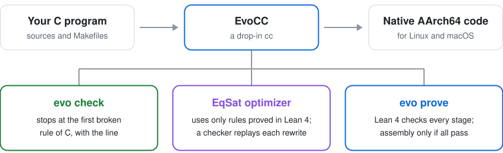
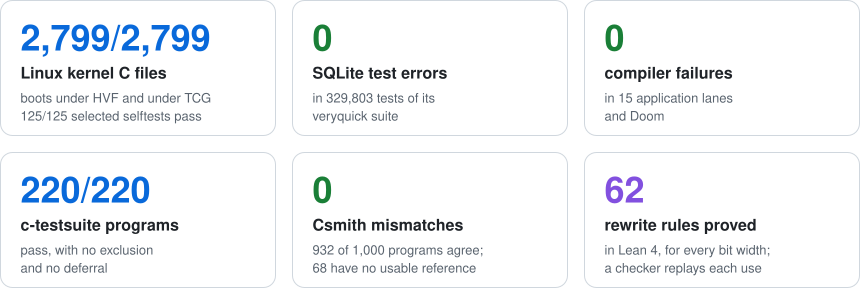
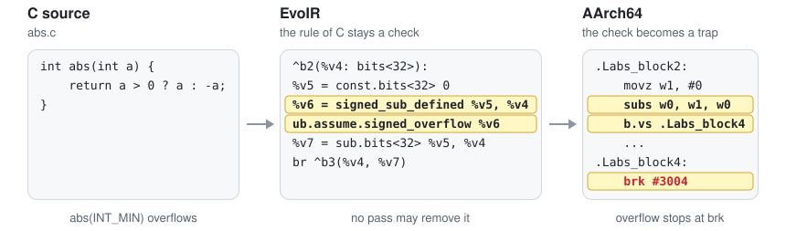
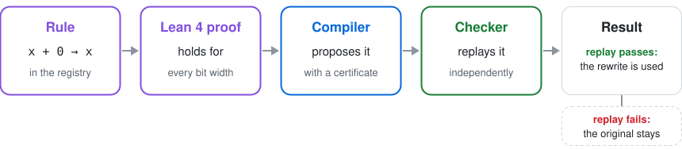

<p align="center">
  
</p>

<h1 align="center">EvoCC</h1>

<p align="center">
  <b>A C compiler that shows its work.</b><br>
  Built by agents. Built for agents.
</p>

<p align="center">
  <a href="https://github.com/onehr/evocc/releases"></a>
  <a href="LICENSE"></a>
</p>

EvoCC is a practical C compiler for AArch64 Linux and macOS, written from scratch in Rust, that
can show why its output is right. Use it in place of `cc`. It also does three things that a
compiler usually leaves to other tools: it finds undefined behavior on the path that your program
runs, its EqSat optimizer rewrites only with rules that Lean 4 proves, and it can check a whole
compilation down to the assembly text.

<p align="center">
  <picture>
    <source media="(prefers-color-scheme: dark)" srcset="docs/images/readme/highlights-dark.svg">
    
  </picture>
</p>

## Why EvoCC

<p align="center">
  <picture>
    <source media="(prefers-color-scheme: dark)" srcset="docs/images/readme/overview-dark.svg">
    
  </picture>
</p>

- **The rules of C stay explicit.** EvoIR turns the undefined-behavior rules of C into checks.
  An optimization can remove work, never a check. So `evo check` finds bugs that sanitizers miss,
  and the checked `abs(INT_MIN)` traps. ([How it works](#how-it-works))
- **Optimization with proved rules.** The EqSat optimizer (`-Oeq-scalar`) uses only rewrite
  rules that Lean 4 proves for every bit width. An independent checker replays each rewrite before EvoCC writes
  output. ([Checked optimization](book/src/optimization.md))
- **Compilation with proof.** For the `core-v1` subset, `evo prove` has Lean 4 check every stage,
  from typed Core source to the final assembly text. It writes assembly only if all stages pass.
  ([Compiling with proof](book/src/proof.md))
- **Real scale, with records.** A Linux kernel built with `make CC=evocc` boots. Doom and 15
  application lanes, SQLite among them, run with no compiler failure. Each number has a receipt.
  ([Proven on real code](#proven-on-real-code))
- **Made for agents.** Stable diagnostic codes, JSON output, safe repairs and an MCP server. In a
  registered experiment on bugs that GCC and UBSan miss, a coding agent needed about a third
  fewer steps with EvoCC.
  ([Agent experiment](book/src/evaluation-agents.md#experiment-5-repair-effort-and-program-size))

## Proven on real code

<p align="center">
  <picture>
    <source media="(prefers-color-scheme: dark)" srcset="docs/images/readme/scoreboard-dark.svg">
    
  </picture>
</p>

The release compiler of commit `08bf09bd` measured these results on 2026-10-27. Records:
[Linux kernel](tests/contracts/kernel-direct-virt-receipt.json),
[SQLite test log](docs/images/showcase/captures.json),
[application lanes, Doom and c-testsuite](tests/contracts/bench-receipt.json),
[Csmith](tests/contracts/ladder-csmith-receipt.json) and
[Lean 4 rules](tests/contracts/lean-p0-receipt.json). The [status page](docs/status.md) and the
[evidence](docs/evidence.md) give each count with its limits.

## Quick start

### Install

On macOS with Apple silicon, download the archive and the checksum file, check the archive and
unpack it:

```sh
curl -LO https://github.com/onehr/evocc/releases/download/v0.1.0/evocc-0.1.0-aarch64-apple-darwin.tar.gz
curl -LO https://github.com/onehr/evocc/releases/download/v0.1.0/SHA256SUMS
grep evocc-0.1.0-aarch64-apple-darwin.tar.gz SHA256SUMS | shasum -a 256 -c -
tar xzf evocc-0.1.0-aarch64-apple-darwin.tar.gz
export PATH="$PWD/evocc-0.1.0-aarch64-apple-darwin/bin:$PATH"
```

On Linux (AArch64), use `aarch64-unknown-linux-gnu` in the file name and `sha256sum -c -`. The
`bin/` directory of each archive holds `evo` (the commands), `evocc` (the compiler),
`evocc-checker` (the certificate checker) and `evoir-sem` (the Lean checker).
[Installation](book/src/install.md) shows the source build and the macOS quarantine attribute.

The example programs below are in [`examples/`](examples/).

### Compile, as with `cc`

```console
$ evocc hello.c -o hello && ./hello
Hello, world!
$ make CC=evocc
```

### Find a famous bug

[`first_bad.c`](examples/first_bad.c) has the binary-search bug that broke Java's
`Arrays.binarySearch` in 2006:

```c
int mid = (lo + hi) / 2;
```

GCC 14 and Apple Clang compile it with `-O2 -Wall -Wextra` and give no warning. The GCC program
does not finish. The Clang program stops with a trap. `evo check` shows the cause:

```console
$ evo check first_bad.c
error[E3004]: signed-integer-overflow
  --> first_bad.c:9:19
   |
 9 |         int mid = (lo + hi) / 2;
   |                   ^^^^^^^^^ signed-integer-overflow
   |
   = note: this operation failed on the executed path
```

Change the line to `int mid = lo + (hi - lo) / 2;`, and the check passes.

### See what UBSan misses

In [`mean.c`](examples/mean.c), the declaration `struct stats s;` gives `count` and `total` no
value. GCC with `-Wall -Wextra -fsanitize=undefined` gives no warning and no report. The program
returns 0 at `-O0`. At `-O2`, it returns a wrong value that changes from run to run. The right
answer is 4.

```console
$ evo check mean.c
error[E3001]: read-of-uninitialized-object
  --> mean.c:7:9
   |
 7 |         s->count += 1;
   |         ^^^^^^^^^^^^^ read-of-uninitialized-object
   |
   = note: this operation failed on the executed path
$ evo explain E3001 | head -n 3
# E3001: read-of-uninitialized-object

The executed path reads object bytes that have not been initialized.
```

### Prove a compilation

```console
$ evo prove abs.c -o abs.s
checked from typed Core source to final assembly text: …/checked/record.json
```

Lean 4 checks each stage of this compilation, from typed Core source to assembly text. If a check
fails, `evo prove` writes no output. `abs(INT_MIN)` has no valid result in C, so the checked
assembly traps instead of returning a wrong value:

```asm
    subs w0, w1, w0
    b.vs .Labs_block4
    ...
.Labs_block4:
    brk #3004
```

`subs` computes `0 - a` and sets the overflow flag. On overflow, `b.vs` jumps to the trap.

### Give it to your agent

```console
$ claude mcp add evo -- evo mcp
```

The `evo` commands also write JSON with `--json`. [Agents](book/src/agents.md) shows the setup for
Claude Code and Codex.

## What it compiles correctly

EvoCC compiled each program below. Each caption names the check, and each results link opens its
record.

<table>
  <tr>
    <td width="33%" align="center" valign="top"><a href="docs/images/showcase/doom.png"></a><br><b>Doom / Freedoom</b><br>Headless replay<br><a href="tests/contracts/ladder-doom-receipt.json">results</a></td>
    <td width="33%" align="center" valign="top"><a href="docs/images/showcase/tinycc.svg"></a><br><b>TinyCC paints reflections</b><br>Compiles a ray tracer<br><a href="tests/contracts/ladder-tinycc-receipt.json">results</a></td>
    <td width="33%" align="center" valign="top"><a href="docs/images/showcase/lua.svg"></a><br><b>Lua explores a fractal</b><br>Floating-point pixels<br><a href="tests/contracts/ladder-lua-receipt.json">results</a></td>
  </tr>
  <tr>
    <td width="33%" align="center" valign="top"><a href="docs/images/showcase/sqlite.svg"></a><br><b>SQLite</b><br>0 errors in 329,803 tests<br><a href="tests/contracts/ladder-sqlite-receipt.json">results</a></td>
    <td width="33%" align="center" valign="top"><a href="docs/images/showcase/jq.svg"></a><br><b>jq</b><br>make check passes<br><a href="tests/contracts/ladder-jq-receipt.json">results</a></td>
    <td width="33%" align="center" valign="top"><a href="docs/images/showcase/cjson.svg"></a><br><b>cJSON</b><br>216 unit tests, 0 failures<br><a href="tests/contracts/ladder-cjson-receipt.json">results</a></td>
  </tr>
  <tr>
    <td width="33%" align="center" valign="top"><a href="docs/images/showcase/linux.svg"></a><br><b>Linux 6.18</b><br>make CC=evocc; boots on 4 CPUs<br><a href="tests/contracts/kernel-direct-virt-receipt.json">results</a></td>
    <td width="33%" align="center" valign="top"><a href="docs/images/showcase/toybox.svg"></a><br><b>Toybox</b><br>1,669 tests, same results as GCC<br><a href="tests/contracts/ladder-toybox-receipt.json">results</a></td>
    <td width="33%" align="center" valign="top"><a href="docs/images/showcase/mbedtls.svg"></a><br><b>Mbed TLS seals pixels</b><br>Encrypt, restore, reject<br><a href="tests/contracts/ladder-mbedtls-receipt.json">results</a></td>
  </tr>
  <tr>
    <td width="33%" align="center" valign="top"><a href="docs/images/showcase/zstd.svg"></a><br><b>Zstandard packs a fractal</b><br>Identical pixels<br><a href="tests/contracts/ladder-zstd-receipt.json">results</a></td>
    <td width="33%" align="center" valign="top"><a href="docs/images/showcase/zlib.svg"></a><br><b>zlib ships a tiny arcade</b><br>Sprites restored intact<br><a href="tests/contracts/ladder-zlib-receipt.json">results</a></td>
    <td width="33%" align="center" valign="top"><a href="docs/images/showcase/polybench.svg"></a><br><b>PolyBench models a field</b><br>FDTD-2D simulation<br><a href="tests/contracts/ladder-polybench-receipt.json">results</a></td>
  </tr>
  <tr>
    <td width="33%" align="center" valign="top"><a href="docs/images/showcase/opentyrian.png"></a><br><b>OpenTyrian</b><br>Three frames match GCC<br><a href="docs/images/showcase/README.md#three-native-c-games">results</a></td>
    <td width="33%" align="center" valign="top"><a href="docs/images/showcase/neverball.png"></a><br><b>Neverball</b><br>One disclosed source fix<br><a href="docs/images/showcase/README.md#three-native-c-games">results</a></td>
    <td width="33%" align="center" valign="top"><a href="docs/images/showcase/quakespasm.png"></a><br><b>Quakespasm / LibreQuake</b><br>3D demo replay<br><a href="docs/images/showcase/README.md#three-native-c-games">results</a></td>
  </tr>
</table>

Each image is real program output, a plot of it, or an excerpt of a recorded test log. See the
[capture notes and credits](docs/images/showcase/README.md) and the
[compatibility table](book/src/compatibility.md).

## How it works

<p align="center">
  <picture>
    <source media="(prefers-color-scheme: dark)" srcset="docs/images/readme/pipeline-dark.svg">
    
  </picture>
</p>

- **C-HIR** keeps the meaning of C: types, evaluation order, which bytes are initialized and what
  each pointer may point to. `evo check` runs at this level.
- **EvoIR** turns the undefined-behavior rules of C into explicit checks. An optimization can
  remove work, but never a check.
- **EvoMIR** treats the machine as data. Registers, calling conventions and instruction encodings
  are tables in [`targets/aarch64/`](targets/aarch64/).
- **Lean 4** proves the 62 rewrite rules of the optimizer. For `core-v1` on AArch64 Linux, five
  Lean checkers compare the input and output of each stage, and one theorem covers that chain.

Here is one rule of C on its way through the compiler. The release compiler made this EvoIR and
this assembly from [`abs.c`](examples/abs.c):

<p align="center">
  <picture>
    <source media="(prefers-color-scheme: dark)" srcset="docs/images/readme/explicit-check-dark.svg">
    
  </picture>
</p>

AI agents wrote EvoCC in under three months, under the direction of one engineer.
[The paper](docs/paper.md) tells that story and describes the design and the evaluation.

## Where EvoCC fits

Sanitizers instrument one optimized build. They report a bug when that build reaches it and
their instrumentation covers it. Verified compilers such as CompCert prove their compilation
passes correct once, for every program in the C subset that they accept. EvoCC sits between the
two. It compiles large real programs and keeps the rules of C explicit in every stage.
`evo check` checks the path that a program runs. Lean 4 proves the rewrite rules of its EqSat
optimizer and, for a smaller subset, checks whole compilations.

## Add a proved optimization

In EqSat mode, a new optimization is an equality, not a new pass. Lean 4 proves the rule once, for every
bit width. The compiler then proposes each use of the rule with a certificate, and an independent
checker replays it before the rewrite reaches the output.

<p align="center">
  <picture>
    <source media="(prefers-color-scheme: dark)" srcset="docs/images/readme/proved-rewrite-dark.svg">
    
  </picture>
</p>

[Your First Proved Optimization](book/src/first-optimization.md) follows the rule `x + 0 → x`
through the registry, its Lean proof, the compiler and the checker, and runs it on a real program.

## Scope of 0.1.0

EvoCC 0.1.0 is experimental.

- It targets AArch64 only, on Linux and macOS. Its code is 1.8 to 2.3 times the size of GCC `-O2`
  output on five library files, and it is not tuned for speed ([evaluation](book/src/evaluate.md)).
- `evo check` runs programs that do not call the C library
  ([undefined behavior](book/src/undefined-behavior.md)).
- Proofs cover `core-v1`: integer functions without pointers, arrays or recursion, from typed Core
  source to assembly text. Parsing, assembly, linking and other C programs are not proved
  ([verification contract](spec/verification.md)).
- GNU C support is broad but not complete, and full kernel test acceptance is open. The changelog
  lists each [known limit](CHANGELOG.md#known-limits).

## Learn more

- [The EvoCC Book](book/src/SUMMARY.md): installation, a first program, undefined behavior, proofs
  and agents.
- [The paper](docs/paper.md): how agents built EvoCC, its design and its evaluation.
- [Specifications](spec/README.md): EvoIR, EvoMIR, the target tables and the verification contract.

## Contributing

Read [CONTRIBUTING.md](CONTRIBUTING.md). To report wrong code, follow [SECURITY.md](SECURITY.md).

## License

Apache License 2.0. Copyright 2026 Haoran Wang, NexRidge. See [LICENSE](LICENSE), [NOTICE](NOTICE)
and [THIRD-PARTY-NOTICES.md](THIRD-PARTY-NOTICES.md).
