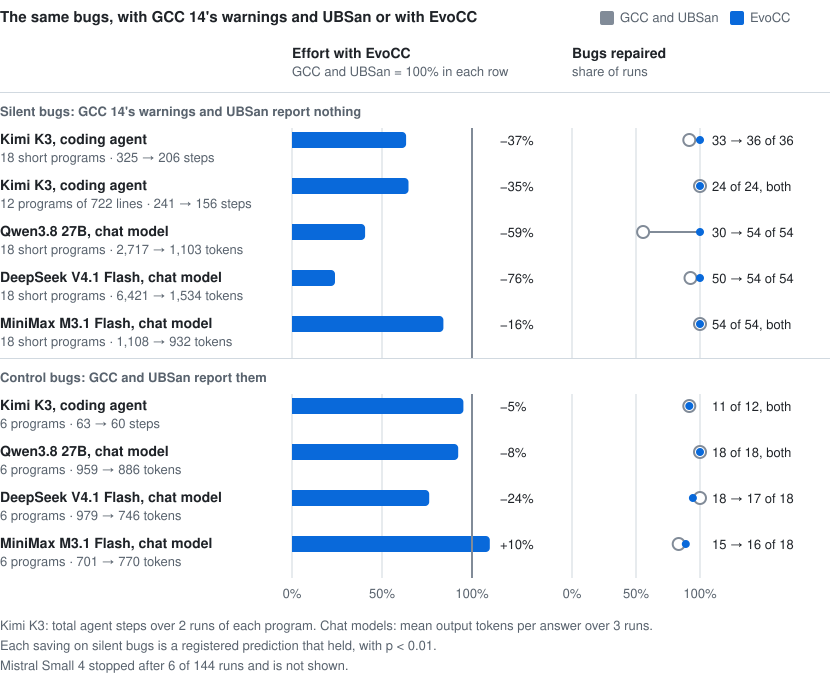

# Propose, Then Check: Building a C Compiler with Coding Agents

Haoran Wang · NexRidge

## Abstract

Coding agents can write a large program in weeks, but an agent's report about its work is not
evidence. We built EvoCC, a C compiler for AArch64 Linux and macOS, in 79 days: coding agents wrote
351,524 lines of Rust and 68,830 lines of Lean 4 under the direction of one engineer. In both the
compiler and its construction, an untrusted component proposes, and a smaller checker, fixed in
advance, decides. Tests written first, sealed GCC and Clang oracles and fail-closed gates decide
which agent changes land. A separate checker replays each optimization certificate against 62 rules
that Lean proves for every bit width. For a subset of integer C, five Lean checkers and one theorem
cover each compilation from typed source to assembly text. The IRs keep each undefined-behavior
rule of C as an obligation. The release compiler compiles all 2,799 target C files of a Linux 6.18
kernel that boots, and 10 of 15 application test lanes pass. Its code is 1.8 to 2.3 times the size of GCC `-O2` code, and the proved rewrites save
0.03% of it. With EvoCC's diagnostics, a coding agent repaired bugs that GCC's warnings and UBSan
miss in 37% fewer steps (p < 0.001). We report the agents' failures and the checks that caught them.

## 1 Introduction

Every program trusts its compiler. A miscompilation turns a correct program into a wrong one, and
usually nothing reports it. Random testing finds such bugs in GCC and LLVM [1, 2] but
cannot show that none remain. CompCert removes the compiler from the trusted base with a
machine-checked proof [3], after years of expert work and for a restricted language.

Coding agents reduce the cost of writing code, not the cost of trusting it. In this project, the
agents' records were plausible and wrong more than once. A preprocessor gate reported 33 of 33
fixtures passing after the failing fixture had left its corpus (commit `b765c241`). A receipt called
1,280 certificate replays independent, but the replays used rules that the certificates supplied
(`957afe6b`). An audit of the specifications against the code of a frozen release candidate found
seven defects that gave silent wrong code or broke a fail-closed rule, and no existing test
exercised them (`2e426061`).

We argue that a compiler that coding agents write can be built and evaluated if no claim rests on
an agent's report. Each agent product is a proposal that a check accepts or refuses, and the check
is smaller than the product, fixed before the change and closed on failure. The same split works
inside the compiler, where an untrusted optimizer and untrusted stages propose and small checkers
decide. It also gives users evidence: EvoCC keeps each undefined-behavior (UB) rule of C as an
explicit obligation, so an executed check names the operation that breaks a rule.

EvoCC has its own preprocessor, parser, three intermediate representations (IRs),
equality-saturation (EqSat) optimizer, register allocator and AArch64 assembly emitter; it uses the
platform assembler and linker. We claim five contributions, and a later section supports each.

1. An IR that represents each UB rule of C as data: a predicate and an obligation that no
   transformation may delete or use (§3).
2. A checked EqSat optimizer whose rules Lean proves for every bit width and whose certificates a
   separate, pinned checker replays before output exists (§4).
3. A proof-required path for the subset `core-v1`: five Lean checkers and one refinement theorem
   from typed source to final assembly text, with an explicit trusted base (§5).
4. An interface for coding agents, and eight experiments on whether its evidence changes how agents
   repair C; two found registered effects (§6, §7.5).
5. An account of how one engineer and coding agents built the compiler: the method, eleven failures
   and the check that caught each one (§8).

## 2 Propose, then check

A proposer produces a result and, optionally, hints such as a certificate, loop cut points or a
register map. A checker reads the input, the result and the hints, and accepts or refuses. Every
checker in EvoCC follows three rules. It is smaller than the proposer, and Lean proves it or a
reviewer can read all of it. It takes its rules, test lists and expected results from its own side,
never from the proposal. It fails closed: a missing checker, a wrong digest, a timeout or an
unreadable input refuses the result, and a refusal never yields a weaker result under the same
label. A hint can help a correct result pass, but it cannot make a wrong result pass, because the
checker checks the hint too.

| Level | Proposer | Checker | Fixed before the proposal | On failure |
|---|---|---|---|---|
| Building the compiler | coding agents | a test written first; sealed GCC 14.2 and Clang 19.1; gates | the test and its denominator | the change does not land |
| Optimizing | the EqSat search | `evocc-checker` | the rule registry; the checker digest | no output |
| Compiling with proof | each compiler stage | five Lean checkers | the checker digest; the theorem | no output (exit 3 to 6) |
| Checking a program | a user or an agent | `evo check` | the diagnostic codes | the code and line are reported |

*Table 1. The propose-and-check split at four levels.*

The split moves trust to the small part, and it moves cost: each checker must be written, and a
checker can refuse a correct result (§7.4, §8).

## 3 Making C's rules explicit

Production compilers keep most UB rules implicit. In LLVM, an `nsw` flag states that an addition
does not overflow, and a pass that drops the flag drops the fact; Lee et al. showed that the
semantics of `undef` and `poison` made textbook optimizations unsound [4]. EvoCC keeps each
rule as an object of its three IRs: C-HIR, EvoIR, and the machine IR EvoMIR.

### 3.1 C-HIR keeps the meaning of C

The parser produces C-HIR, a typed tree with C's types, qualifiers, lvalues, evaluation order and
source spans; lowering turns it into EvoIR, an optional EqSat pass rewrites EvoIR, and the backend
lowers it to EvoMIR and prints AArch64 assembly. C-HIR has its own interpreter, which `evo run`
uses, and it shares a memory model with the EvoIR interpreter. In that model, each object has a lifetime and an
initializedness state for each bit, and each pointer carries a provenance: an object, a function or
null, as in the provenance models of Memarian et al. [5]. Provenance travels out of band,
also through memory. Each access checks provenance, lifetime, bounds, alignment and initializedness,
and each failure has its own code, for example E3001 for an uninitialized read and E3010 for a
dangling pointer.

### 3.2 EvoIR makes undefined behavior data

EvoIR is block-argument SSA over bit vectors, `bits<N>`, which have no sign. Memory and the outside
world travel as explicit tokens, `mem<all>` and `world`. Lowering turns each scalar UB rule into a
total predicate and an obligation. For the negation in `int abs(int a) { return a > 0 ? a : -a; }`,
the release compiler emits:

```text
%v5 = const.bits<32> 0
%v6 = signed_sub_defined %v5, %v4
ub.assume.signed_overflow %v6
%v7 = sub.bits<32> %v5, %v4
```

`signed_sub_defined` computes whether `0 - a` is representable. `ub.assume.signed_overflow` states
that it must be and selects the diagnostic E3004 if it is not. `sub.bits<32>` is a plain bit-vector
subtraction. An uninitialized local is a poison value that a block argument can copy but an
operation cannot consume without E3001. Memory rules are guards instead: `access_in_bounds` and
`pointer_valid` inspect a named memory snapshot and return a new token.

Two rules govern every transformation ([spec/evoir.md](../spec/evoir.md), §6.4 and §8.5). No
transformation reads a fact from `ub.assume`, so EvoCC never optimizes under the assumption that UB
is absent. An optimization can remove work but not an obligation (§4.2). The backend lowers each
`ub.assume` to a branch to a trap whose immediate is the diagnostic number, for example `brk #3004`;
`--ub-checks=unchecked` omits these branches. The memory guards lower to nothing, so only the
interpreters check them. `-fwrapv` removes the obligations of signed addition, subtraction and
multiplication, and no other check.

### 3.3 `evo check` executes the obligations

`evo check` runs `evocc --check`, which lowers the program to EvoIR, runs `main` in the EvoIR
interpreter, stops at the first obligation or guard that fails, and reports the C span that lowering
recorded for that instruction.
In `examples/mean.c`, the declaration `struct stats s;` gives `count` and `total` no value before
this function reads them:

```c
static void add(struct stats *s, int x) {
    if (x > 0) {
        s->count += 1;
        s->total += x;
    }
}
```

On 2026-10-27, GCC 14 with `-Wall -Wextra -fsanitize=undefined` compiled the program with no
warning, and the run gave no report. It returned 0 at `-O0`, and 34, 226, 188, 87 and 178 in five
runs at `-O2`; the correct result is 4 ([evidence](evidence.md#readme-examples-and-reproduction-rows)).
`evo check` reports E3001, `read-of-uninitialized-object`, at `mean.c:7:9`.

### 3.4 EvoMIR and the executable references

EvoMIR has register classes and views, the calling convention, call clobbers, spill slots and
flags. Its machine facts are versioned tables in `targets/aarch64/`, from which
`tools/generate-target.py` generates the backend tables. The C-HIR and EvoIR interpreters are
separate implementations; the differential tests require that they agree with each other and with
GCC 14.2 and Clang 19.1 in a sealed image with no network. Each lowering step thus has an executable
reference before any proof exists.

## 4 Checked equality saturation

Equality saturation keeps equal versions of a program in an e-graph and selects one at the end
[6, 7]. Its output depends on many rewrites in an order that nobody wrote down, so
EvoCC trusts none of the search.

### 4.1 Regions, rules and proofs

`-Oeq-scalar` admits pure scalar regions into the e-graph: constants, integer arithmetic, bitwise
operations, comparisons and width changes. Memory operations, calls and obligations stay outside,
byte for byte. The driver admits at most 100,000 nodes, 1,024 epochs and 8 transactions, and a
failed transaction rolls back the e-graph and the module. The rules are registries in
[spec/evoir.md](../spec/evoir.md) (§11.6): 55 scalar rules in `p0.scalar.v4`, and 7 guard rules in
`g0.ub.v1`, which replace a UB predicate with the constant 1 only when the known bits of its
operands prove it. A generator turns the registry text into Lean data. For each rule, a theorem
`RuleCovered` states that both sides have the same value for every bit width when the side
condition holds:

```text
p0_003_mul_one_rhs mul(?x,const_like(?x,1)) => ?x when true
```

The Lean audit classifies all 62 rule theorems as kernel-only: they use no native code and no axiom
beyond `propext`, `Classical.choice` and `Quot.sound` ([receipt](../tests/contracts/lean-p0-receipt.json)).

### 4.2 Certificates and a separate replay

Each transaction writes an `evp2` certificate: the registry and its digest, the region, the seeds,
the e-graph nodes, each rewrite with its rule and bindings, and the extraction. For
`int f(int x) { return x * 1; }`, the certificate records `p0_003_mul_one_rhs` with `?x` bound to
`%v0`:

```text
; before                                   ; after
%v2 = signed_mul_defined %v0, %v1          %v2 = signed_mul_defined %v0, %v1
ub.assume.signed_overflow %v2              ub.assume.signed_overflow %v2
%v3 = mul.bits<32> %v0, %v1                ret %v0
ret %v3
```

The multiply is gone and the obligation remains, so the native code still checks the overflow
([book, chapter 6](../book/src/optimization.md)). The checker, `evocc-checker`, is a separate
program whose crate depends on neither the e-graph nor the optimizer. It reads the rules from its own
copy of the registry, replays each region, rebuilds the program after the step and compares it with
the optimizer's program, refusing any difference outside the replaced roots, a deleted obligation
included. The driver runs it on every transaction before it writes output; `-Oeq-scalar` refuses to
run without `--eq-checker-sha256`, and a failed replay fails the compilation.

### 4.3 The Lean replay

In proof-required mode (§5), `Rewrite.checkRewrite` replays each step again in Lean, and
`checkRewrite_refines` states that an accepted step refines; the pipeline theorem rests on this check
alone. The Lean checker accepts fewer forms than `evocc-checker`. It refuses an extraction of the
root to a seed, an extraction with more than one new instruction, and known-bits facts through
addition, subtraction, multiplication and comparisons, whose proofs use the SAT-based `bv_decide`
tactic and trust native code. The `x * 1` step extracts its root to the seed `%v0`, so its
proof-required compilation exits with status 3.

## 5 Compiling with proof

CompCert proves each pass correct once, for every input [3]. EvoCC proves small checkers
correct and runs them on each compilation that asks for proof: translation validation
[8, 9] with proved validators [10]. The compiler's algorithms need no proof
and can change; in exchange, a checker can refuse a correct compilation.

### 5.1 The subset `core-v1`

The proof input is typed Core C-HIR that the front end exports, not C text. `core-v1` has `int`,
`long` and `long long` and their unsigned forms; arithmetic, bitwise, comparison, conversion,
conditional and short-circuit expressions without signed left shift; `if`, `while`, `do`, `for`,
`break`, `continue` and `return`, with no bound on loops; non-escaping scalar locals; and direct
calls to defined, prototyped, nonvariadic, non-recursive functions. Floating point, `char`,
pointers, arrays, aggregates, static objects, `switch`, `goto`, indirect and external calls, inline
assembly and volatile or atomic accesses are outside it. The target is `aarch64-unknown-linux-gnu`
at `-O0 -fno-builtin`, with `-Oeq-scalar` as the one optional optimization
([spec/verification.md](../spec/verification.md), §2).

### 5.2 Five stage checkers

The driver exports the input and output of each stage to files, and for each selected entry it runs
the compiled Lean checker `evoir-sem` on each stage and then on the whole chain.

| Stage | What the checker compares | Checker | Theorem |
|---|---|---|---|
| `source-to-evoir` | typed source and EvoIR: values, order, conversions, diagnostics, loops, calls | `checkSourceTargetPair` | `check_source_target_refines` |
| `rewrite` | EvoIR before and after one EqSat step, with its certificate | `checkRewrite` | `checkRewrite_refines` |
| `lowering` | EvoIR, SSA EvoMIR and post-SSA EvoMIR | `checkLowering` | `source_machine_refines` |
| `allocation` | post-SSA and allocated EvoMIR, registers and spill slots | `checkAllocation` | `checkAllocation_sound` |
| `frame-emission` | allocated EvoMIR and assembly AST; printed AST and assembly text, byte for byte | `checkAsm`, `printMatches` | `checkAsm_sound` |

*Table 2. The stage checkers.*

Each checker checks its untrusted hints. `source-to-evoir` proves relations at loop cut points from
a proposal file, so it does not unroll loops. `lowering` compares canonical forms of source and
machine terms, and if they differ, a second proved pass lifts unsigned width changes out of bitwise
operators. `allocation` walks each block before and after allocation in lockstep from one abstract
state per block entry, tracking registers and spill slots as CompCert's validator does [11].
`frame-emission` checks frame areas, callee-saved save slots, operand widths and stack bounds.

### 5.3 The theorem

`Pipeline.checkPipeline` runs the five checks and four link checks on one compilation. Its theorem,
`checkPipeline_sound`, says: if the check accepts, the printed assembly AST is the published text;
and for the selected entry, every argument list of its parameter types and every AArch64 entry
state that obeys the ABI assumption, the source has an initial state, and the assembly refines the
source from these two states ([spec/verification.md](../spec/verification.md), §3.3 and §5):

```lean
structure Refines (sourceStep : S → Option S) (targetStep : T → Option T)
    (sourceObserve : S → Option O) (targetObserve : T → Option O)
    (sourceEntry : S) (targetEntry : T) : Prop where
  terminal : ∀ t, Reaches targetStep targetEntry t → targetStep t = none →
    ∃ s o, Reaches sourceStep sourceEntry s ∧ sourceStep s = none ∧
      sourceObserve s = some o ∧ targetObserve t = some o
  divergence : Infinite targetStep targetEntry → Infinite sourceStep sourceEntry
  progress : ∀ t, Reaches targetStep targetEntry t →
    (∃ next, targetStep t = some next) ∨ ∃ o, targetObserve t = some o
```

Each halted assembly state has the observation of a halted source state: the same returned bits, or
the same diagnostic among E3002 to E3005. If the assembly runs forever, so does the source, and no
reachable assembly state is stuck. The semantics use no fuel. The ABI assumption requires the AArch64
calling convention for the low bits of each argument and enough stack; the upper bits of argument
registers are arbitrary. The Lean kernel checks the theorem once, and a compilation runs only the
compiled checker. The theorem depends on `propext`, `Classical.choice` and `Quot.sound` alone, and a
`#guard_msgs` test fails the build if another axiom appears.

### 5.4 Publication fails closed

Adjacent stages must read the same bytes: the driver compares the SHA-256 digests of the files that
adjacent readers read, and the published `output.s` must hold exactly the bytes that
`frame-emission` read. The driver writes `output.s` and a record of stages, digests and trusted base
only if every check accepts. A rejection exits with 3, a missing or changed input with 4, a checker
failure with 5, and a construct outside `core-v1` with 6, and none of them falls back to ordinary
compilation. For `abs`, the checked assembly traps on `abs(INT_MIN)`, which has no valid result in C:

```asm
    subs w0, w1, w0
    b.vs .Labs_block4
    ...
.Labs_block4:
    brk #3004
```

`subs` computes `0 - a` and sets the overflow flag, and `b.vs` branches to the trap.

### 5.5 The trusted base

Each checked compilation records what it still trusts ([spec/verification.md](../spec/verification.md),
§8): preprocessing, parsing and the export of the typed source; the Lean kernel, and the compiled
checker with the Lean compiler, its runtime and the host toolchain; the readers of the exported
files and the printer of the assembly AST; the Lean semantics of typed Core C and of the AArch64
subset; the ABI assumption; and the assembler, the linker, the runtime libraries and the hardware.
The Rust compiler, the snapshots, the hints and the semantics of EvoIR and EvoMIR are not trusted.

## 6 An interface for agents

A coding agent repairs C in a loop of build, run, read and edit, and it can act only on what its
tools report. `evo` has one subcommand for each step: `run`, `check`, `explain`, `fix`, `prove` and
`build`. Each has one exit-status rule; `evo check` exits with 0 when the checked path completes,
also when `main` returns nonzero, and with 1 for a finding or a refusal. With `--json`, each writes
one JSON object per line.

Each diagnostic has a stable code from the authority table of [spec/evoir.md](../spec/evoir.md)
(§6.3), and `evo explain CODE` prints one of 157 explanation pages. A test requires one page per
code, compares each page with the output of `--explain`, and runs its examples: the triggering
example must report the code, and the fixed example nothing (`crates/evocc/tests/explain_pages.rs`).
`evo fix --plan` lists repairs and edits nothing; `--apply` applies only repairs that cannot change
observable behavior, checks the syntax again, and restores the input if that check fails. A test
runs `run`, `check`, `explain`, `fix --plan` and `prove` twice on fixed inputs and requires
byte-identical JSON apart from temporary paths (`crates/evocc/tests/determinism.rs`). `evo mcp`
serves `run`, `check`, `explain`, `prove` and `fix_plan` over the Model Context Protocol, with no
tool that edits a file. Since 2026-10-09, a clean check ends with "This does not check that the
results are correct." (commit `000d58f0`).

## 7 Evaluation

The release campaign ran on 2026-10-27 with one build of the compiler of commit `08bf09bd` (SHA-256
`ab0c9043…` on macOS, `3520c267…` for Linux); other results give their own date and commit.
Release 0.1.0 (`37d214da`) has the same compiler source. The current code (`5ec1cb7f`) produces
AArch64 objects byte-identical to those of the 0.1.0 compiler on a 792-object identity population;
we did not repeat the campaign at that commit. The Linux lanes run in a sealed AArch64 container on
an Apple silicon Mac, and the kernels boot in QEMU.

### 7.1 RQ1: Does EvoCC compile and run real C software?

`make CC=evocc` compiled all 2,799 target C files of a retained ARM64 virtconfig configuration of
Linux 6.18.44 in one run in a fresh output tree; no target C object came from GCC. GNU tools
assembled, linked and built host programs, and six kernel options had no effect.

| Scope | Date, compiler | Result |
|---|---|---|
| Direct Kbuild | 2026-10-27, `08bf09bd` | 2,799 of 2,799 target C files; boots under HVF with pointer authentication and under TCG; 9 paired selftest programs pass 125 of 125 subtests on the EvoCC and the GCC kernel |
| Original KVM selftests | 2026-10-27, `08bf09bd` | GCC kernel: 10 of 10 modes of two programs; EvoCC kernel: each reaches its 120-second limit after 6 modes |
| BPF and modules | 2026-09-28, digest `ab2eeb7b…` | 7,008 of 7,008 target C files and 848 modules; boots and powers off |
| Built-in KUnit | 2026-09-22 | of 1,504 cases, EvoCC 1,432 pass, 12 fail, 60 skip; GCC 1,438, 7, 59; 31 modules pass 765 of 765 cases on both |
| Installed kselftest | 2026-09-22 | of 970 programs, EvoCC 529 pass, GCC 532; incomplete |

*Table 3. Linux results. Sources: [direct Kbuild](../tests/contracts/kernel-direct-virt-receipt.json),
[BPF and modules](../tests/contracts/kernel-bpf-full-receipt.json),
[KUnit](../tests/contracts/kernel-expanded-kunit-receipt.json),
[kselftest ledger](archive/notebook/kernel-selftest-gaps-20260914.md).*

Each application lane builds a pinned release with EvoCC and runs the program's own tests,
unchanged. `PASS` holds for the recorded build and test selection; `PROFILE_CLEAN` means no compiler
failure after evidenced exclusions; `INCOMPLETE` means that part of the lane did not finish or could
not be judged. The campaign changed no population, budget, timeout, flag or disposition rule.

| Lane | Status | Result |
|---|---|---|
| c-testsuite | PASS | 220 of 220 programs |
| GCC torture | PROFILE_CLEAN | 1,543 of 1,692; 146 inapplicable, 3 unusable references |
| LLVM test-suite | PROFILE_CLEAN | 1,066 of 1,735; 665 inapplicable, 2 deferred, 2 unusable references |
| Csmith | INCOMPLETE | 932 of 1,000 agree; 68 unusable references; 0 mismatches |
| zlib, Zstandard, cJSON, TinyCC, Mbed TLS, jq, Lua, PolyBench/C | PASS | 19, 44, 23, 11, 382, 70 and 34 units and 30 kernels; their own tests pass |
| SQLite | PASS | 86 units; Tcl `veryquick`: 0 errors in 329,803 tests |
| Toybox; musl with libc-test | INCOMPLETE | 203 and 1,339 units; the test results of the GCC builds, with no added failure |
| Doom | PASS | 81 units; two demos, twice under each of EvoCC, GCC 14 and Clang 19: 12 runs of 350 frames with matching hashes |

*Table 4. Lanes, 2026-10-27, compiler `08bf09bd`. Sources: [benchmark receipt](../tests/contracts/bench-receipt.json)
and the `ladder-*-receipt.json` files in [`tests/contracts/`](../tests/contracts/).*

Ten of the fifteen application lanes pass, and none of the other five has a compiler failure. The
Doom lane builds with `-fwrapv` for all three compilers; §7.2 gives the reason.

### 7.2 RQ2: What supports output that carries no proof?

Ordinary compilations carry no proof, so their evidence is differential. Csmith [1] generated
1,000 programs in two campaigns without floating point, packed structures or volatile accesses, one
with bit-fields. EvoCC matched the agreeing GCC and Clang checksums for 932; for the other 68, a
reference run gave no checksum. No program gave a mismatch, a refusal or a trap
([receipt](../tests/contracts/ladder-csmith-receipt.json)). On 2026-10-01 (commit `7b385567`), the
Rust optimizer, checker and interpreter agreed with the Lean definitions on 1,487,689 of 1,487,689
compared vectors ([receipt](../tests/contracts/lean-correspondence-receipt.json)).

The obligations found UB in unchanged programs. The checked build of Doom stopped with E3004 before
its first frame: in `P_SpawnMapThing`, `ANG45 * (mthing->angle / 45)` multiplies signed values, and
6 × 536,870,912 exceeds `INT_MAX`; GCC's and Clang's UBSan report it too
([lane notes](../tests/fixtures/doom-headless.out)). Both EvoCC interpreters stop with E3004 in the
unchanged LLVM test `pr23135`, and its native code traps; GCC's UBSan reports the overflow, and
Clang's does not check vector multiplication ([record](../tests/fixtures/llvm-pr23135-definedness.out)).
The model also reports wrongly: two GCC torture programs report the misaligned access E3012 although
their native accesses are aligned, because the model judges alignment by the declared alignment of
the object, not by its address (open task D33).

### 7.3 RQ3: What does the proof-required path cover?

On 2026-10-06 (commit `8770b186`), proof-required mode checked 17 pilot modules, with every function
as an entry and a cut-point proposal for each loop entry. All 107 entries were checked to final
assembly text, and none was refused. They include the unchanged `abs` of musl and `FixedMul` of
doomgeneric; the others are fixtures for control flow, loops and calls. Two optimized cases passed,
with one guard fold and one scalar fold. At commit `e657709b`, the sweep passed again with
byte-identical output.

The native run tested the trusted end of the chain. The checked output ran on Linux AArch64 for
14,438 argument vectors, built once with GNU as and ld 2.44 and once with clang 19 and ld.lld 19.
14,194 runs agreed with the Lean source interpreter, and none disagreed. Each of the 178 vectors with
UB in the source trapped with the source's diagnostic, and 66 reached the interpreter's step limit.
Another 45,232 calls on 83 entries put nonzero values in the upper 32 bits of each 32-bit argument
register, and no result changed. The optimized cases agreed in 328 comparisons
([receipt](../tests/contracts/core-v1-native-run.json)).

### 7.4 RQ4: What do the checks cost?

| Unit | EvoCC checked | EvoCC unchecked | GCC 14 `-O2` | Ratio, checked | Checks | `-Oeq-scalar` |
|---|---:|---:|---:|---:|---:|---:|
| zlib `deflate.c` | 25,924 | 24,544 | 14,432 | 1.80 | 5.3% | −12 |
| zlib `inflate.c` | 20,080 | 19,252 | 9,940 | 2.02 | 4.1% | 0 |
| Zstandard `zstd_compress.c` | 109,944 | 107,204 | 48,760 | 2.25 | 2.5% | −56 |
| Zstandard `zstd_decompress.c` | 31,252 | 30,652 | 14,492 | 2.16 | 1.9% | 0 |
| cJSON `cJSON.c` | 26,484 | 26,292 | 14,400 | 1.84 | 0.7% | 0 |

*Table 5. Bytes of `.text`, 2026-10-27, compiler `08bf09bd`. "Checks" is the share of the checked
size that the UB traps take; the last column is the change of the checked size. Sources:
[default](../tests/contracts/application-size-default-20261027-receipt.json) and
[EqSat](../tests/contracts/application-size-eqsat-20261027-receipt.json) receipts.*

The checks are not the main cause of the gap: the unchecked code is still 1.70 to 2.20 times the
size of GCC's. A census of the same units on 2026-10-02 (commit `7680ae23`) found the largest excess
in frame code, constant materialization and memory access
([ledger](archive/notebook/codegen-census-20261002.md)). Unlike EvoCC (§3.2), GCC also optimizes
under the assumption that UB is absent.

The proved rewrites buy almost nothing. With `-Oeq-scalar`, the checked total of the five units and
a small fixture fell from 213,808 to 213,740 bytes, by 0.03%; with an earlier backend, on 2026-10-01
(commit `e625b89c`), the rewrites saved 0.8% to 2.4% on the units that changed
([measurements](evidence.md#checked-eqsat-measurements)). The median of three compile times grew 1.9
to 3.4 times, in wall-clock time on a shared host. On 2026-09-30, fixed proof templates proved 1,174
of 1,222 candidate rules, but no rule, policy or shortcut track met its admission criterion, so none
was installed ([ledger](archive/notebook/eqsat-r02-review-repair-20260930.md)).

The checked kernel executes more instructions. A fixed-work KVM workload that QEMU counted on the
release kernels executed 2.59 times the instructions of the GCC kernel, and 2.77 times in the kernel
itself. Runs of six or more consecutive frame accesses or moves made up 6.1% of EvoCC's instructions
and 2.0% of GCC's ([receipt](../tests/contracts/kernel-direct-virt-receipt.json)).

The Lean development of release 0.1.0 has 68,830 lines in 392 files (`git grep -c ''` at
`37d214da`): 29,854 for the source and EvoIR semantics and `source-to-evoir`, 19,841 for EvoMIR and
`lowering`, 6,277 for the AArch64 subset and `frame-emission`, 3,814 for `rewrite`, 3,431 for
`allocation`, 1,387 for the rule and known-bits proofs and 747 for the pipeline. The lowering checker matches output
forms construct by construct, while the allocation checker relates abstract states at block
entries; the two check different transformations, so the sizes are not a controlled comparison.

### 7.5 RQ5: Does EvoCC's evidence change how agents repair C?

Each registered experiment froze its corpus, prompt, conditions, predictions and analysis in a
commit before the first measured request. Condition C1 builds and runs the program with GCC 14
`-Wall -Wextra -fsanitize=undefined`; C3 builds and runs it with EvoCC and adds the JSON records of
`evo check`, `evo explain` and `evo fix --plan`. A repair counts only if the final source passes a
hidden test under GCC 14 at `-O0` and `-O2` and Clang 19 at `-O2`. The coding agent was Kimi K3 in
Kimi Code 2.0.2 at low reasoning effort. Experiments 5 and 8 use exact one-sided Wilcoxon
signed-rank tests over items.

| # | Date | Registration | Subjects | Result |
|---|---|---|---|---|
| 1 | 2026-10-08 | `7eed5eac` | a chat model; 30 programs | ceiling: C3 87 of 90, C1 88, Clang with UBSan 82 |
| 2 | 2026-10-08 | `0701fea5` | two chat models; 30 programs | inconclusive: stopped at 444 of 900 repetitions by a spending limit |
| 3 | 2026-10-09 | pilots | the coding agent | no comparison: the unconfined agent downloaded the upstream source |
| 4 | 2026-10-09 | `5b765db0` | the coding agent; 24 items | equal repairs; fewer steps only in an unregistered analysis |
| 5 | 2026-10-09 | `9672d2d9` | the coding agent; 36 items | 3 of 4 predictions held |
| 6, 7 | 2026-10-20 | pilots | — | pilots only |
| 8 | 2026-10-29 | `0b9cef89` | four chat models; 24 items | fewer tokens for 3 models, more repairs for 1 |

*Table 6. The agent experiments; [method, receipts and transcripts](../book/src/evaluation-agents.md).*

Experiments 4, 5 and 8 inject uninitialized reads, dangling pointers and out-of-bounds accesses into
code adapted from zlib, Zstandard and cJSON. Qualification kept a silent item only if C1 reports
nothing and EvoCC reports the code at the repair line, so EvoCC's detection holds by construction.
Other tools find some of them: AddressSanitizer reports the 12 out-of-bounds and dangling-pointer
items, and GCC `-O2 -Wall` the 6 uninitialized ones.

<p align="center">
  <picture>
    <source media="(prefers-color-scheme: dark)" srcset="images/readme/agent-results-dark.svg">
    
  </picture>
</p>

*Figure 1. Registered results of experiments 5 and 8, drawn by `tools/render-readme.py` from the
receipts.*

In experiment 5, C3 used 36.6% fewer steps than C1 on the 18 short silent items (p = 3.8 × 10⁻⁵),
39.7% fewer tokens (p = 5.3 × 10⁻⁵), and 35.3% fewer steps on 12 items of 722 lines
(p = 4.9 × 10⁻⁴). The fourth prediction, a larger relative saving on larger programs, did not hold.
Repairs were 47 of 48 against 44 of 48 on the short items and 24 of 24 for both on the long ones; on
the six controls, which UBSan reports, C3 used 60 steps and C1 63
([analysis](../tests/contracts/agent-repair-5-20261010.json)). In experiment 8, chat models answered
once per trial from the frozen records of experiment 4. With C3, DeepSeek V4.1 Flash, Qwen3.8 27B
and MiniMax M3.1 Flash used 76%, 59% and 16% fewer completion tokens on the silent items
(p ≤ 0.0052 each), and Qwen3.8 27B repaired 54 of 54 silent trials against 30 of 54 (p = 0.0039);
the other two repaired 50 or more of 54 with both records. Mistral Small 4 stopped after 6 of 144
trials on HTTP 429 responses ([analysis](../tests/contracts/agent-repair-8-20261029.json)).

Experiments 1 to 3 could not separate the conditions: a ceiling, the delivery of long answers
without a reasoning limit (275 of 444 repetitions ended in a response error), and an agent that
bypassed the feedback. Five failed repairs in experiment 5 removed the UB and changed the required
result; a clean check is not a correct repair.

## 8 How agents built EvoCC

### 8.1 Setup and timeline

One engineer, the author, set the goals, wrote or approved each brief, decided disputes and owned
merges and releases. Coding agents wrote the code, tests, Lean proofs, specifications, receipts and
briefs for other agents, often several at once, each in its own git worktree; the history has 67
merge commits. The first commit added no compiler code, only frozen lab contracts and a fail-closed
acceptance harness.

| Date | Commit (number) | Event |
|---|---|---|
| 2026-08-10 | `b6175a2a` (1) | frozen lab contracts and a fail-closed acceptance harness |
| 2026-09-09 | `8cff4de8` | Lean proofs of the 55 scalar rules and the known-bits table |
| 2026-09-13 | `eb1b9300` (1,380) | first complete boot of a kernel built by EvoCC, day 34 |
| 2026-10-04 to 06 | `63c1f5b8` to `e657709b` (1,951) | 99 commits add 66,742 lines of Lean for the `core-v1` checkers; the sweep of §7.3 |
| 2026-10-27 | `08bf09bd` (2,321) | the compiler of the release campaign |
| 2026-10-28 | `37d214da` (2,342) | release 0.1.0, day 79 |

*Table 7. Milestones from `git log`; the number counts the commits that a commit contains.*

At release 0.1.0, the repository had 351,524 lines of Rust outside `vendor/`: 192,885 in crate
sources, 154,433 in crate tests and 4,206 in examples and build scripts.

### 8.2 Method

Seven controls applied to every change. (1) Five documents in [`spec/`](../spec/README.md) define
EvoIR, EvoMIR, the target tables, the diagnostics and the verification contract; `spec/pins.json`
pins the revision and SHA-256 of each. (2) Authorities have ranks: frozen language and ABI
contracts, then reviewed fixtures, then agreement of the sealed GCC and Clang, and last a kernel
boot; a GCC–Clang disagreement on a defined program is a conflict, not a vote. (3) A change starts
with a test that fails for the right reason, in its own commit; 407 of the 2,301 non-merge commits
change only test files (a count over `git log --name-only` without receipts). (4) A gate that
cannot find its evidence fails, and a skip, a timeout or a missing result is never a pass. (5) Each
result is a receipt in `tests/contracts/` with the compiler digest, the inputs, the command and a
claim ceiling, and the generated status page fails a check when it and the receipts disagree. (6)
Each open task in `TODO.md` has a next action and an exit condition that names a test or a receipt.
(7) Since 2026-10-29, new Rust and Python files have at most 1,500 lines and new functions at most
150.

### 8.3 Failures and the checks that caught them

| # | Date, record | What went wrong | What caught it | What changed |
|---|---|---|---|---|
| 1 | 2026-08-12, `b765c241` | a gate commit removed failing fixture 024 and reported 33 of 33 | review, 77 minutes later (`6092ce21`) | the gate requires 34 cases and a separate token serializer |
| 2 | 2026-08-23, `957afe6b` | 1,280 replays called independent used the certificates' own rules | review of each call site's authority | a tested field names the authority; later a separate checker |
| 3 | 2026-09-01, `00adf559` | pointer roots of places admitted one form at a time | the kernel parse survey | one rule for all pointer-typed roots; clean parses of a 16-unit cohort rose from 3 to 9 |
| 4 | 2026-09-07, `b87a88b7` | Csmith runs trapped where GCC and Clang agreed: its runtime shifted 1 into the sign bit | EvoCC's own trap | one repaired runtime for all compilers |
| 5 | 2026-09-29, [ledger](archive/notebook/verified-eqsat-implementation-20260929.md) | two producer defects in the EqSat chain; a gate without the checker crate | rejected replays; review | regression tests; the gate covers the checker |
| 6 | 2026-10-04, `409b84e3` | the Rust allocation verifier ignored spill-slot contents | review before its port to Lean | the Lean checker tracks spill slots |
| 7 | 2026-10-08, experiment 2 | the harness took 914 HTTP 403 refusals for response errors | transcript analysis | the report applies the registered stop |
| 8 | 2026-10-09, experiment 3 | the agent fetched the upstream Zstandard source with `curl` | audit of the session commands | an OS sandbox |
| 9 | 2026-10-13, `2e426061` | 7 defects gave silent wrong code or broke a fail-closed rule, among them an `asm` clobber of `x19` that the prologue did not save | a read-only audit of the specifications against code, tests and probes, with 53 findings | all seven repaired by 2026-10-14 |
| 10 | 2026-10-27, `02d84269` | a clean Lean build timed out in `bv_decide`; a cached build hid it | a clean build | a 60-second solver limit |
| 11 | 2026-10-29, `d68dc9ea` | 29 files over 1,500 lines (the largest 21,062) and 192 functions over 150 lines | review of the structure | a size check; splits that kept the 792 identity objects |

*Table 8. Failures, the checks that caught them, and the repairs.*

### 8.4 What the failures show

In rows 1, 2 and 7, the work was right on what it measured and wrong about what it measured: the
denominator, the authority or the stop rule. A frozen denominator, and a field that code sets
instead of an adjective, closed these gaps. In rows 4 and 5, a checker that refused turned a defect
into a visible rejection instead of wrong code. In row 3, the front end admitted one more form after
each failure until one rule replaced the list. Row 9 shows that passing gates do not establish that a
specification holds, because the gates tested what the agents had chosen to test. Proof was the
cheap part: the `core-v1` checkers took three days of commits (Table 7), and the Lean kernel checks
every proof. The hard decisions were what to prove, which semantics to trust and which
optimizations to admit.

## 9 Limitations and threats to validity

The proof covers little of the compiler: the subset of §5.1, checked on 107 pilot functions that
are mostly written fixtures. The theorem starts at a typed source that the trusted front end exports
and ends at text that a trusted assembler and linker process. The semantics at both ends are written
by hand; tests compare them with compilers and hardware, but no proof relates them to the C standard
or to Arm's architecture specification. No pilot entry has a 32-bit parameter on the stack, so that
part of the ABI assumption has no native test. We have not measured the compile time of
`evo prove`.

The other results rest on tests. `evo check` covers the executed path only, does not check the
same-object rules of pointer subtraction and ordering, and cannot call arbitrary C library
functions; native code checks the scalar obligations only (§3.2). Agreement with GCC and Clang
cannot reveal a bug that all three share, and the Csmith campaigns exclude floating point and
volatile accesses. Complete kselftest and KUnit acceptance is open, and the complete runs of Table 3
predate the release compiler. EvoCC is larger and slower than GCC: we measured code size on six
translation units and executed instructions on one kernel workload, made no wall-clock run-time
measurement on a quiet machine, and make no speed claim.

The measurements come from several commits, and each states its own; the current code matches the
release compiler only on the 792-object identity population. All runs used one host, and the kernel
replay used QEMU 11.1.2 instead of the pinned 11.0.3. No hosted CI run has passed, because GitHub
refused the jobs for a billing reason, so every gate ran on the author's machine, and a clean hosted
runner fails seven tests that need untracked inputs or a newer SDK.

In the agent experiments, the bugs are injected into code from three libraries, and the 18 silent
items share six kernels, so the nominal p-values overstate the evidence. One coding-agent model at
one effort setting ran two repetitions; each chat model ran three at temperature 0 through one
provider. The experiments compare two fixed bundles of feedback and do not isolate which part
helped.

No person read every line. Agents also wrote the checkers, the tests and the trusted semantics, and
review found some of their defects late (rows 2 and 9 of Table 8); others can remain. With one
engineer and no control group, no result can be attributed to one control of §8.2. Commit dates
record when work was committed, not how long it took.

## 10 Related work

Verified compilers. CompCert proves in Coq that its passes preserve the semantics of Clight
[12] down to assembly [3], and some passes use verified validators, for example for
register allocation with spilling [11]. CakeML verifies an implementation of ML down to
machine code [13], and a validated parser extends the proved part of a C front end
[14]. EvoCC proves checkers, not passes. Its proved subset is far smaller than CompCert's and
its front end is trusted, but its unproved compiler builds GNU C at the scale of Linux, and its
algorithms change without a change to any proof.

Translation validation. Pnueli, Siegel and Singerman proposed to check each run of a translator
[8], and Necula validated GCC's optimizations with an unproved validator [9].
Tristan and Leroy proved validators in Coq [10]; EvoCC's checkers follow this pattern in
Lean and compose into one theorem. Sewell, Myreen and Klein validated GCC's binary for the seL4
kernel against its C semantics [15]. Alive proves LLVM peephole rewrites with an SMT solver
[16], and Alive2 validates LLVM optimizations with bounded loop unrolling [17]; EvoCC's
checked path uses no solver, proves its rules for every bit width and checks loops at cut points.

Undefined behavior and C semantics. Vellvm mechanizes the semantics of LLVM IR [18], and Lee et
al. repaired its `undef` and `poison` semantics [4]; EvoIR makes each scalar UB condition an
instruction and keeps poison only for uninitialized values. STACK finds code that a compiler may
delete because of UB [19]; no EvoCC transformation uses a UB assumption. KCC gives C an
executable semantics [20] that detects many kinds of undefinedness [21], and
Cerberus elaborates the de facto standards of C, pointer provenance included
[5, 22]. `evo check` is an executable semantics of this kind inside a compiler,
and we have not proved it equal to any of these models.

Sanitizers. AddressSanitizer [23], MemorySanitizer [24] and UBSan [25],
which grew from integer-overflow checks in Clang [26], instrument one build and report an
error when that build reaches it, at native speed and with libraries; EvoCC's checks follow the
rules of C instead of one build's behavior (§3.3).

Equality saturation and testing. Tate et al. introduced equality saturation [6], Stepp et al.
used it to validate LLVM translations [27], and egg made e-graphs fast [7]; EvoCC
adds a certificate per optimization, a separate replay and a Lean proof per rule. Csmith [1]
and equivalence modulo inputs [2] find wrong-code bugs with random and mutated programs.

Infrastructure and agents. Like LLVM [28], EvoCC separates the front end, a typed SSA IR
and the back end; its proofs use Lean 4 [29]. Carlini reports a C compiler of about 100,000
lines of Rust that 16 parallel agents wrote in two weeks; it builds a bootable Linux 6.9 for x86,
ARM and RISC-V, with GCC as a known-good oracle for the kernel [30]. EvoCC's claims rest
instead on certificates, proved checkers and receipts. Language-model repair feeds execution
results back to the model [31], and SWE-bench measures repairs of real issues [32]; our
experiments hold the bugs fixed and vary only the compiler feedback.

## 11 Conclusion

Coding agents built a C compiler that boots Linux in 79 days because each proposal had to pass a
check that was smaller than the proposal and fixed before it. The same structure made the compiler's
own claims checkable: undefined behavior becomes an obligation, an optimization a replayed
certificate, and a compilation in a small subset a proof. Next, we will extend `core-v1` to memory
and pointers, reduce the code size without giving up the checks, and run the gates on hosted
machines.

## References

1. X. Yang, Y. Chen, E. Eide and J. Regehr. Finding and understanding bugs in C compilers. In *PLDI 2011*, 2011.
2. V. Le, M. Afshari and Z. Su. Compiler validation via equivalence modulo inputs. In *PLDI 2014*, 2014.
3. X. Leroy. Formal verification of a realistic compiler. *Communications of the ACM* 52(7):107–115, 2009.
4. J. Lee, Y. Kim, Y. Song, C.-K. Hur, S. Das, D. Majnemer, J. Regehr and N. P. Lopes. Taming undefined behavior in LLVM. In *PLDI 2017*, 2017.
5. K. Memarian, V. B. F. Gomes, B. Davis, S. Kell, A. Richardson, R. N. M. Watson and P. Sewell. Exploring C semantics and pointer provenance. *Proc. ACM Program. Lang.* 3(POPL), article 67, 2019.
6. R. Tate, M. Stepp, Z. Tatlock and S. Lerner. Equality saturation: a new approach to optimization. In *POPL 2009*, 2009.
7. M. Willsey, C. Nandi, Y. R. Wang, O. Flatt, Z. Tatlock and P. Panchekha. egg: fast and extensible equality saturation. *Proc. ACM Program. Lang.* 5(POPL), 2021.
8. A. Pnueli, M. Siegel and E. Singerman. Translation validation. In *TACAS 1998*, LNCS 1384, pp. 151–166, 1998.
9. G. C. Necula. Translation validation for an optimizing compiler. In *PLDI 2000*, pp. 83–95, 2000.
10. J.-B. Tristan and X. Leroy. Formal verification of translation validators: a case study on instruction scheduling optimizations. In *POPL 2008*, pp. 17–27, 2008.
11. S. Rideau and X. Leroy. Validating register allocation and spilling. In *Compiler Construction (CC 2010)*, LNCS 6011, pp. 224–243, 2010.
12. S. Blazy and X. Leroy. Mechanized semantics for the Clight subset of the C language. *Journal of Automated Reasoning* 43(3):263–288, 2009.
13. R. Kumar, M. O. Myreen, M. Norrish and S. Owens. CakeML: a verified implementation of ML. In *POPL 2014*, pp. 179–191, 2014.
14. J.-H. Jourdan, F. Pottier and X. Leroy. Validating LR(1) parsers. In *ESOP 2012*, 2012.
15. T. Sewell, M. O. Myreen and G. Klein. Translation validation for a verified OS kernel. In *PLDI 2013*, pp. 471–482, 2013.
16. N. P. Lopes, D. Menendez, S. Nagarakatte and J. Regehr. Provably correct peephole optimizations with Alive. In *PLDI 2015*, 2015.
17. N. P. Lopes, J. Lee, C.-K. Hur, Z. Liu and J. Regehr. Alive2: bounded translation validation for LLVM. In *PLDI 2021*, pp. 65–79, 2021.
18. J. Zhao, S. Nagarakatte, M. M. K. Martin and S. Zdancewic. Formalizing the LLVM intermediate representation for verified program transformations. In *POPL 2012*, pp. 427–440, 2012.
19. X. Wang, N. Zeldovich, M. F. Kaashoek and A. Solar-Lezama. Towards optimization-safe systems: analyzing the impact of undefined behavior. In *SOSP 2013*, pp. 260–275, 2013.
20. C. Ellison and G. Roşu. An executable formal semantics of C with applications. In *POPL 2012*, pp. 533–544, 2012.
21. C. Hathhorn, C. Ellison and G. Roşu. Defining the undefinedness of C. In *PLDI 2015*, pp. 336–345, 2015.
22. K. Memarian, J. Matthiesen, J. Lingard, K. Nienhuis, D. Chisnall, R. N. M. Watson and P. Sewell. Into the depths of C: elaborating the de facto standards. In *PLDI 2016*, 2016.
23. K. Serebryany, D. Bruening, A. Potapenko and D. Vyukov. AddressSanitizer: a fast address sanity checker. In *USENIX ATC 2012*, pp. 309–318, 2012.
24. E. Stepanov and K. Serebryany. MemorySanitizer: fast detector of uninitialized memory use in C++. In *CGO 2015*, pp. 46–55, 2015.
25. The Clang Team. UndefinedBehaviorSanitizer. Clang documentation. https://clang.llvm.org/docs/UndefinedBehaviorSanitizer.html
26. W. Dietz, P. Li, J. Regehr and V. Adve. Understanding integer overflow in C/C++. In *ICSE 2012*, pp. 760–770, 2012.
27. M. Stepp, R. Tate and S. Lerner. Equality-based translation validator for LLVM. In *CAV 2011*, LNCS 6806, pp. 737–742, 2011.
28. C. Lattner and V. Adve. LLVM: a compilation framework for lifelong program analysis & transformation. In *CGO 2004*, 2004.
29. L. de Moura and S. Ullrich. The Lean 4 theorem prover and programming language. In *Automated Deduction – CADE 28*, LNCS 12699, pp. 625–635, 2021.
30. N. Carlini. Building a C compiler with a team of parallel Claudes. Anthropic Engineering blog, February 2026. https://www.anthropic.com/engineering/building-c-compiler
31. X. Chen, M. Lin, N. Schärli and D. Zhou. Teaching large language models to self-debug. In *ICLR 2024*, 2024.
32. C. E. Jimenez, J. Yang, A. Wettig, S. Yao, K. Pei, O. Press and K. Narasimhan. SWE-bench: can language models resolve real-world GitHub issues? In *ICLR 2024*, 2024.

## Artifact

The repository holds the compiler, the proofs, the test programs and the receipts.
`python3 tools/bench.py LANE --jobs 2` runs one lane ([book](../book/src/evaluate.md)), the
[agent experiments chapter](../book/src/evaluation-agents.md) reproduces each analysis without a
model call, and [Evidence](evidence.md) gives each measurement with its qualifiers.
