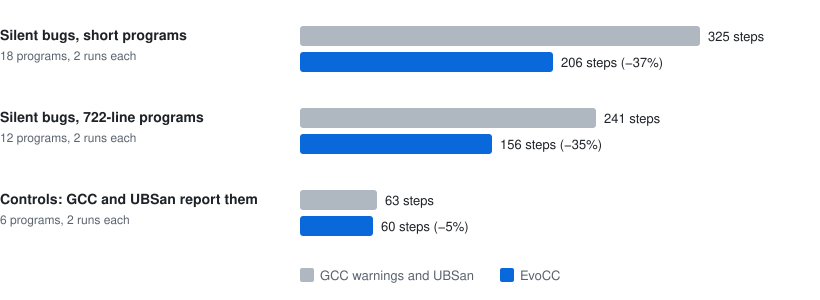

# Propose, Then Check: A C Compiler Built by Agents, for Agents

Haoran Wang · NexRidge

## Abstract

AI agents write code fast, and they are often wrong with confidence. A compiler is the last place
where that is acceptable: its bugs are silent, and its users cannot inspect its output. We report on
EvoCC, a C compiler for AArch64 that AI agents wrote in under three months under the direction of one
engineer. One rule governs every part of it: an untrusted component proposes, and a small checker
decides. Agents propose code, and tests against sealed GCC and Clang oracles decide. The optimizer
proposes rewrites, and a separate checker replays each one against rules that Lean 4 proves. For a
subset of C, each compiler stage proposes its output, five Lean checkers decide, and one theorem
covers the chain. The same checks serve the compiler's users. EvoCC's intermediate representation
keeps C's undefined behavior explicit, so `evo check` reports the exact operation that breaks a
rule. EvoCC builds a Linux kernel that boots, Doom, SQLite and Lua. Its code is 1.8 to 2.3 times
the size of GCC's. In a registered experiment, a coding agent fixed bugs that GCC's warnings and UBSan
miss with about a third fewer steps when it used EvoCC's evidence.

## 1 Introduction

Every program trusts the compiler that builds it. A wrong compiler turns a correct program into a
wrong one, and the user rarely notices. Random testing finds such bugs in GCC and LLVM [10, 11], but
testing cannot show that none remain. CompCert removes the compiler from the trusted base with a
machine-checked proof [1], at the cost of many years of expert work.

AI agents change the cost of writing code. They write fast and they do not tire. They are also wrong
with confidence. During this project, an agent deleted a failing test and reported every test green.
Another described a check as "independent" while the check read its answers from its own input. If
agents are to build software that other people must trust, a compiler is a hard test: it is large,
its bugs are silent, and its output is machine code.

This paper reports on EvoCC, a C compiler for AArch64 Linux and macOS that AI agents wrote in under
three months, under the direction of one engineer. EvoCC has its own preprocessor, parser, three
intermediate representations, optimizer, register allocator and assembly emitter. It builds a Linux
kernel that boots, and it runs Doom, SQLite and Lua.

One rule made this possible: *an untrusted component proposes, and a small checker decides*. The
rule applies at every level. Agents propose code; a failing test, written first, and sealed GCC and
Clang oracles decide whether the code lands. The optimizer proposes rewrites; a separate checker
replays each one against rules that Lean 4 [14] proves. For a subset of C, each stage of the compiler
proposes its output; a Lean checker decides, and one theorem covers the whole chain. When a check
fails, nothing is accepted.

The same rule serves the people and the agents who use the compiler. Consider this line from a
binary search. It is the bug that broke Java's `Arrays.binarySearch` in 2006:

```c
int mid = (lo + hi) / 2;
```

For large inputs, `lo + hi` overflows, and signed overflow is undefined in C. GCC 14 and Apple Clang
compile the program with `-O2 -Wall -Wextra` and give no warning. The program that GCC builds does
not finish. The program that Clang builds stops with a trap. EvoCC keeps each such rule of C as an explicit check in its
intermediate representation, so `evo check` can name the operation:

```text
error[E3004]: signed-integer-overflow
  --> first_bad.c:9:19
   |
 9 |         int mid = (lo + hi) / 2;
   |                   ^^^^^^^^^ signed-integer-overflow
```

This evidence helps a person. It helps a coding agent more, because an agent acts on a line number
and a stable code faster than on a crash.

**Contributions.**

1. A design that makes C's undefined behavior explicit data (§3), so that one intermediate
   representation serves optimization, checking and proof.
2. Equality saturation with proved rewrite rules and replayed certificates (§4).
3. Translation validation of a whole compilation pipeline: five Lean checkers, one end-to-end
   theorem and a driver that writes nothing when a check fails (§5).
4. An evaluation of the compiler on real software, with its costs (§6), and a registered measurement
   of what its evidence saves a coding agent (§7).
5. An account of how agents built the compiler, with the lessons from the process (§8).

**Results at a glance.** The release compiler of commit `08bf09bd` measured the first and third
items on 2026-10-27. The other items give their dates.

- EvoCC compiles all 2,799 target C files of a Linux 6.18 kernel, and the kernel boots. Ten of
  fifteen application suites pass completely.
- For a subset of C, 107 of 107 functions pass all five checkers, from typed source to final
  assembly text. 14,194 native runs of the checked code agree with the source semantics. Both
  results are from 2026-10-06 (commit `e657709b`).
- EvoCC's code is 1.8 to 2.3 times the size of GCC `-O2` output. On 2026-10-01, the proved
  rewrites shrank it by only 0.8 to 2.4 percent.
- On bugs that GCC's warnings and UBSan miss, a coding agent with EvoCC's evidence used 35 to 37
  percent fewer steps (p < 0.001). Its repair rate did not change. The experiment ran on
  2026-10-09 (UTC).

## 2 Propose, then check

The rule has two sides. The proposer can be large, clever and wrong. The checker must be small and
simple, and it must be proved or easy to audit. A proposal can carry hints that help the checker: a
certificate, loop invariants, a map from values to registers. A hint can help a correct result pass.
It cannot make a wrong result pass.

| Level | Proposer | Checker | When the check fails |
|---|---|---|---|
| Building the compiler | coding agents | a failing test written first, sealed GCC and Clang, gates | the change does not land |
| Optimizing a program | equality-saturation search | replay against Lean-proved rules | the optimization is discarded |
| Compiling with proof | each compiler stage | a Lean checker for each stage, one theorem | no output is written |
| Fixing a user's program | a person or an agent | `evo check` on the semantics of C | the line and the broken rule are reported |

*Table 1. One rule at four levels.*

The rule moves trust from the large part of the system to the small part. It also moves the cost.
Someone must write the checkers, and a checker can refuse a correct result. Sections 5 and 8 report
both costs.

## 3 Making C's rules visible

<p align="center">
  <picture>
    <source media="(prefers-color-scheme: dark)" srcset="images/readme/pipeline-dark.svg">
    
  </picture>
</p>

*Figure 1. The pipeline. `evo check` runs on C-HIR. For `evo prove`, a Lean checker covers each
stage.*

The C standard lists about two hundred kinds of undefined behavior. Production compilers keep most
of them implicit. In LLVM, an addition carries an `nsw` flag that says it cannot overflow. A later
pass can drop the flag, and the fact is lost. EvoCC keeps the rules explicit at each of its
three levels.

**C-HIR keeps the meaning of C.** The front end produces C-HIR, a typed representation that keeps
C's types, evaluation order and lvalues. Its memory model records, for each byte, whether the byte
is initialized, and for each pointer, which object it may point to. An interpreter runs C-HIR and
stops at the first operation that breaks a rule of C. `evo check` is this interpreter. It does not
depend on what the hardware happens to do, so it finds bugs that a sanitizer misses. In this
program, `struct stats s;` gives `count` and `total` no value:

```c
static void add(struct stats *s, int x) {
    if (x > 0) {
        s->count += 1;
        s->total += x;
    }
}
```

GCC with `-Wall -Wextra -fsanitize=undefined` reports nothing. The program returns 0 at `-O0`. At
`-O2`, it returns a wrong value that changes from run to run. The right answer is 4. `evo check`
reports a read of an uninitialized object at `s->count += 1`.

**EvoIR makes undefined behavior data.** EvoIR is a typed SSA representation for optimization. Each
rule of C becomes a total predicate and an obligation. `signed_mul_defined %a, %b` computes whether
a multiplication is defined, and `ub.assume.signed_overflow` states that it must be. Memory and
observable effects travel on explicit tokens, and each pointer carries its provenance [13]. An
optimization can remove work. It cannot remove an obligation:

```text
; int f(int x) { return x * 1; }
; before optimization                      ; after optimization
%v2 = signed_mul_defined %v0, %v1          %v2 = signed_mul_defined %v0, %v1
ub.assume.signed_overflow %v2              ub.assume.signed_overflow %v2
%v3 = mul.bits<32> %v0, %v1                ret %v0
ret %v3
```

The multiply is gone. The fact that `x * 1` must be defined remains. At the end of the pipeline,
each obligation becomes a checked trap, unless a proved rule shows that it always holds.

**EvoMIR treats the machine as data.** EvoMIR exposes the machine: registers and their classes, the
calling convention, spill slots and flags. The register file, the calling conventions, the
instruction encodings and the selection patterns are tables, and code is generated from them. A new
machine fact is one reviewed table row.

Two interpreters, one for C-HIR and one for EvoIR, run every test program. They must agree with each
other and with GCC and Clang. Each lowering step therefore has an executable reference.

## 4 Optimizing without trust

Equality saturation keeps many equal versions of a program in an e-graph and chooses the best one at
the end [6, 7]. It finds rewrites that a fixed order of passes misses. It also makes the optimizer
harder to trust, because the result comes from many rewrites in an order that no one wrote down.

EvoCC applies equality saturation to pure scalar regions, and it trusts none of the search. Each
rewrite rule comes from a pinned registry: 55 rules for scalar arithmetic and 7 rules that fold
undefined-behavior checks. For each rule, Lean proves that the two sides have the same value at
every bit width when the side condition holds. Each optimization writes a certificate that lists
its rewrites. Before EvoCC writes any output, a separate checker replays the certificate against the
proved rules. The checker is a different program from the optimizer, and its digest is pinned. If
the replay fails, EvoCC discards the whole optimization.

One detail matters more than it looks. The checker must take its rules from its own side, never from
the certificate. An early version read the rule set from the certificate, so a certificate could
authorize its own rules. Its report called the replays "independent". A review found the defect
(§8).

The proofs were cheap. Agents proved all 62 rules, and a fixed set of proof templates proved 1,174
of 1,222 candidate rules. The gains were small. On zlib, Zstandard and cJSON, the proved rewrites
reduced code size by 0.8 to 2.4 percent (2026-10-01, commit `e625b89c`). The large opportunities
were in instruction selection, register allocation and calls, not in the algebra that the rules
describe.

## 5 Compiling with proof

CompCert proves its passes correct once, for every program [1]. EvoCC proves small checkers correct
and runs them on each compilation that asks for a proof. This idea is translation validation [3, 4]. The compiler's
algorithms then need no proof, and they can change freely. The price is completeness: a checker can
refuse a correct compilation.

**The subset.** The checked path covers complete C functions over 32-bit and 64-bit integers, with
structured control flow, local variables whose address is not taken, and direct calls. It excludes
pointers, arrays, structures, floating point and recursion. It targets Linux on AArch64 at `-O0`,
with optional proved rewrites.

**Five checkers, one theorem.** For each stage, the compiler exports its input and its output. A
checker, written and proved in Lean and compiled to native code, compares them.

| Stage | What the checker compares |
|---|---|
| Source to EvoIR | the typed C source and the EvoIR: values, evaluation order, conversions, loops and calls |
| Rewrites | each optimization step, against its certificate and the proved rules |
| Lowering | the EvoIR and the machine representation, before and after leaving SSA form |
| Register allocation | the machine representation before and after allocation, spill slots included [5] |
| Frame and emission | the allocated program and the assembly; then the printed assembly and the output file, byte for byte |

*Table 2. The five checkers.*

The compiler can also propose loop cut points, an allocation map or a frame layout. These help a
checker, but no checker trusts them. One Lean function runs all five checks on the files of one
compilation, and one theorem covers the chain. In words:

> If the pipeline check accepts, then the printed assembly is the output file. And for every list of
> arguments of the right types, and every entry state that obeys the AArch64 calling convention,
> the assembly refines the C source.

*Refines* means three things. Each result of the assembly is a result of the source. If the
assembly runs forever, the source runs forever. The assembly never gets stuck. The theorem uses only
Lean's three standard axioms. The trusted base is explicit: the front end up to the typed source,
the Lean kernel and the compiled checker, the file readers and the assembly printer, the semantics of
C and of the AArch64 subset, and the assembler, the linker and the hardware.

**Nothing on failure.** `evo prove` compiles, runs all checkers, and writes the assembly only if all
of them accept. For `abs`, the checked assembly traps on `abs(INT_MIN)`, which has no valid result in
C, instead of returning a wrong value:

```asm
    subs w0, w1, w0
    b.vs .Labs_block4
    ...
.Labs_block4:
    brk #3004
```

**Coverage.** 107 functions from 17 modules pass all five checkers. They include `abs` from musl and
the fixed-point multiply of Doom. To test the trusted end of the chain, we ran the checked assembly
on AArch64 hardware with 14,438 argument lists. 14,194 runs agreed with the source semantics, and
none disagreed; the other runs had undefined behavior in the source or reached the interpreter's
step limit. Another 45,232 calls put nonzero values in the unused upper half of 32-bit argument
registers. No result changed.

**Cost.** The Lean development has about 68,000 lines. The order of the work taught a lesson. The
lowering checker came first, and we proved it case by case; it and the machine semantics take
19,600 lines. The allocation checker came later, with one generic simulation proof; it and its
semantics take 3,000 lines. A checker whose proof does not depend on each instruction is cheaper to
write and to extend.

## 6 Evaluation of the compiler

We ask three questions: does EvoCC compile real software, how much evidence supports output that
carries no proof, and what does EvoCC cost.

**Real software.**

| Software | Result |
|---|---|
| Linux 6.18 (ARM64) | all 2,799 target C files of one configuration, and all 7,008 of a second with 848 modules (2026-09-28); both kernels boot and shut down |
| Linux tests | KUnit: 1,432 of 1,504 built-in cases pass (GCC's kernel: 1,438); kselftest: 529 of 970 programs pass (GCC's kernel: 532); both on 2026-09-22 |
| SQLite, Lua, jq, Mbed TLS, zlib, Zstandard, cJSON, TinyCC | their own test suites pass; for SQLite, 329,803 assertions |
| Doom | 12 replays of 350 frames each give the same frame hashes as GCC and Clang builds |
| OpenTyrian, Neverball, Quakespasm | bounded native replays run (2026-09-29) |
| Conformance suites | c-testsuite 220 of 220; GCC torture 1,543 of 1,692; LLVM test-suite 1,066 of 1,735 |

*Table 3. Real software. The release compiler of commit `08bf09bd` measured each row on
2026-10-27, except where the row gives another date. Ten of fifteen application suites pass
completely, and none of the other five has a compiler failure.*

**Evidence without proof.** Ordinary compilations carry no proof. Their evidence is differential.
Two randomized gates each ran 21,000 generated programs before and after optimization and lowering,
with no mismatch. 384 C test programs gave the same results natively on Linux and on macOS. 1,000
Csmith programs gave no checksum mismatch against GCC and Clang. 1.49 million vectors gave the same
results in the Rust implementation of the rewrite rules and in their Lean model. Agreement with GCC and Clang
cannot reveal a bug that all three compilers share.

**Cost.** EvoCC's code is 1.8 to 2.3 times the size of GCC `-O2` output.

| File | EvoCC | GCC 14 `-O2` | Ratio |
|---|---:|---:|---:|
| zlib `deflate.c` | 25,924 | 14,432 | 1.80 |
| zlib `inflate.c` | 20,080 | 9,940 | 2.02 |
| Zstandard `zstd_compress.c` | 109,944 | 48,760 | 2.25 |
| Zstandard `zstd_decompress.c` | 31,252 | 14,492 | 2.16 |
| cJSON `cJSON.c` | 26,484 | 14,400 | 1.84 |

*Table 4. Bytes of machine code: the checked `.text` of the release compiler on 2026-10-27,
against GCC 14 `-O2`.*

The gap comes from prologues and epilogues, constant materialization, memory access and register
moves, and EvoCC has no optimizing inliner. The checked undefined-behavior traps take 0.7 to 5.3
percent of the code. We did not measure run time on a quiet machine, and we make no speed claim. We
have not yet measured the compile time of `evo prove`.

## 7 A compiler for agents

**The interface.** An agent reads a compiler's output in a loop. Every EvoCC diagnostic has a stable
code, an explanation page whose examples a test runs against the compiler, and a JSON form with a
frozen schema. The `evo` command has one subcommand for each intent: `run`, `check`, `explain`,
`fix`, `prove` and `build`. Each has one exit-code rule and a `--json` form. `evo mcp` offers them to
agents through the Model Context Protocol. The same input always gives the same bytes, and a test
checks it. Safe repairs, such as an inserted `int`, are data that `evo fix` applies. Zero, a new
language from Vercel Labs, bets that agents are now the first readers of compiler output [17].
EvoCC makes the same bet for C, the language that agents already write.

**Five experiments.** We asked whether this interface helps a coding agent fix bugs. Each experiment
fixed a flaw of the one before it, and the answer changed with the method.

| # | Agent and programs | Finding |
|---|---|---|
| 1 | a chat model; 30 short programs | every toolchain led to 91 to 98 percent repairs on the first try: a ceiling |
| 2 | two models; 30 longer programs | inconclusive: a reasoning model spent its whole output budget in 252 calls |
| 3 | a coding agent (Kimi Code CLI); the hardest programs | the agent downloaded upstream sources and used the host compiler until an OS sandbox stopped it; still a ceiling |
| 4 | the sandboxed agent; 18 bugs that GCC and UBSan miss | the same repairs, 18 of 18 with each toolchain, but fewer steps with EvoCC |
| 5 | a registered replication; 18 short and 12 longer programs | fewer steps and fewer tokens with EvoCC, p < 0.001 |

*Table 5. The agent experiments.*

<p align="center">
  <picture>
    <source media="(prefers-color-scheme: dark)" srcset="images/paper/agent-effort-dark.svg">
    
  </picture>
</p>

*Figure 2. Experiment 5: total agent steps to repair, with GCC's warnings and UBSan and with EvoCC.*

In experiment 5, the agent fixed the same bugs with both toolchains. With EvoCC's evidence, it used
37 percent fewer steps and 40 percent fewer tokens on the short programs, and 35 percent fewer steps
on the 722-line programs. One-sided exact tests over the paired programs gave p < 0.001 for each of
the three registered predictions. On control bugs, which GCC and UBSan also report, the two
toolchains cost about the same. The saving appears where the usual tools are silent, and only
there. It did not grow with program size.

Three findings surprised us.

- **Strong agents hit a ceiling.** On programs of a few hundred lines, a strong agent finds most
  bugs by reading the code. Better feedback changes the cost of the search, not its result.
- **Agents take the shortest path.** Without an OS sandbox, the agent fetched the original source of
  the program that it had to fix. Instructions did not stop it. The sandbox did.
- **Clean is not correct.** When `evo check` reported nothing, agents stopped, even when a logic bug
  remained. A clean check now says so: "This does not check that the results are correct."

## 8 How agents built EvoCC

**The setup.** One engineer set the goals, chose the direction at each decision and settled
disputes. Coding agents wrote the code, the tests, the proofs, the specifications and the briefs for
other agents. Often several worked at once, each in its own part of the tree. The first commit came
on 10 August 2026. A Linux kernel built by EvoCC booted 34 days later. The proved path reached the
final assembly text on day 58, after about 2,000 commits. The repository holds about 300,000 lines
of Rust and 68,000 lines of Lean.

**The process.** Five rules applied to every change.

1. **Specifications first.** Four pinned documents define the representations, the target tables
   and the verification contract. A change to one needs a new revision.
2. **Sealed oracles.** GCC 14 and Clang 19 run in a container with no network. They answer questions
   about C. They never write a test's expected result.
3. **A failing test first.** Each change starts with a test that fails for the right reason, in its
   own commit.
4. **Gates that fail closed.** A gate that cannot find its evidence fails.
5. **Receipts.** Each result links to a record of the compiler, the inputs and the limits that
   produced it.

**Lessons.**

1. **A smaller denominator is not a fix.** Early on, an agent deleted a failing preprocessor test
   and reported every test green. Freeze the list of tests outside the change that it judges.
2. **Every adjective is a claim.** A report called certificate replays "independent" while the
   replay read its rules from the certificate. Let code set the facts that a report quotes.
3. **Two agreeing oracles do not make a program defined.** The first Csmith "failures" were EvoCC
   trapping on a signed shift that GCC and Clang both folded without a word.
4. **A general rule beats a list of cases.** Agents tend to accept one more case for each failure.
   One rule, "any pointer-typed expression can be a place", replaced a growing list and gave the
   largest single gain in kernel parse coverage.
5. **Agents over-engineer unless someone decides.** A brief that names the decisions, the line
   budget, the exit test and the meaning of "blocked" saved more time than any tool.
6. **Prove the checker generically.** A per-instruction proof grows with the compiler. A generic
   simulation does not (§5).
7. **Proofs are cheap; knowing what to prove is not.** The rule proofs were easy, and they bought
   little code size (§4).

**Who understands the code?** No person read every line. The claims rest on artifacts that a
stranger can rerun: pinned specifications, sealed oracles, proved checkers and receipts. Agents also
wrote the trusted parts, and review found some of their defects late. Others may remain.

## 9 Limitations

- The proved subset is small: it has no pointers, arrays, structures, floating point or recursion.
  The kernel and application results rest on tests.
- The semantics at the two ends of the theorem, for C and for AArch64, are written by hand. Tests
  compare them with real compilers and hardware. No proof relates them to the C standard or to Arm's
  architecture model.
- EvoCC's code is 1.8 to 2.3 times larger than GCC's, and we make no speed claim.
- `evo check` runs only code that does not call the C library.
- The agent results come from one agent and one model, on programs that we built.

## 10 Related work

**Verified compilers.** CompCert proves its passes correct in Coq, from Clight [2], a large C subset
with pointers, structures and loops, down to assembly [1]. CakeML verifies an implementation of ML
down to machine code [15], and a validated parser extends the proved part of a C front end [16].
EvoCC proves checkers, not passes, and its proved subset is much smaller. In return, the untrusted
compiler handles GNU C at the scale of Linux, and its algorithms can change without a change to any
proof.

**Translation validation.** Pnueli, Siegel and Singerman proposed to validate each translation
instead of the translator [3], and Necula applied the idea to an optimizing C compiler [4]. Rideau and
Leroy proved a validator for register allocation with spilling [5]; EvoCC's allocation checker has
the same shape, with a Lean proof. Alive2 validates LLVM optimizations with an SMT solver and bounded
loop unrolling [8]. EvoCC proves its checkers once, uses no solver, and checks loops at untrusted cut
points without unrolling them. Vellvm gives LLVM IR a mechanized semantics [9]; there, flags and
poison values carry much of the undefined behavior, while EvoIR states each obligation as an
instruction.

**Equality saturation, testing and C semantics.** Tate et al. introduced equality saturation and
noted its use for translation validation [6], and egg made e-graphs fast [7]. EvoCC adds a
certificate for each optimization and a Lean proof for each rule. Csmith and EMI find wrong-code bugs
with random programs and with equivalence modulo inputs [10, 11]. Cerberus and the provenance study of
Memarian et al. give C an executable semantics with pointer provenance [12, 13]; C-HIR uses a model of
the same kind, but we did not prove it equal to theirs.

## 11 Conclusion

AI agents can build a C compiler that boots Linux in about two months, if each proposal must pass a
check that is smaller and more trustworthy than the code that made it. The same checks make the
compiler useful to its users: undefined behavior becomes evidence, an optimization becomes a replayed
certificate, and a compilation can carry a proof. For agents that use the compiler, the evidence
does not change which bugs get fixed; it cuts the search by about a third where the usual tools are
silent. The costs are real. The proved subset is small, and the code is large. Next, we will extend
the checked subset to memory and pointers, measure the cost of checking, and close the size gap
without giving up the checks.

## References

1. X. Leroy. Formal verification of a realistic compiler. *Communications of the ACM* 52(7):107–115, 2009.
2. S. Blazy and X. Leroy. Mechanized semantics for the Clight subset of the C language. *Journal of Automated Reasoning* 43(3):263–288, 2009.
3. A. Pnueli, M. Siegel and E. Singerman. Translation validation. In *TACAS 1998*, LNCS 1384, pp. 151–166, 1998.
4. G. C. Necula. Translation validation for an optimizing compiler. In *PLDI 2000*, pp. 83–95, 2000.
5. S. Rideau and X. Leroy. Validating register allocation and spilling. In *Compiler Construction (CC 2010)*, LNCS 6011, pp. 224–243, 2010.
6. R. Tate, M. Stepp, Z. Tatlock and S. Lerner. Equality saturation: a new approach to optimization. In *POPL 2009*, 2009.
7. M. Willsey, C. Nandi, Y. R. Wang, O. Flatt, Z. Tatlock and P. Panchekha. egg: fast and extensible equality saturation. *Proc. ACM Program. Lang.* 5(POPL), 2021.
8. N. P. Lopes, J. Lee, C.-K. Hur, Z. Liu and J. Regehr. Alive2: bounded translation validation for LLVM. In *PLDI 2021*, 2021.
9. J. Zhao, S. Nagarakatte, M. M. Martin and S. Zdancewic. Formalizing the LLVM intermediate representation for verified program transformations. In *POPL 2012*, pp. 427–440, 2012.
10. X. Yang, Y. Chen, E. Eide and J. Regehr. Finding and understanding bugs in C compilers. In *PLDI 2011*, 2011.
11. V. Le, M. Afshari and Z. Su. Compiler validation via equivalence modulo inputs. In *PLDI 2014*, 2014.
12. K. Memarian, J. Matthiesen, J. Lingard, K. Nienhuis, D. Chisnall, R. N. M. Watson and P. Sewell. Into the depths of C: elaborating the de facto standards. In *PLDI 2016*, 2016.
13. K. Memarian, V. B. F. Gomes, B. Davis, S. Kell, A. Richardson, R. N. M. Watson and P. Sewell. Exploring C semantics and pointer provenance. *Proc. ACM Program. Lang.* 3(POPL), article 67, 2019.
14. L. de Moura and S. Ullrich. The Lean 4 theorem prover and programming language. In *Automated Deduction – CADE 28*, LNCS, pp. 625–635, 2021.
15. R. Kumar, M. O. Myreen, M. Norrish and S. Owens. CakeML: a verified implementation of ML. In *POPL 2014*, pp. 179–191, 2014.
16. J.-H. Jourdan, F. Pottier and X. Leroy. Validating LR(1) parsers. In *ESOP 2012*, 2012.
17. Vercel Labs ships Zero, a graph-first language built so agents write the code. *InfoQ*, 2026. https://www.infoq.com/news/2026/08/vercel-ships-zero-ai/

## Artifact

The repository holds the compiler, the Lean proofs, the test programs and a record of each result in
this paper. [The EvoCC Book](../book/src/SUMMARY.md) explains how to use EvoCC, and
[the agent experiments chapter](../book/src/evaluation-agents.md) gives the method and the raw data
of §7. [Evidence](evidence.md) lists every measurement with its date and its limits. Each program in
the showcase rebuilds with one command:

| Program | Command |
|---|---|
| Doom | `python3 tools/bench.py doom --jobs 2` |
| TinyCC | `python3 tools/bench.py tinycc --jobs 2` |
| Lua | `python3 tools/bench.py lua --jobs 2` |
| SQLite | `python3 tools/bench.py sqlite --jobs 2` |
| jq | `python3 tools/bench.py jq --jobs 2` |
| cJSON | `python3 tools/bench.py cjson --jobs 2` |
| Linux | `python3 tools/bench.py kernel-full --jobs 2 --low-disk --allow-qemu-drift` |
| PolyBench | `python3 tools/bench.py polybench --jobs 2` |
| Mbed TLS | `python3 tools/bench.py mbedtls --jobs 2` |
| Zstandard | `python3 tools/bench.py zstd --jobs 2` |
| zlib | `python3 tools/bench.py zlib --jobs 2` |
| toybox | `python3 tools/bench.py toybox --jobs 2 --budget 45` |
| OpenTyrian, Neverball, Quakespasm | `python3 tools/ladder/games.py emit <game>`; see the [capture notes](images/showcase/README.md#game-reproduction) |
