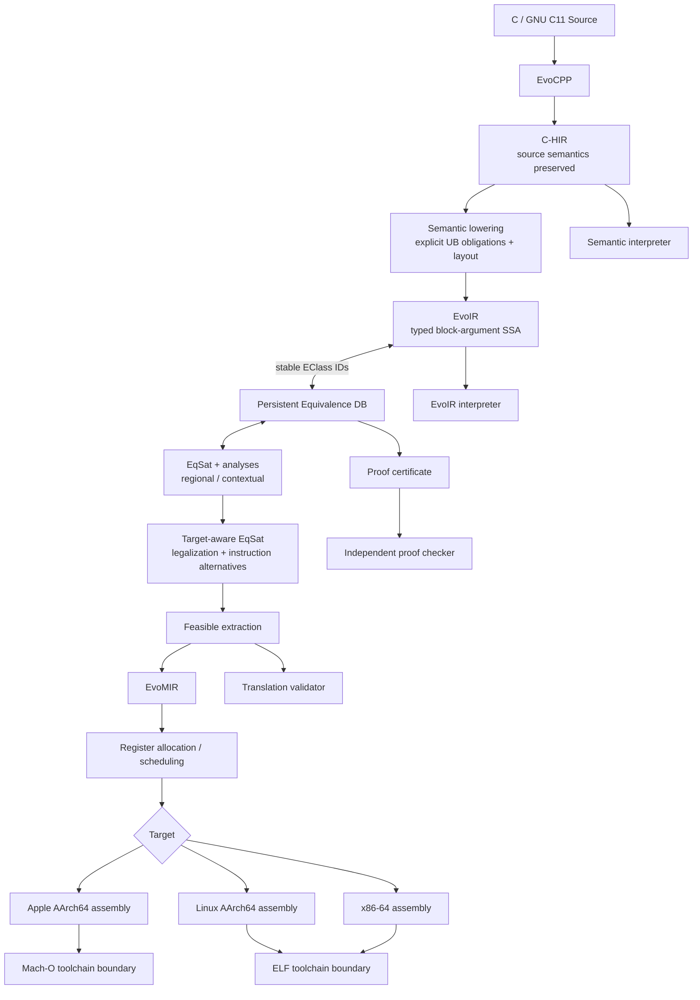
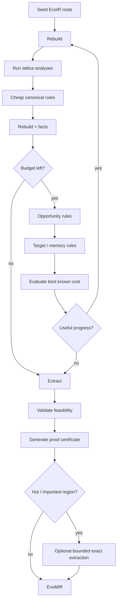
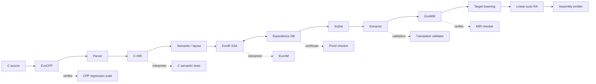
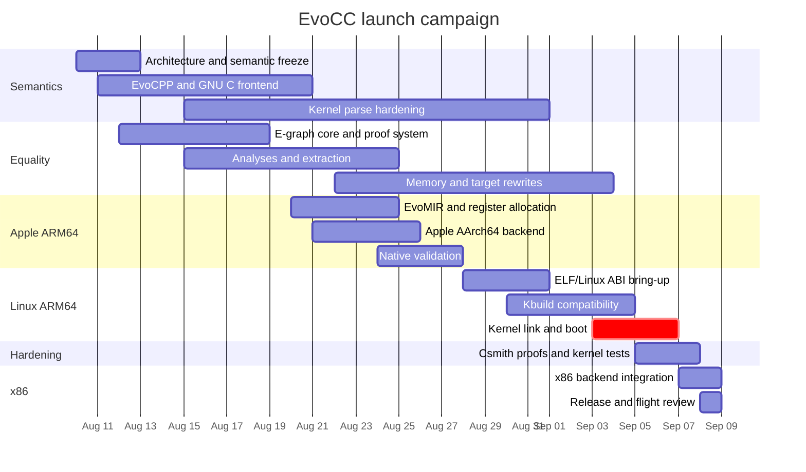
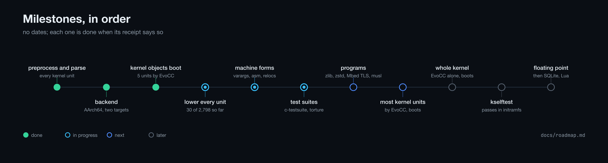
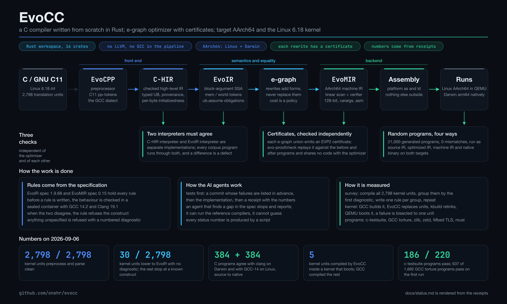
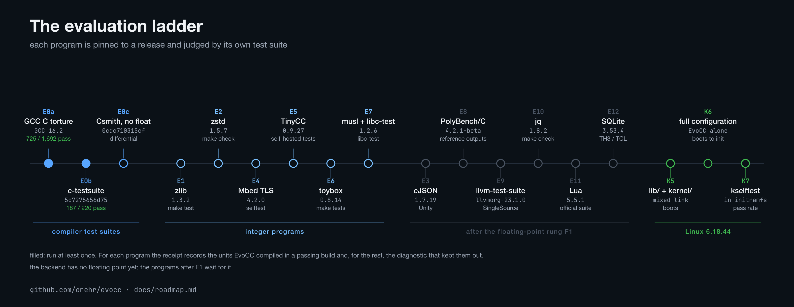

# EvoCC: An Equality-Native, Self-Contained C Compiler Architecture and Launch Plan

## Executive summary

The correct architecture is **not** “C → conventional SSA → bolt on an e-graph optimizer → backend.” If equality saturation is genuinely the primary optimization paradigm, the compiler should treat **equivalence as persistent compiler state**: semantic lowering creates a typed, effect-aware representation; optimization accumulates alternatives rather than destructively choosing them; lowering to target instructions adds more equivalent alternatives; extraction is the point where the compiler finally commits to one implementation. That interpretation is closest to the original equality-saturation vision, to `egg`’s modern engineering techniques, and to the 2026 work on persistent e-graphs.

My recommended architecture is:



The architectural philosophy should be:

> **EvoIR is a typed, contextual equality substrate over explicit state, not merely a list of instructions.**

Five decisions follow from that.

First, use **block-argument SSA** for EvoIR, but do not identify “SSA” with an LLVM-like IR. SSA gives every value a functional identity, which is extremely convenient for congruence, rewriting, proof tracking, and extraction. Memory and externally visible effects should be represented through explicit state/token dependencies. Non-SSA mutable temporaries should exist only in C-HIR before lowering.

Second, do **not** attempt whole-program/whole-CFG saturation in the first 30 days. Expression e-graphs are mature; general control-flow/effect saturation remains active research. Cranelift has successfully deployed an acyclic e-graph optimizer in production, while recent Julia work adds special machinery for control flow and side effects, and the May 2026 E-Path paper is explicitly a prototype for equivalence over CFG instruction sequences. The launch architecture should therefore keep the CFG structurally explicit and apply EqSat **regionally** to pure computations, state-threaded memory expressions, guarded regions, and later machine-instruction selection.

Third, **C definedness, effects, pointer provenance, volatile behavior, atomics, and alias facts must be in the semantics before EqSat sees the program**. ISO/IEC TS 6010:2025 formalizes provenance precisely because two pointers with the same concrete address need not be semantically interchangeable; provenance is relevant to alias reasoning and optimization. An e-graph that simply treats a pointer as a 64-bit integer will eventually produce attractive but unsound rewrites.

Fourth, never run “all rewrites until saturation” as the production scheduling strategy. `egg` solved important implementation bottlenecks with rebuilding and e-class analyses, but later research shows that complex optimization spaces still explode: sketch-guided EqSat reports five of seven matrix optimizations failing under unguided saturation even after an hour and 60 GB, while a handful of guides reduced those searches to seconds and under 1 GB. EvoCC should therefore use **bounded, staged, guided saturation epochs** with node budgets, match fuel, profitability feedback, and extraction/re-seeding.

Fifth, make **proofs a first-class product**. The 2022 “Small Proofs from Congruence Closure” work added practical proof generation to `egg`, describing it as the first certifying equality-saturation engine and reporting substantially smaller certificates than Z3 on its benchmark corpus. For a compiler whose rewrite library will be partially generated by AI agents, this is not an optional research feature; it is the trust boundary.

The 30-day target needs one scope clarification. The phrase “self-contained C compiler” is clear about **not delegating the frontend, IR, optimizer, instruction selection, register allocation, or code generation to LLVM or GCC**. Whether it also prohibits the platform assembler, linker, archiver, `objcopy`, and related binary utilities is **unspecified**. The plan below assumes the compiler itself is self-contained while Apple `ld`/assembler tools and GNU binutils may be used as non-compiler toolchain components. This matters because the Linux tree contains architecture assembly and Kbuild uses a family of tools beyond `CC`; the kernel's own documentation exposes `CC`, `LD`, `AR`, `NM`, `STRIP`, `OBJCOPY`, `OBJDUMP`, `READELF`, host compiler variables, and related tooling separately. If “self-contained” means *no external assembler/linker/binutils either*, add an assembler, static linker, archive writer, symbol utilities, and significant ELF/Mach-O relocation support; that should be treated as a separate toolchain project rather than silently hidden inside this 30-day estimate.

There is also one hard specification conflict: **literal compiler self-hosting is impossible if EvoCC is implemented in Rust**, because a C compiler cannot compile its own Rust source. Under the requested Rust assumption, Day 30 can demonstrate a reproducible bootstrap, an EvoCC-compiled C runtime/test suite, and a compiler built on both macOS and Linux, but not literal self-hosting. If “EvoCC compiles EvoCC” is a hard requirement, the implementation language must be changed to C on Day 1.

The realistic flight plan is therefore:

| Flight milestone | Required outcome |
|---|---|
| Semantic engine | C subset → C-HIR → EvoIR → interpreter, with explicit memory/effect semantics |
| Equality engine | Custom Rust e-graph, guarded rewrites, analysis lattices, extraction and independently checked proof certificates |
| Mac flight | Native Apple AArch64 programs compile and execute on the M2 Max without LLVM/GCC code generation |
| Linux flight | Same frontend/IR/backend architecture targets AArch64 ELF/Linux ABI and passes native tests inside an ARM64 Linux environment |
| Kernel launch | A pinned ARM64 Linux kernel configuration compiles, links and boots under QEMU with EqSat enabled |
| Secondary vehicle | x86-64 backend reuses EvoMIR/extraction infrastructure; userspace is a Day-30 target, full x86 kernel is a stretch |
| Research payload | `evo explain`, e-graph visualization, proof inspection, optimizer statistics and agent-generated-but-machine-checked rewrite proposals |

The Linux kernel officially uses the GNU dialect of ISO C11 and routinely depends on GNU extensions and attributes, so “supports C11” alone is not a sufficient frontend gate. The primary Day-30 success criterion should consequently be **a booting Linux ARM64 kernel generated by EvoCC**, not merely compiling toy C programs. x86-64 kernel support is worth starting in parallel behind a gated branch, but it should not be allowed to steal the critical path from ARM64 boot.

## Research landscape and what it implies for EvoCC

The foundational EqSat proposal by Tate, Stepp, Tatlock, and Lerner replaces destructive optimization sequences with equality analyses that accumulate equivalent representations and defer the final choice until extraction. That is still the right conceptual starting point, but the research since 2020 makes clear that three additional issues—**scalability, effects/control, and extraction**—have become at least as important as the core congruence data structure.

| Work / system | Status and main contribution | Direct lesson for EvoCC |
|---|---|---|
| Equality Saturation, Tate et al. | Foundational POPL work: accumulate equalities instead of destructively ordering optimizations. | Make equivalence persistent knowledge, not a temporary peephole pass. |
| `egg`, Willsey et al. | Rebuilding amortizes e-graph invariant restoration; e-class analyses integrate domain analysis into EqSat. | Copy the *architecture*, not the library: custom union-find/hashcons/rebuild plus lattice analyses. |
| Small Proofs | Practical proof-certificate generation for congruence closure and EqSat. | Every trusted merge gets a justification; extracted code must be explainable from source roots. |
| `egglog` | Combines EqSat with Datalog-style fixed-point reasoning, efficient incremental execution, and lattice analyses. | Treat analysis facts and equality as cooperating fixed-point computations rather than separate passes. |
| Guided / sketch-guided EqSat | Demonstrates catastrophic unguided growth on complex optimization sequences and large improvements from staged guidance. | “Saturation” must be budgeted and phased in production. |
| Sparse/treewidth extraction | Recent work exploits low treewidth/sparsity for efficient optimal extraction; related work connects e-graphs and circuits. | Keep e-graphs sparse and implement a fast extractor first; exact extraction is a targeted second tier. |
| Cranelift ægraphs | Cranelift describes itself as the first production compiler using e-graphs as a unified optimization framework; its implementation emphasizes compile-time and memory efficiency. | Production EqSat should be constrained; a kernel compiler cannot tolerate unbounded optimizer explosions. |
| Julia high-level EqSat | Handles high-level IR with control flow and side effects and uses type-aware rewrites plus a global extraction formulation. | Effects and global code placement cannot be an afterthought. |
| Persistent compiler e-graphs | 2026 work proposes representing e-graphs natively so equality information survives ordinary compiler transformations and abstraction-level changes. | Give EvoIR values stable equality identities that survive lowering instead of serialize→optimize→discard. |
| E-Path | 2026 prototype records equivalences among CFG instruction sequences rather than only expressions. | Very interesting post-launch direction; too experimental to be the Day-30 CFG foundation. |
| Herbie / Ruler | Herbie's ecosystem shows EqSat applied to numerical rewriting; Ruler uses EqSat to infer compact rewrite sets automatically. | Agents can propose/discover rewrites, but rule discovery and rule trust must remain separate. |
| Souper | SMT-based superoptimizer that finds missing LLVM IR peepholes; its repository was archived in October 2025. | Automated optimization discovery is valuable, but EvoCC should internalize the idea, not depend on Souper or LLVM. |

A particularly useful conclusion comes from comparing these systems: **EqSat works best when the represented objects behave like mathematical terms.** C initially does not. C has mutable storage, overlapping objects, unspecified sequencing, volatile access, atomics, inline assembly, implementation-defined layout, GNU extensions, and undefined behavior. Therefore the frontend's most important job is not merely parsing. Its job is to transform hostile C semantics into a representation on which equality is meaningful.

The right way to do that is to make **definedness contextual**. Let `Γ` denote facts known at a program point: branch conditions, non-zero facts, alignment, lifetime facts, no-overflow obligations, provenance constraints, and other assumptions. EvoIR equality should mean:

```text
Γ ⊢ A ≡ B: τ
```

meaning that for every execution satisfying `Γ`, `A` and `B` have the same semantic value and observable effects.

This is better for EqSat than burying C undefined behavior in vaguely defined instruction flags. For example, C-HIR can lower:

```c
int z = x + y;
```

into conceptually:

```text
%ok = signed_add_defined %x, %y
ub.assume %ok
%z = add.bits %x, %y
```

Inside the dominated context containing `%ok`, arithmetic rewriting can reason over a total bit-vector operation. A rule that needs a stronger condition simply carries that condition:

```text
rule reassociate_signed_add
 add(add(?a, ?b), ?c)
 => add(?a, add(?b, ?c))
requires
 SignedAddTreeNoOverflow(?a, ?b, ?c)
```

That makes rule legality visible to the e-graph instead of embedding C-language folklore inside optimizer code.

Pointer semantics require the same treatment. ISO's provenance work explicitly distinguishes storage instances even when concrete addresses coincide; an executable semantics is also available through the Cerberus project. EvoCC should consequently define the *semantic* pointer as something like:

```text
Ptr {
 address: Bits<PTR_WIDTH>,
 provenance: Provenance,
}
```

while acknowledging that the **machine representation** can still be an ordinary 64-bit address. Provenance exists in the abstract semantics and analysis database; it need not occupy bits at runtime.

The implication for EqSat is fundamental:

```text
ptrtoint(p) == ptrtoint(q)
```

does **not** imply:

```text
p == q
```

unless the relevant provenance conditions have also been proved.

### The central IR alternatives

For EvoCC, SSA is the clear baseline.

| Representation | EqSat advantages | Problems | Recommendation |
|---|---|---|---|
| Non-SSA mutable IR | Closest to source C | Definitions depend on program state; substitutions are contextual; congruence becomes much harder | **Reject for EvoIR**; use only in early C-HIR |
| Expression trees / ANF | Excellent match to e-graphs | Poor native representation of arbitrary control flow and shared values | Use internally for local rewrite patterns |
| Classic phi-node SSA | Explicit dataflow and single definitions | Phi semantics complicate term representation and rewriting | Viable |
| **Block-argument SSA** | Single definitions, explicit CFG edges, no special phi instruction, easy use-def indexing | Still needs effect/state modelling | **Recommended** |
| Full functional IR with memory passed everywhere | Beautiful semantics for EqSat | Can become enormous; code placement and state threading become cumbersome | Use selectively through memory-state SSA, not as the sole surface syntax |

Souper's success as an automated optimizer is another indication that single-assignment, expression-like representations are friendly to automated reasoning, even though Souper itself is not an EqSat system and is not suitable as EvoCC's backend.

The integration point for e-graphs is equally consequential.

| EqSat integration | Equality lifetime | Engineering risk | Suitability |
|---|---:|---:|---|
| Convert function to e-graph → optimize → extract → discard | One pass | Low | Too conventional for this project |
| Independent e-graph sidecar per basic block | Short | Low | Good bootstrap architecture |
| **Persistent equality database attached to SSA values** | Across optimization/lowering phases | Medium | **Recommended Day-30 architecture** |
| E-graph encoded directly as ordinary compiler IR operations | Across the compiler | High | Research target inspired by 2026 persistent-egraph work |
| Full CFG equivalence graph | Across control-flow variants | Very high | Post-launch research; E-Path shows the direction but remains a prototype. |

I therefore recommend a **persistent sidecar architecture** for v1. EvoIR remains pleasant to inspect, serialize, interpret, and code-generate, but each eligible SSA value has a stable `EClassId`. Transformations may add representations to its equivalence class without discarding the previous ones. Later, if the architecture proves itself, the representation can move toward a fully persistent compiler-level e-graph similar to the 2026 research direction.

## EvoIR semantics and concrete specification

The compiler should contain two semantically distinct high-level IRs.

**C-HIR** is language-facing. It retains C types, lvalues, storage duration, qualifiers, source order where relevant, GNU constructs, bitfields, initializers, attributes, inline-assembly syntax, and source spans. It is where C's semantics are understood.

**EvoIR** is optimization-facing. Aggregates have mostly been lowered to explicit layouts and offsets; lvalues become pointers plus memory operations; sequencing has become data/control/effect dependencies; integer operations are explicit bit-vector operations; undefined-behavior assumptions are explicit; and calls have effect summaries.

The kernel requirement is important here. Linux documents its source language as GNU C11 and states that GNU extensions are used routinely; attributes are particularly common. EvoCPP and C-HIR therefore need to understand the dialect expected by kernel headers rather than merely accepting ISO syntax.

A compact EvoIR type universe can be:

```text
Type::=
 bits<N>
 | f32 | f64
 | ptr<AddressSpace>
 | vec<N, Type>
 | mem<Region>
 | world
 | atomic_world
 | tuple<Type...>
 | void
```

Signedness belongs primarily to operations rather than integer storage types:

```text
sdiv.bits<32>
udiv.bits<32>
icmp.slt
icmp.ult
sext
zext
```

That representation is much friendlier to bit-vector reasoning than carrying signed/unsigned nominal integer types through every e-class.

C aggregates stay richer in C-HIR:

```text
CType::=
 CInt(rank, signedness)
 | CFloat(kind)
 | CPointer(CType, qualifiers)
 | CArray(CType, bound)
 | CStruct(fields, attrs)
 | CUnion(fields, attrs)
 | CFunction(params, variadic, attrs)
 |...
```

A target data-layout service lowers these types:

```rust
trait TargetLayout {
 fn size_of(&self, ty: CTypeId) -> u64;
 fn align_of(&self, ty: CTypeId) -> u32;
 fn field_offset(&self, aggregate: CTypeId, field: FieldId) -> u64;
 fn bitfield_layout(&self, field: FieldId) -> BitFieldLayout;
}
```

That service must be target-specific. Apple publishes a platform-specific ARM64 ABI, while Arm maintains AAPCS64 and the AArch64 ELF ABI for environments such as Linux; x86-64 System V has its own maintained psABI. Therefore “ARM64” alone is not a complete ABI target.

A function could look like:

```text
func @sum(
 %p: ptr<generic>,
 %n: bits<64>,
 %m0: mem<all>,
 %w0: world
) -> (bits<32>, mem<all>, world)
 cc = target_default
{
^entry:
 %zero = const.bits<64> 0
 br ^loop(%zero, 0, %m0, %w0)

^loop(%i: bits<64>, %acc: bits<32>,
 %m: mem<all>, %w: world):

 %done = icmp.uge %i, %n
 cond_br %done, ^exit(%acc, %m, %w), ^body(%i, %acc, %m, %w)

^body(%i: bits<64>, %acc: bits<32>,
 %m: mem<all>, %w: world):

 %q = ptr.offset %p, %i scale 4
 %x = mem.load %m, %q: bits<32>
 [region=unknown, align=4]
 %acc1 = add.bits %acc, %x
 %i1 = add.bits %i, 1
 br ^loop(%i1, %acc1, %m, %w)

^exit(%r: bits<32>, %m: mem<all>, %w: world):
 ret %r, %m, %w
}
```

Notice that an ordinary load is semantically a function of a memory version:

```text
load(M, p)
```

while a store creates a new memory version:

```text
M1 = store(M0, p, v)
```

That is the essential MemorySSA-like structure.

The minimal memory vocabulary should be:

```text
mem.alloca: (size, align, lifetime) -> (ptr, mem')
mem.global_addr: Symbol -> ptr

mem.load: (mem<R>, ptr) -> T
mem.store: (mem<R>, ptr, T) -> mem<R>

mem.memcpy: (mem<R>, dst, src, size) -> mem<R>
mem.memmove: (mem<R>, dst, src, size) -> mem<R>
mem.memset: (mem<R>, dst, byte, size) -> mem<R>

mem.vload: (mem<R>, world, ptr) -> (T, world')
mem.vstore: (mem<R>, world, ptr, T) -> (mem<R>, world')

atomic.load: (...)
atomic.store: (...)
atomic.rmw: (...)
atomic.cmpxchg: (...)
atomic.fence: (...)
```

Atomic operators carry at least:

```text
MemoryOrder =
 Relaxed | Acquire | Release | AcqRel | SeqCst
```

and a scope field should exist even if the first implementation supports only system scope.

The abstract machine used by the verifier/interpreter should conceptually maintain:

```text
State {
 objects: ObjectId -> {
 bytes,
 lifetime,
 alignment,
 },

 volatile_trace,
 atomic_trace,
 io_trace,

 path_facts,
}
```

and:

```text
Pointer {
 abstract_address,
 provenance,
}
```

The production machine backend erases most of this information only **after** legality has been established.

Regions are optimization metadata, not a replacement for provenance:

```text
Region =
 StackObject(ObjectId)
 | Global(Symbol)
 | HeapFamily(Id)
 | Escaped
 | Unknown
 | All
```

Alias analysis returns a proof-carrying lattice:

```text
AliasResult =
 MustAlias
 | NoAlias
 | MayAlias
```

The safe starting point is **one global memory region**. Region splitting is an optimization. Any rewrite depending on `NoAlias(p,q)` records the alias fact as a proof premise.

That gives useful rules such as:

```text
load(store(M, p, x), p) -> x
```

provided the accesses have compatible width/alignment/provenance and are not volatile or atomic.

A second rule is:

```text
load(store(M, p, x), q) -> load(M, q)
```

only when:

```text
NoAlias(p, q)
```

is proven.

That distinction is exactly where an equality-native C compiler becomes interesting: alias analysis does not destructively rewrite IR; it **enables additional equalities**.

The effects model should be explicit even though tokens already capture ordering:

```text
EffectSummary {
 reads: RegionSet,
 writes: RegionSet,

 volatile: bool,
 atomic: bool,
 io: bool,
 may_trap: bool,
 may_unwind: bool,

 control: ControlEffect,
}
```

This summary belongs to instructions and functions and participates in e-class legality.

A crucial invariant is:

> **An e-class may never contain representations with different semantic result types or incompatible observable-effect contracts.**

A pure integer expression and a volatile load can therefore never become alternatives just because they happen to produce the same integer in some test.

Calls stay target-independent in EvoIR:

```text
(%ret, %m1, %w1) =
 call @foo(%a, %b, %m0, %w0)
 effects {
 read = {R1},
 write = {R2},
 volatile = false
 }
```

Target ABI lowering happens after extraction through an interface such as:

```rust
trait TargetAbi {
 fn classify_argument(&self, ty: CTypeId) -> AbiValue;
 fn classify_return(&self, ty: CTypeId) -> AbiValue;
 fn lower_varargs(&self, sig: FunctionSig) -> VarArgPlan;
 fn callee_saved(&self) -> RegSet;
 fn caller_saved(&self) -> RegSet;
 fn stack_alignment(&self) -> u32;
 fn symbol_name(&self, symbol: &str) -> String;
}
```

For Apple native code this uses Apple's ARM64 conventions; for Linux AArch64 it uses AAPCS64 plus the relevant platform/ELF rules; x86 uses the x86-64 psABI.

Inline assembly must not be parsed as an ordinary pure expression. A suitable representation is:

```text
asm.opaque {
 template = "...",
 inputs = [(constraint, Value)...],
 outputs = [(constraint, Type)...],
 clobbers = [...],
 memory_clobber = true|false,
 volatile = true|false,
 goto_targets = [...]
}
```

It consumes and produces the appropriate `world`/memory state and is a scheduling barrier according to its clobbers.

`asm goto` is not optional for serious kernel work. Linux explicitly documents using `asm goto` for static keys so assembly can branch directly to C labels. The IR representation should therefore make it a terminator-like operation with explicit CFG successors rather than trying to hide it inside an expression:

```text
asm.goto "...":
 inputs(...)
 clobbers(...)
 fallthrough ^bb1
 targets [^slow_path]
```

For the first 30 days, inline assembly should be **opaque to EqSat**. Its surrounding dataflow may still be optimized subject to constraints, but the e-graph does not reinterpret its machine instructions.

### Persistent equivalence representation

The persistent equality database can be quite small conceptually:

```rust
struct ENode {
 op: OpId,
 children: SmallVec<[EClassId; 4]>,
 sort: SortId,
 attrs: AttrSetId,
}

struct EClass {
 id: EClassId,
 nodes: Vec<ENodeId>,
 facts: AnalysisFacts,
 parents: Vec<ParentUse>,
}

struct EquivDb {
 revision: u64,

 classes: Arena<EClass>,
 nodes: Arena<ENode>,

 union_find: UnionFind<EClassId>,
 hashcons: HashMap<ENodeKey, EClassId>,
 dirty: VecDeque<EClassId>,

 proofs: ProofDb,

 evo_value_to_class: HashMap<ValueId, EClassId>,
 mir_value_to_class: HashMap<MirValueId, EClassId>,
}
```

The important feature is the two maps at the bottom. When generic:

```text
add(x, shl(y, 3))
```

is lowered toward AArch64, EvoCC can add a target node:

```text
a64.add_shifted(x, y, LSL 3)
```

to the **same semantic class** instead of deleting the generic representation.

Extraction can then choose between:

```text
lsl xTmp, y, #3
add dst, x, xTmp
```

and:

```text
add dst, x, y, lsl #3
```

based on target cost, register pressure, and legality.

That is what it means in practice for EqSat to remain the primary optimization philosophy all the way into instruction selection.

## Equality engine, extraction, and verification

EvoCC should implement its own EqSat engine in Rust rather than embedding `egg`. `egg` is an exceptionally useful architectural reference—especially rebuilding and e-class analyses—but using the engine itself would make one of the project's main research artifacts somebody else's component. `egg`'s paper specifically identifies rebuilding and e-class analyses as its two key engineering contributions.

The internal engine should begin with five standard structures:

```text
UnionFind
 canonical EClass identity

HashCons
 canonical ENode(op, canonical_children, attrs)

EClass
 equivalent ENodes + analysis facts

ParentIndex
 children -> parent uses

DirtyQueue
 incremental rebuilding
```

Insertion is:

```text
canonicalize children
 ↓
hash-cons lookup
 ↓
create/reuse e-class
 ↓
update parent indexes
```

Union is:

```text
union classes
 ↓
record justification
 ↓
enqueue affected parents
 ↓
rebuild later
```

The deliberate “later” is the rebuilding strategy popularized by `egg`: expensive congruence restoration is amortized rather than performed eagerly after every merge.

The analysis layer should look more like a small incremental logic system than a series of optimizer passes. `egglog` is especially relevant here because it combines equality with lattice-valued analyses and incremental fixed-point computation.

For every e-class, EvoCC should eventually maintain:

```text
ConstValue
KnownBits
IntegerRange
NonZero

Alignment

PointerBase
ProvenanceSet
RegionSet
AliasSummary

EffectSummary

TargetLegal(AArch64Apple)
TargetLegal(AArch64Linux)
TargetLegal(X86_64)

CheapLowerBound
SizeLowerBound
ProofLowerBound
```

Facts form lattices. For example:

```text
Unknown
 ⊒
Range[-32, 71]
 ⊒
Constant(7)
```

A rewrite only fires when its required facts are established.

The rewrite language should encode legality directly:

```text
rule add-zero {
 lhs: (add ?x (const 0))
 rhs: ?x

 requires:
 SameBitsType(?x)

 proof:
 bitvector.add_identity
}
```

A more interesting one:

```text
rule load-after-store {
 lhs: (load (store ?m ?p ?v) ?p)
 rhs: ?v

 requires:
 SameAccessWidth(?p, ?v),
 NonVolatile(?p),
 NonAtomic(?p),
 AccessDefined(?p)

 proof:
 memory.store_forward
}
```

And:

```text
rule bypass-nonalias-store {
 lhs: (load (store ?m ?p ?v) ?q)
 rhs: (load ?m ?q)

 requires:
 NoAlias(?p, ?q),
 NonVolatile(?p),
 NonVolatile(?q),
 NonAtomic(?p),
 NonAtomic(?q)

 proof:
 memory.nonalias_store_bypass
}
```

Rules should belong to trust classes:

| Trust class | Origin | Kernel-mode policy |
|---|---|---|
| `Axiom` | Hand-reviewed semantic lemma | Enabled |
| `Derived` | Machine-proved from trusted lemmas | Enabled |
| `Validated` | Exhaustive or solver-validated rule schema with stored certificate | Enabled after checker validation |
| `Candidate` | Agent/Ruler-like discovery | CI only |
| `Experimental` | Performance hypothesis | Benchmark/evaluator only |

This is where agents can be aggressive without making the compiler unsafe. Ruler demonstrates that EqSat can itself help synthesize smaller rewrite sets, while recent LLM-guided EqSat work explores language models as search guides; neither observation justifies trusting generated equalities without an independent correctness boundary.

A proof record can be tiny:

```rust
enum Justification {
 Rewrite {
 rule: RuleId,
 subst: SubstitutionId,
 premises: SmallVec<[FactProofId; 4]>,
 },

 Congruence {
 lhs: ENodeId,
 rhs: ENodeId,
 },

 Reflexive,
}

struct ProofEdge {
 lhs: EClassId,
 rhs: EClassId,
 why: Justification,
}
```

`evo-proofcheck` should be a separate executable/library with far less code than the optimizer. It accepts:

```text
source root
target extracted root
rule definitions
proof DAG
analysis-premise certificates
```

and either prints:

```text
VALID
```

or rejects the compilation in verification mode.

The small-proofs research is directly relevant because naive congruence explanations can become unnecessarily large even when the actual optimization is simple. The published greedy algorithm adds no asymptotic overhead to congruence closure while producing much smaller practical certificates. EvoCC does not need its most sophisticated proof minimizer on Day 1, but it should retain enough justification information that such minimization remains possible.

### Saturation should be guided, not suicidal

The production loop should be:



Do not equate “EqSat compiler” with “wait for mathematical saturation.” Guided EqSat's results are an unusually strong warning: naïve saturation can run out of tens of gigabytes while a small number of phase guides finds the intended result almost immediately.

A reasonable **initial engineering budget**, to be tuned empirically rather than treated as research fact, is:

```text
max_egraph_nodes(function):
 min(50_000, 40 * original_nodes + 2_000)

max_enodes_per_eclass:
 64

max_matches_per_rule_per_epoch:
 max(256, 8 * original_nodes)

max_epochs:
 6

stop_if:
 no new best extraction for 2 consecutive epochs

hard memory limit:
 configurable per compilation
```

Rules should be scheduled in tiers:

```text
Tier A reductions / canonical identities
Tier B constant, known-bits and range-driven rules
Tier C guarded algebraic alternatives
Tier D memory/alias alternatives
Tier E target instruction alternatives
Tier F high-expansion exploratory rules
```

Associativity and commutativity deserve special treatment. Blindly adding:

```text
a+b = b+a
(a+b)+c = a+(b+c)
```

can generate enormous redundant spaces. Prefer AC-aware canonical representation, variadic normalized nodes, or tightly fuelled AC rules rather than treating every permutation as an ordinary alternative.

Incremental EqSat should be built in from the beginning. `egglog` demonstrates the value of efficient incremental fixed-point execution, while the recent persistent-egraph architecture explicitly motivates preserving equalities across conventional compiler transformations. EvoCC should therefore keep:

```text
revision numbers
dirty e-class queues
dirty analysis queues
per-rule match indexes
dependency indexes
```

and resaturate only affected regions after a constructive compiler transformation.

### Extraction is part of the optimizer, not cleanup

A local expression cost such as:

```text
cost(add) = 1
cost(mul) = 3
```

is useful but insufficient because compiled code is a **DAG**, not a tree. Shared subexpressions, placement, register pressure, effects, target addressing modes, and proof requirements can all make a locally cheap representative globally poor. Current extraction research specifically studies sparse/low-treewidth e-graphs, and high-level Julia EqSat uses global extraction machinery to exploit code reuse while respecting control-flow structure.

The extraction alternatives should be treated as follows:

| Extractor | Compile cost | Quality | Global sharing | EvoCC use |
|---|---:|---:|---:|---|
| Recursive greedy / tree DP | Very low | Good for simple DAGs | Poor | Always available fallback |
| Iterative DAG-aware greedy | Low | Better | Moderate | **Default v1** |
| Bounded branch-and-bound | Medium/high | Potentially exact for small regions | Good | **Hot/small regions** |
| ILP | High + solver dependency | Strong global solution | Excellent | Research/reference mode; not self-contained |
| Sparse/treewidth exact algorithms | Attractive on suitable e-graphs | Optimal under model | Good | Post-launch implementation, inspired by 2024 results |

Extraction begins with **hard feasibility**, not cost:

```text
Feasible(candidate) =
 target operators legal
 ∧ types legal
 ∧ no cyclic value dependency
 ∧ effect ordering respected
 ∧ no duplicated impure operation
 ∧ dominance satisfied
 ∧ inline-asm constraints satisfiable
 ∧ ABI boundaries legal
```

Only then compare costs.

Four cost strategies are useful:

| Cost model | Strength | Weakness | Role |
|---|---|---|---|
| Node/instruction count | Stable, easy | Poor performance model | Bring-up |
| Estimated target cycles | Better performance proxy | Ignores size/sharing/pressure | Main `-O2` component |
| Code bytes | Good kernel/embedded objective | Can choose slow code | Main `-Os` component |
| Multi-objective target model | Models cycles, size, sharing, pressure, proofs | More tuning | **Recommended final model** |

I would encode the default cost lexicographically:

```text
Cost =
(
 semantic_or_target_illegality, // must be zero
 predicted_spills,
 estimated_cycles,
 weighted_code_bytes,
 register_pressure,
 proof_complexity
)
```

with target-specific weight profiles.

For `-Os`:

```text
code_bytes ↑ weight
cycles ↓ weight
```

For `-O2`:

```text
cycles ↑ weight
register_pressure ↑ weight
size moderate
```

Proof complexity should initially be a tie-breaker rather than something allowed to select obviously slower code. Its primary purpose is keeping certificates tractable.

After register allocation, one **feedback re-extraction** is worth supporting:

```text
extract
 ↓
register allocate
 ↓
observe spills / pressure
 ↓
update cost feedback
 ↓
incrementally re-extract hot regions once
```

That is an attractive use of persistent equivalences: the alternatives still exist, so a bad pressure decision need not trigger a whole sequence of inverse compiler transformations.

### Verification stack

EqSat gives EvoCC an opportunity to be considerably more verifiable than a conventional experimental compiler.

**Machine-checked rules (added 2026-09-09).** The rewrite rules of the scalar registry `p0.scalar.v4` (with `p0.scalar.v3` as its verified prefix) and the known-bits transfer table, merge, join and side-condition predicates of EvoIR Section 8.10 are proved in Lean 4 against a single model of the Section 3 scalar semantics, for every width the P0 profile admits. An audit records the axioms every theorem depends on (the 55 rule theorems are kernel-only; the enumerated `add`, `sub`, `mul` and comparison rows are SAT-backed through `bv_decide` and carry per-theorem reflection axioms) and writes `tests/contracts/lean-p0-receipt.json`; `tests/contracts/lean-correspondence-receipt.json` records that the producer's analysis, the checker's facts and the interpreter agree with the Lean model on 1,325,045 vectors. What this replaces is the human review of the registry and of the transfer table; what it does not touch is listed in EvoIR Section 11.7: eligibility, the seed-fact fixed point, the checker's replay, the parser, the front end, the backend and the memory model. The plan and its two rounds of external review are in `docs/lean-plan.md`.

The stack should be:

```text
C source
 │
 ├── C-HIR semantic interpreter / frontend tests
 │
 ▼
EvoIR before optimization
 │
 ├── evo-run reference interpreter
 │
 ▼
EqSat + extraction
 │
 ├── equality proof certificate
 ├── independent certificate checker
 └── per-function translation validation
 │
 ▼
EvoMIR
 │
 ├── MIR structural verifier
 └── ABI/regalloc property tests
 │
 ▼
machine code
 │
 ├── differential execution
 ├── randomized ABI tests
 └── kernel boot / KUnit / kselftest
```

Csmith should be a major launch harness. Its project describes it explicitly as a random C generator intended to find compiler bugs through differential testing and aims to generate programs without undefined behavior. In development, invoking Clang or GCC as a **test oracle only** does not compromise the architectural goal—none of their frontend, optimization, IR, or code generation is linked into EvoCC. If even test-only use is considered forbidden, compare EvoIR interpreter output against EvoCC `-O0` and `-Oeq` native output instead.

A typical fuzz gate can be:

```bash
csmith > /tmp/t.c

evocc -O0 /tmp/t.c -o /tmp/t-o0
evocc -Oeq /tmp/t.c -o /tmp/t-eq

/tmp/t-o0 > /tmp/o0.txt
/tmp/t-eq > /tmp/oeq.txt

cmp /tmp/o0.txt /tmp/oeq.txt
```

During development, optionally add:

```bash
clang -O2 /tmp/t.c -o /tmp/t-ref
/tmp/t-ref > /tmp/ref.txt
cmp /tmp/ref.txt /tmp/oeq.txt
```

Again, that is an oracle, not an implementation dependency.

For every EqSat test, also check:

```bash
evocc --emit-evoir-before t.c > before.evo
evocc --emit-evoir-after t.c > after.evo
evocc --emit-proof t.c > proof.evp

evo-proofcheck before.evo after.evo proof.evp
```

Translation validation should borrow the architectural lesson of systems such as Alive2—validate particular transformations rather than assuming an entire optimizer is correct—but EvoCC should target EvoIR's own semantics rather than importing LLVM's. The Alive2 work demonstrates the practical value of translation validation for compiler transformations and memory semantics.

Kernel-level verification comes later. Linux provides both KUnit and kselftest infrastructures; the kernel testing documentation describes those as its principal testing frameworks, and KUnit can run quickly on supported kernel architectures.

The most important launch invariant is:

> **`-Oeq` may never be required for correctness.**

If an e-graph exceeds its budget or a proof fails, the compiler must be able to choose the original/legal baseline representation and continue. EqSat may be the main *optimization paradigm* without becoming a single point of compiler availability failure.

## End-to-end compiler and kernel-capable backend

The full pipeline should have contracts narrow enough that agents can work independently:



The frontend deserves far more schedule priority than most hobby-compiler plans give it. Linux's documented baseline is GNU C11, not a small pedagogical C subset. EvoCPP therefore needs, early:

```text
object-like macros
function-like macros
variadic macros
recursive expansion rules

# and ##
__VA_ARGS__

#include
#include_next
#if / #elif / #else / #endif
#ifdef / #ifndef

defined(...)

_Pragma
#line

predefined target macros

__has_attribute
__has_builtin
__has_feature where needed by headers

correct token rescanning
```

C-HIR/parser priorities include:

```text
all ordinary declarators
function pointers
arrays
VLA parsing even if cautiously lowered

struct / union / enum
anonymous aggregates
bitfields
flexible arrays
designated initializers
compound literals

_Generic
_Static_assert
_Alignof
_Atomic syntax

GNU statement expressions
typeof / __typeof__
attributes
section/alignment/packed
weak/alias/visibility
zero-length arrays where encountered
GNU ?: extension
label addresses if encountered

asm
asm volatile
asm goto
```

Do not attempt to guess the complete extension list up front. From the first week onward, run the pinned kernel tree through `evocc -E` and `evocc --parse-only`, reduce every failure, and let actual kernel compilation telemetry set extension priority.

The baseline optimizer should initially support only transformations whose semantics you can explain mechanically:

| Priority | Rewrite/analysis family | Examples |
|---|---|---|
| **P0** | Exact constants | bit-vector constant folding, comparisons, shifts with defined counts |
| **P0** | Algebraic identities | `x+0`, `x*1`, `x&0`, `x|0`, double negation |
| **P0** | Select/control values | constant condition, identical arms |
| **P0** | Cast simplification | redundant `zext/sext/trunc` compositions when widths permit |
| **P0** | Known bits | mask folding, impossible comparisons |
| **P0** | Proof facts | non-zero, ranges, alignment, definedness |
| **P1** | Memory forwarding | load after same-location store |
| **P1** | Alias-aware memory | bypass stores with proven non-alias |
| **P1** | Redundant loads | same memory version + same pointer |
| **P1** | Call effects | eliminate/reorder only with proven summaries |
| **P1** | Strength alternatives | power-of-two multiply/shift when semantics permit |
| **P1** | Target-independent addressing | fold constant offsets |
| **P2** | AArch64 idioms | shifted operands, fused multiply-add integer idioms where legal, compare/branch forms |
| **P2** | x86 idioms | LEA addressing, TEST/compare forms, memory operands |
| **P2** | Inlining alternatives | call and inline body coexist under budgets |
| **P3** | LICM / loop rewrites | once control/effect framework is proven |
| **P3** | Vectorization | post-launch |
| **P3** | Whole-CFG EqSat | E-Path-like research branch, not launch critical |

The ordering is intentional. A kernel-capable compiler with impeccable scalar optimization is more valuable after 30 days than a compiler with an unfinished vectorizer.

### EvoMIR

EvoMIR should be much more conventional than EvoIR. Once extraction has committed to one semantic implementation, backend engineering benefits from explicit machine constraints:

```text
vreg
stackslot
physical register
register class

copy
load/store
alu
shift
compare
branch
call
return

target instruction candidate

fixed-register operand
early-clobber
tied operand
implicit def/use
```

Example:

```text
%v3:gpr64 = add %v1, %v2
```

can become:

```text
%v3:gpr64 = A64_ADDrr %v1, %v2
```

or:

```text
%v3:gpr64 = A64_ADDshift %v1, %v2, LSL, 3
```

Register allocation should be **linear scan first**. For Day 30 you need:

```text
live intervals
caller/callee saved handling
fixed operands
spills/reloads
stack slot allocation
coalescing where easy
asm constraints
```

You do not need a research-grade graph-coloring allocator to boot Linux.

For AArch64, the minimal native backend is still substantial:

```text
integer add/sub/mul/div
logic AND/OR/XOR
variable/immediate shifts
sign/zero extension
compare
conditional/unconditional branches
conditional select eventually

byte/halfword/word/dword loads/stores
scaled and unscaled addressing
address construction

function call / return
stack frames
callee/caller saved registers

globals and symbol addresses
relocations
function pointers

switch lowering

atomics or compiler builtins where required

inline-asm constraint plumbing
```

The Arm-maintained ABI repository provides AAPCS64, ELF, atomics ABI, and related specifications; Apple's ARM64 documentation defines the platform ABI expected on the Mac.

For Linux, object-level conventions are ELF64/AArch64. Arm's AAELF64 document explicitly specifies how ELF is used by the AArch64 ABI.

For x86-64, reuse all target-independent machinery and add:

```text
GPR classes and subregisters
condition codes
two-address forms
LEA/addressing modes
variable/immediate shifts
MUL/DIV fixed-register rules
SysV calls/returns
ELF relocations
x86 asm constraints/clobbers
```

The maintained x86-64 psABI repository is the authoritative backend reference.

### Assembly and object-format boundary

For the 30-day mission, I recommend:

```text
EvoMIR
 ↓
your instruction selection
 ↓
your register allocation
 ↓
your assembly emission
 ↓
platform assembler
 ↓
Mach-O / ELF object
 ↓
platform linker
```

That still means **all compiler decisions are yours**. The assembler is an encoder, not an optimizer.

It also solves a nontrivial problem: kernel inline assembly and `.S` files already contain architecture assembly. Writing a complete AArch64 assembler and then an x86 assembler simply to avoid `as` would consume critical-path time without advancing the EqSat research.

A direct Mach-O/ELF relocatable writer is a valuable post-launch/parallel feature. Apple confirms Mach-O is the standard packaging format for its executables and object files, while the Arm ABI specifies ELF for AArch64. But it should not prevent the kernel launch.

This gives a precise definition:

```text
Self-contained compiler:
 YES
 frontend
 preprocessor
 semantic analysis
 IR
 EqSat
 extraction
 instruction selection
 register allocation
 assembly generation

Self-contained complete Unix toolchain:
 UNSPECIFIED
 assembler
 linker
 ar
 nm
 strip
 objcopy
 objdump
 readelf
```

If the latter is also required, update the mission definition before Day 1.

### Linux integration

Do Linux integration inside an **ARM64 Linux environment** after Mac-native bring-up rather than making macOS-host Kbuild quirks part of compiler debugging. The kernel's build system uses GNU Make and many host/build utilities; its own Makefile documentation notes reliance on GNU Make features.

Use the M2 Max for an ARM64 Linux VM. The target remains essentially:

```text
host compiler binary: aarch64-linux
kernel target: arm64-linux
```

which eliminates an unnecessary ISA cross-compilation variable during first boot.

Pin on Day 1:

```text
Linux revision: UNSPECIFIED
Kernel configuration: UNSPECIFIED
```

Do **not** track `master` for 30 days. Freeze a commit and configuration so the compiler target does not move underneath the team.

A first kernel build gate inside the ARM64 Linux environment should resemble:

```bash
make O=out-evo ARCH=arm64 defconfig

make O=out-evo -j"$(nproc)" ARCH=arm64 \
 CC=/opt/evo/bin/evocc \
 HOSTCC=/opt/evo/bin/evocc \
 LD=ld \
 AR=ar \
 NM=nm \
 STRIP=strip \
 OBJCOPY=objcopy \
 OBJDUMP=objdump \
 READELF=readelf
```

This intentionally contains no GCC or LLVM compiler.

EvoCC's driver must understand Kbuild-style invocations including:

```text
-E
-S
-c
-o

-I / -isystem
-D / -U

-include
-std=gnu11

-ffreestanding
-fno-...
-W...
-m...
```

Unsupported diagnostic/performance options should be categorized as:

```text
accepted-and-ignored-safe
unsupported-error
implemented
```

rather than crashing the driver.

The same `CC` command path may be asked to preprocess assembly. EvoCC therefore needs a driver mode equivalent to:

```text
-x assembler-with-cpp
```

that runs **EvoCPP** and then hands the resulting architecture assembly to the allowed assembler.

For boot, QEMU officially provides `qemu-system-aarch64` for emulating 64-bit Arm and supports its generic `virt` platform. A launch command can be:

```bash
qemu-system-aarch64 \
 -M virt \
 -cpu max \
 -smp 4 \
 -m 2048 \
 -kernel out-evo/arch/arm64/boot/Image \
 -initrd evo-rootfs.cpio.gz \
 -append 'console=ttyAMA0 panic=-1' \
 -nographic \
 -no-reboot
```

The ideal `evo-rootfs.cpio.gz` contains a tiny `/init` **also compiled by EvoCC**, so the boot marker validates both the kernel and a freestanding userspace program:

```text
[... kernel boot...]
EVO INIT: compiler launch successful
```

That is a much stronger Day-27 demonstration than merely producing `vmlinux`.

## Agent operating model and launch execution

Agents should be organized around **invariants**, not repository directories.

| Owner | Invariant |
|---|---|
| Human lead / architecture | No semantic contract or core IR schema changes without architecture review |
| C semantics agent | Every accepted C construct has defined C-HIR meaning and source-span diagnostics |
| CPP/GNU agent | Token expansion behavior is deterministic and kernel-preprocessor regressions never reopen |
| EqSat-core agent | Union/find, hashcons and rebuild preserve congruence invariants |
| Proof agent | Every trusted union has a replayable justification |
| Analysis/memory agent | Alias/provenance/effect facts are conservative; no “unknown → optimistic” transition |
| ARM backend agent | Every EvoMIR operation has legal AArch64 lowering or is rejected before RA |
| Kernel agent | Every Kbuild failure is classified and reduced to the smallest useful testcase |
| x86 agent | No x86-specific semantics leak into target-independent EvoIR |
| Red-team verification agent | Never fixes production code; only writes adversarial tests, fuzzers, reducers and bug reports |

The proof/verification agent should specifically **not** be the same agent that wrote a rewrite rule. This reduces shared-failure modes.

Every agent PR should satisfy:

```text
spec change?
 → spec test required

new EvoIR op?
 → verifier + interpreter semantics required

new rewrite?
 → proof/test required

new backend instruction?
 → encoder/assembly fixture + ABI test required

kernel bug fix?
 → reduced reproducer required

optimization?
 → correctness test before benchmark
```

The dashboard should expose five numbers every hour:

```text
kernel files preprocessing successfully
kernel files parsing successfully
kernel C translation units compiling successfully
Csmith clean executions
EqSat proof-check success rate
```

and five EqSat health metrics:

```text
mean e-nodes / original IR node
P99 e-graph size
P99 EqSat time
rules responsible for most growth
best-cost improvement per epoch
```

That prevents an agent from declaring success because one benchmark became 2% faster while e-graph memory increased 40×.

The execution model should be **flight-gated**. A backend agent can prepare x86 tables in parallel, but x86 does not enter the integration branch until ARM64 Linux has reached its gate. This preserves parallelism without letting parallel branches corrupt the critical path.

Assuming an illustrative start on August 10, 2026—the actual start date is **unspecified**—the high-level Gantt is:



## Launch logic (re-plan of 2026-08-25)

Rulings: the mandatory Day-30 deliverable stays **a QEMU boot of the pinned Linux kernel** (`6.18.44`,
`ARCH=arm64 virtconfig`, EvoCC-built `/init` prints the marker). Dates are not constraints; the order
below is. The day table that follows is kept as a scope inventory and is no longer the schedule.

**How to read it.** Work backwards from the boot. Each stage names what must already be true, the work,
and one gate written as *number, command, threshold, oracle*. A stage is done when its gate is green on
sealed evidence; nothing else counts. Stages with no arrow between them may run in parallel when a
second executor exists; with one executor, run them in the listed order.

```text
 F: front end B: backend K: kernel lab
F1 parse cohort 16/16 [CLOSED 2026-09-02, run 20260901T185119Z-83939] ──┐ B1 EvoMIR + RA K1 flight lab (VM, Kbuild, QEMU, initramfs)
F2 preprocess 16/16 (no diagnostics; fidelity measured by F3) ┤ B2 Mac scalar ABI │
 │ B3 spills, globals, fnptr │
 │ B4 aggregates, varargs │
 │ B5 MAC FLIGHT GATE (Csmith) │
 │ B6 Linux ELF/ABI │
 │ B7 LINUX USERSPACE GATE │
 └────────────┬───────────────────────────┘
 F3 full-config parse 2,798/2,798 [CLOSED 2026-09-04, run 20260903T162825Z-96918; 34 HOSTCC records excluded; Kbuild-driven telemetry replaces the cohort)
 F4 full-config lowering N/N (survey-ranked; first run 4/2,798, the frontier)
 C1 kernel codegen: asm, asm goto, atomics, sections, relocations
 C2 KERNEL OBJECT GATE: TUs compiling N/N, vmlinux links (baseline extraction)
 G1 BASELINE BOOT: marker printed under QEMU
 │
 S: semantics and equality │
 S1 STANDING SEMANTIC GATE: random EvoIR differential + proof replay, before any rewrite family ships
 S2 lattices + scheduler with deterministic budgets (iterations/nodes, never wall clock)
 S3 memory rewrites with proof facts
 │
 G2 EQSAT BOOT: same image built twice byte-identical, every optimized TU proof-checked
 H hardening; x86 userspace; x86 kernel is stretch
```

| Stage | Requires | Gate: number / command / threshold / oracle |
|---|---|---|
| F1 | spec 10.1.9-10.1.14 | dual-oracle clean parse / `publish-kernel-dashboard.py` / 16 of 16 / GCC-14+Clang-19 preprocessed input |
| F2 | F1 | raw preprocess clean / same script / 16 of 16 / `evocpp -E` equals oracle `-E` modulo line markers |
| B1-B4 | Day 6-8 semantics (done) | native suite pass count / `evocc --target arm64-apple-darwin` + run / 100 percent of suite / program output |
| B5 | B4 | Csmith clean executions / Csmith harness (to build) / thousands, zero mismatches / GCC-14 built reference |
| B6-B7 | B5 | libc-free programs run on ARM64 Linux / `evocc --target aarch64-linux-gnu` / 100 percent of suite / program output |
| K1 | none | one command boots a GCC-built kernel and initramfs under QEMU and prints the marker / boot log |
| F3 | F2, K1 | TUs parsing and preprocessing / Kbuild `-E`/`--parse-only` sweep / N of N / dashboard |
| F4 | F3 | TUs lowering to EvoIR / `--emit=evoir` sweep with the survey harness / N of N / sealed publication, ranked by first lowering diagnostic |
| C1 | B7, F3 | assembler accepts every emitted `.s` / Kbuild `-S` sweep / N of N / platform assembler |
| C2 | C1 | objects compiling and link / Kbuild `-c` + link / N of N, `vmlinux` present / linker |
| G1 | C2, K1 | boot marker / QEMU command in this document / marker printed / boot log archived |
| S1 | Day 8 proof checker (done) | mismatches on random EvoIR / generator + differential (to build) / 0 of 1000+; proof replay 100 percent / two interpreters + `evo-proofcheck` |
| S2, S3 | S1 | same gate re-run per rewrite family / 0 mismatches, budgets deterministic / same |
| G2 | G1, S3 | image hash equal on two builds / full rebuild twice / equal, proofs 100 percent / sha256 |

Standing rules, replacing the day-indexed abort table:
1. A rewrite family enters the ruleset only after S1 is green for it; S1 never expires.
2. EqSat budgets are counted in iterations and nodes. A wall-clock cap may exist only as a crash guard and must be recorded when it fires.
3. Any gate red: fix or fall back (baseline extraction, disable the rule family), never skip the gate.
4. Every gate re-publishes the dashboard; the dashboard is the only place a number may be claimed.
5. Order inside a stream follows measured first-error telemetry; order between streams follows this table.
6. Commit each coherent implementation slice locally after its tailored checks, before starting the next slice.
   Long-running campaigns must not leave stable source and harness changes uncommitted for days. If an
   unfinished repair needs a checkpoint, its commit must name the pending validation rather than claim PASS.
   Keep live receipts explicitly RUNNING and separate from completed evidence; pushing requires authorization.

Why S sits after G1 with one executor: baseline boot needs none of S, and D1 makes boot mandatory. With a
second executor S runs from now in parallel; that is the first thing a second executor should take.

The actual day-by-day campaign below is kept as a scope inventory; it is superseded as a schedule by the launch logic above.

| Day | Critical work | Acceptance gate | Contingency |
|---|---|---|---|
| **1** | Freeze compiler boundary, Rust workspace, target triples, kernel commit/config, semantic principles, testing harness. Write `EvoIR-SPEC.md`. | `cargo test --workspace`; architecture document defines types/effects/UB/memory/equality criterion. | No coding agent may invent alternative IR semantics. |
| **2** | EvoCPP token model, macro-expansion core; C lexer; C-HIR arena; EqSat union-find/hashcons skeleton. | Macro unit suite including nested object/function macros; 100 lexer golden tests. | Drop cosmetic diagnostics. |
| **3** | Variadic macros, `#`, `##`, include/conditional directives; declarator/expression parser; e-graph congruence/rebuild. | `evocc -E` agrees with curated GNU-CPP fixtures; rebuild invariant property tests. | Do not optimize parser architecture; correctness first. |
| **4** | Statements/functions/struct/union/enum parsing; type interning; initial proof justifications; source-span tracking. | Parse 1,000 curated C snippets; every e-class union has a justification. | Unsupported syntax becomes reduced regression. |
| **5** | Layout, bitfields, lvalues, initializers; scalar C-HIR interpreter; run kernel preprocessor reconnaissance. | `evocc --parse-only` handles first real kernel translation units; all failures categorized. | Kernel telemetry overrides synthetic feature priorities. |
| **6** | C-HIR → block-SSA EvoIR; explicit branch arguments; definedness obligations; integer interpreter. | `fib`, loops, recursion and function calls execute identically in C-HIR/EvoIR interpreters. | No machine backend work merged until semantic gate passes. |
| **7** | Memory states, pointers, provenance model, globals, arrays, load/store/volatile; rewrite DSL; greedy extractor. | Linked-list, array-sort and alias test suites execute through `evo-run`; basic rewrites preserve results. | Begin with `mem<all>`; postpone region splitting. |
| **8** | Call effects, static storage, function pointers; proof checker v0; first persistent `EClassId` mapping. | `evo-proofcheck` independently validates every arithmetic rewrite test. | Proof minimization postponed; proof existence is mandatory. |
| **9** | GNU statement expressions, `typeof`, attributes, designated/compound initializers; analysis lattices; bounded scheduler. | Kernel parse/preprocess percentage is published automatically. | Freeze exotic ISO features not present in kernel. |
| **10** | **Semantic flight gate.** Random EvoIR generator, before/after EqSat VM differential tests, proof replay, growth telemetry. | 1,000+ randomized EvoIR programs: zero semantic mismatches; 100% optimizer proof replay; supported C subset runs through interpreter. | If this gate fails, stop all new rewrite development. |
| **11** | EvoMIR definition; AArch64 register classes/instruction table; live intervals; linear-scan RA v0. | Handwritten EvoIR lowers to valid AArch64 assembly for scalar straight-line code. | No instruction scheduler beyond dependency order. |
| **12** | Apple ABI scalar calls, prologue/epilogue, branches, loads/stores, immediate legalization. | `return 42`, calls and loops assemble/link on M2 Max. | Use external assembler/linker boundary; do not build object writer first. |
| **13** | Spills/reloads, globals/relocations through assembly, function pointers, switch lowering. | Native recursive Fibonacci, arrays and indirect calls pass. | Disable complex switch table lowering and use branch chains. |
| **14** | Aggregate argument/return classification, struct tests, bitfields, varargs baseline, target cost model. | ABI cross-calls against independently built test harness pass across scalars/structs. | Keep uncommon aggregate forms on stack conservatively. |
| **15** | **Mac native flight gate.** Csmith differential campaign, optimization off/on comparison, crash hardening. | `evocc --target arm64-apple-darwin -Oeq` passes native suite; thousands of supported Csmith cases with zero known mismatches. | If correctness < gate, Linux work pauses; EqSat rules are reduced to P0. |
| **16** | GNU CPP/header hardening: feature queries, include edge cases, builtins; kernel attributes/builtin queue. | Broad kernel header preprocessing succeeds. | Agents work exclusively from reduced kernel failures. |
| **17** | GNU inline `asm`, `asm volatile`, constraints/clobbers, `asm goto`; atomics syntax/builtins. | Curated kernel-style asm tests compile; CFG contains correct `asm.goto` successors. | Treat all asm as maximal effects initially. |
| **18** | Alias/provenance analyses; load/store rewrites; target-aware extraction; memory translation validation. | Random stateful EvoIR tests show before/after equivalence; all memory rewrites require proof facts. | Disable memory rewrites individually rather than blocking compiler. |
| **19** | Linux AArch64 target ABI, ELF assembly path, section attributes, Linux symbol conventions. | Freestanding Linux objects/functions generated from same EvoIR as Mac target. | No libc requirement. |
| **20** | **Linux userspace flight gate.** Run EvoCC natively in ARM64 Linux environment; compile libc-free programs. | `evocc --target aarch64-linux-gnu` generates programs that execute correctly on Linux ARM64. | If ABI bugs remain, kernel work stays `--parse-only` in parallel. |
| **21** | Kbuild driver compatibility; `.S` preprocessing path; host compiler mode; ignored-safe compiler flags database. | Kbuild invokes EvoCC without driver crashes; all unknown options classified. | Accept safely ignorable warning/debug options rather than implement them. |
| **22** | ARM64 kernel `tiny/defconfig` C translation-unit campaign; builtin/attribute failure swarm. | ≥95% targeted C TUs compile, every failure has reduced testcase and owner. | Freeze optimizer features; all agents attack compile blockers. |
| **23** | Section/alias/weak symbols, special builtins, asm constraints, remaining frontend gaps; linker-error triage. | Kernel compile failure count trends to zero; generated assembly accepted. | Configure out nonessential debug/BTF tooling for first launch. |
| **24** | **Kernel object-tree gate.** All C TUs for launch config compile; assembly/link path completes. | `vmlinux` or equivalent final kernel link is produced at baseline optimization. | If `defconfig` fails, preserve smaller boot config as launch configuration and continue fixing defconfig afterward. |
| **25** | Boot-oriented codegen debugging, relocation/call issues, stack/ABI audits, enable safe EqSat tier globally. | Kernel reaches early boot under QEMU; no proof failures with `-Oeq`. | Per-function EqSat fallback to baseline representation. |
| **26** | Full launch-config rebuild under EqSat; initramfs and EvoCC-built `/init`; QEMU instrumentation. | Reproducible kernel image built twice; proof certificates validate on every optimized TU. | Any nondeterminism becomes release blocker. |
| **27** | **Primary launch.** QEMU ARM64 boot to EvoCC-built `/init`; boot log archived; KUnit smoke where feasible. | Kernel boots and prints predetermined Evo init marker. | x86 integration is cancelled if ARM launch is not stable. |
| **28** | Reliability campaign: large Csmith batch, repeated kernel rebuilds, KUnit/kselftest subset, optimizer performance/growth measurements. | Zero known correctness failures; proof success 100%; EqSat budgets do not catastrophically explode. | Disable highest-growth rule families for v0.1. |
| **29** | Merge previously isolated x86 backend preparation: SysV ABI, GPRs/flags, ELF asm, calls, spills, addressing modes. | x86-64 freestanding/user programs run under native/QEMU environment; EvoIR unchanged. | Kernel x86 support remains a stretch branch. |
| **30** | Release freeze: x86 kernel subset/tiny configuration attempt, e-graph visualizer, `evo explain`, proof audit, reproducible builds and flight report. | ARM64 kernel boot remains mandatory; x86 userspace mandatory; x86 kernel build is stretch. | No new architecture after noon: fix/revert only. |

### Concrete flight commands

The semantic gate should look roughly like:

```bash
cargo test --workspace --release

./target/release/evocc \
 --emit=evoir tests/fib.c \
 -o /tmp/fib.evo

./target/release/evo-run /tmp/fib.evo

./target/release/evocc \
 -Oeq \
 --emit-proof=/tmp/fib.evp \
 --emit=evoir \
 tests/fib.c \
 -o /tmp/fib.opt.evo

./target/release/evo-proofcheck \
 /tmp/fib.evo \
 /tmp/fib.opt.evo \
 /tmp/fib.evp
```

The M2 Max gate becomes deliberately boring:

```bash
./target/release/evocc \
 --target arm64-apple-darwin \
 -Oeq \
 tests/native.c \
 -o /tmp/evo-native

/tmp/evo-native
echo $?
```

The compiler driver is responsible for invoking the permitted Apple assembly/link boundary. Apple documents its platform-specific ARM64 ABI and Mach-O environment; code built for one Apple platform cannot simply be assumed portable because the processor ISA happens to match.

The Linux ARM64 compiler gate:

```bash
evocc \
 --target aarch64-linux-gnu \
 -Oeq \
 tests/linux_abi.c \
 -o /tmp/linux_abi

/tmp/linux_abi
```

The kernel gate:

```bash
make O=out-evo ARCH=arm64 defconfig

make O=out-evo -j"$(nproc)" ARCH=arm64 \
 CC=/opt/evo/bin/evocc \
 HOSTCC=/opt/evo/bin/evocc \
 LD=ld \
 AR=ar \
 NM=nm \
 STRIP=strip \
 OBJCOPY=objcopy \
 OBJDUMP=objdump \
 READELF=readelf
```

And launch:

```bash
qemu-system-aarch64 \
 -M virt \
 -cpu max \
 -smp 4 \
 -m 2048 \
 -kernel out-evo/arch/arm64/boot/Image \
 -initrd evo-rootfs.cpio.gz \
 -append 'console=ttyAMA0 panic=-1' \
 -nographic \
 -no-reboot
```

QEMU's official Arm documentation confirms that `qemu-system-aarch64` is the 64-bit Arm system emulator and that the generic `virt` machine is available for this purpose.

After boot, target kernel tests can begin with KUnit and selected kselftests rather than attempting the entire test universe. Linux documents both frameworks and supports selecting kselftest subsets.

### Mission abort and de-scope rules

A “SpaceX-level” schedule needs explicit abort logic.

| Checkpoint | Red condition | Automatic response |
|---|---|---|
| Day 10 | Interpreter/EqSat mismatch or proof gaps | Freeze rewrite development; semantic correctness only |
| Day 15 | Native Mac compiler has unresolved miscompilation | Pause Linux codegen integration; backend/red-team swarm |
| Day 20 | Linux ABI not stable | Kernel remains parse/compile-front-end workload only |
| Day 22 | Kernel TU success materially below target | Freeze all fancy EqSat work; every agent joins kernel blocker queue |
| Day 24 | Kernel cannot link | Drop secondary optimization work; boot smaller config first |
| Day 27 | ARM kernel does not boot reliably | x86 integration cancelled for the 30-day release |
| Any day | A rewrite cannot produce trusted proof | Disable rewrite from release ruleset |
| Any day | EqSat exceeds hard budget | Extract baseline/current best and continue compilation |

The most important one is the last. The kernel build must not fail because the optimizer did not reach saturation.

## Priorities, research extensions, and source map

The project's core implementation checklist should be ruthlessly ordered.

**Launch-critical frontend**

```text
[ ] EvoCPP macro correctness
[ ] GNU C11 declarators and expressions
[ ] structs/unions/bitfields/layout
[ ] initializers and designated initializers
[ ] statement expressions
[ ] typeof
[ ] attributes
[ ] compiler builtins demanded by pinned kernel
[ ] volatile
[ ] atomics
[ ] inline asm
[ ] asm goto
[ ] target predefined macros
[ ] Kbuild command-line compatibility
```

Linux's documentation makes the GNU C11 requirement explicit, while its static-key documentation provides a concrete example of why `asm goto` is real kernel language surface rather than an exotic compiler feature.

**Launch-critical EqSat**

```text
[ ] hashcons
[ ] union-find
[ ] parent uses
[ ] rebuilding
[ ] homogeneous typed e-classes
[ ] rewrite DSL
[ ] guarded rewrites
[ ] e-class lattice analyses
[ ] node/match/epoch budgets
[ ] stable EClass IDs
[ ] proof justifications
[ ] independent proof checker
[ ] greedy DAG extraction
[ ] target legality
[ ] target cost model
[ ] fallback extraction
```

The combination of `egg`, `egglog`, guided EqSat, and proof-carrying e-graphs gives unusually clear evidence for those priorities: efficient invariant rebuilding, integrated analyses, bounded/guided search, and certifiable equality are all already established concerns in modern EqSat systems.

**Launch-critical analyses**

```text
[ ] constant values
[ ] known bits
[ ] integer ranges
[ ] non-zero facts
[ ] alignment
[ ] effect summaries
[ ] region sets
[ ] conservative alias analysis
[ ] pointer-base/provenance facts
[ ] path/guard facts
[ ] target legalization
[ ] cost lower bounds
```

**Launch-critical backend**

```text
[ ] EvoMIR
[ ] linear-scan RA
[ ] spills
[ ] stack frames
[ ] Apple AArch64 ABI
[ ] Linux AAPCS64 ABI
[ ] scalar integer A64 ISA
[ ] addressing
[ ] branches/calls
[ ] target asm syntax
[ ] inline-asm constraints
[ ] Linux ELF symbol/section semantics through assembler
[ ] x86 SysV ABI
[ ] minimum x86 integer backend
```

Arm's maintained ABI specifications and Apple's platform documentation should be treated as executable backend requirements, not informal references.

After launch, the research roadmap becomes considerably more interesting than “add more optimization passes.”

A first extension is **contextual equality**. Instead of every function having one global congruence relation, allow equality under path assumptions:

```text
Γ1 ⊢ x == 0
Γ2 ⊢ x != 0
```

Colored e-graphs are one recent attempt to represent congruence relations under different conditions compactly. This maps naturally onto C branch facts and definedness obligations.

A second extension is **whole-CFG equivalence**. E-Path's 2026 prototype moves from expression equivalence to equivalence between instruction sequences in CFGs. EvoCC could eventually explore an E-Path-like layer for loop unswitching, LICM, control-flow simplification, branch fusion and if-conversion while retaining several CFG variants simultaneously. That should happen only after the region/effect semantics are trustworthy.

A third is **machine-level persistent equality**. The 2026 persistent-egraph work specifically argues for retaining equality information across abstraction levels. In EvoCC this could mean:

```text
EvoIR arithmetic
 ≡
legalized arithmetic
 ≡
AArch64 addressing idiom
 ≡
machine instruction candidate
```

all connected by one proof history.

A fourth is **agent-guided optimizer discovery**. Agents can mine:

```text
Csmith corpora
kernel IR
missed extraction opportunities
target instruction tables
benchmark regressions
```

and propose:

```text
rewrite candidate
guard candidate
cost-model correction
saturation guide
```

Ruler is evidence that rule synthesis can produce compact useful rulesets, and recent LLM-guided EqSat work explores using language models to guide formal search. EvoCC's stronger version would be:

```text
agent proposes
 ↓
formal/semantic checker evaluates
 ↓
fuzzer attacks
 ↓
proof certificate created
 ↓
human approves trust promotion
```

not:

```text
agent writes optimizer code
 ↓
merge
```

A fifth is an **optimization observatory**:

```bash
evo explain foo.c --function hash_lookup
```

could report:

```text
Selected:
 a64.add_shifted

Source equivalence:
 add(x, shl(y,3))

Alternatives explored:
 17

Selected cost:
 cycles=1
 bytes=4
 estimated_pressure=2

Rejected:
 shift + add
 cycles=2
 temporary_registers=1

Proof:
 #418 target.a64.add_shifted_equivalence
```

and:

```bash
evo egraph foo.c --function hash_lookup --open
```

could visualize the e-classes, analysis facts, rule firings, selected representation, and proof path. That is exactly the sort of “fancy” feature that reinforces the compiler's core design rather than distracting from it.

### Primary sources and implementation references

| Topic | Primary / official source |
|---|---|
| Foundational equality saturation | Tate et al., *Equality Saturation: A New Approach to Optimization*: https://dl.acm.org/doi/10.1145/1480881.1480915 |
| `egg` | Willsey et al., *egg: Fast and Extensible Equality Saturation*: https://arxiv.org/abs/2004.03082 |
| `egglog` | Zhang et al., *Better Together: Unifying Datalog and Equality Saturation*: https://arxiv.org/abs/2304.04332 |
| Proof-carrying e-graphs | Flatt et al., *Small Proofs from Congruence Closure*: https://arxiv.org/abs/2209.03398 |
| Guided EqSat | Koehler et al., *Guided Equality Saturation*: https://dl.acm.org/doi/10.1145/3632900 |
| Sketch-guided EqSat | https://arxiv.org/abs/2111.13040 |
| Sparse optimal extraction | Goharshady, Lam, Parreaux: https://cse.hkust.edu.hk/~parreaux/publication/oopsla24a/ |
| Treewidth/circuit extraction | Sun, Zhang, Ni: https://arxiv.org/abs/2408.17042 |
| Production Cranelift e-graphs | Cranelift RFC: https://github.com/bytecodealliance/rfcs/blob/main/accepted/cranelift-egraph.md |
| Cranelift project | https://cranelift.dev/ |
| High-level EqSat with effects/CFG | *Equality Saturation for Optimizing High-Level Julia IR*: https://arxiv.org/abs/2502.17075 |
| Persistent compiler e-graphs | Merckx et al., *E-Graphs as a Persistent Compiler Abstraction*: https://arxiv.org/abs/2602.16707 |
| CFG EqSat research | Garcia, *E-Path*: https://arxiv.org/abs/2605.28694 |
| Herbie/Ruler research | https://herbie.uwplse.org/papers.html |
| Souper | https://github.com/google/souper |
| C provenance / Cerberus / TS 6010 | https://www.cl.cam.ac.uk/~pes20/papers/topic.Cerberus_abstracts.html |
| Csmith | https://github.com/csmith-project/csmith |
| Linux C language requirements | https://docs.kernel.org/process/programming-language.html |
| Linux Kbuild structure | https://docs.kernel.org/kbuild/makefiles.html |
| Linux kernel tests | https://docs.kernel.org/dev-tools/kselftest.html and https://docs.kernel.org/dev-tools/kunit/ |
| Arm ABI specifications | https://github.com/ARM-software/abi-aa |
| AArch64 ELF ABI | https://github.com/ARM-software/abi-aa/blob/main/aaelf64/aaelf64.rst |
| Apple ARM64 ABI | https://developer.apple.com/documentation/xcode/writing-arm64-code-for-apple-platforms |
| x86-64 psABI | https://gitlab.com/x86-psABIs/x86-64-ABI |
| QEMU Arm system emulation | https://www.qemu.org/docs/master/system/target-arm.html |

The resulting design is materially different from both LLVM and a traditional “toy compiler plus e-graph pass.” LLVM's narrow waist is essentially one chosen SSA program. EvoCC's narrow waist should instead be:

```text
 Context Γ
 │
 ▼
 ┌─────────────────────────┐
 │ Persistent equality │
 │ │
 │ EClass A │
 │ ├─ generic expression │
 │ ├─ simplified form │
 │ ├─ memory-aware form │
 │ ├─ AArch64 form │
 │ └─ x86 form │
 │ │
 │ + analysis facts │
 │ + proof history │
 └─────────────────────────┘
 │
 feasible extract
 │
 ▼
 EvoMIR
```

That is the central research bet: **optimization is not a sequence of mutations but an expanding, mechanically justified knowledge base of ways to implement a computation**. The compiler frontend establishes the semantic universe; the EqSat engine accumulates alternatives; analyses establish the conditions under which alternatives are legal; extraction chooses according to target reality; proof machinery explains why the choice is valid.

For the 30-day campaign, the discipline is equally important: **Mac-native execution by the midpoint, Linux AArch64 kernel boot as the primary launch, proof-carrying EqSat enabled for that launch, and x86 only after ARM64 is green.** That keeps the project ambitious enough to be genuinely new without spending the month accidentally rebuilding an assembler, an ILP solver, a whole-CFG research prototype, and two production backends before the first real program runs.

## Milestones, in order



## The whole design in one picture



## Milestone ladder for end-to-end evaluation (added 2026-09-06)



Latest application refresh: [2026-09-15 measurements and issue inventory](notebook/benchmark-evaluation-20260915.md).
The September 20 refresh includes implemented protected ELF visibility, builtin
side effects, integer vectors, VLA scope/bounds, SIMD asm and scalar f32/f64.
The current unresolved application frontier includes three LLVM large-data
timeouts and a vector-overflow applicability decision, alongside deferred
strict fenv, binary128, floating complex/vector execution and baseline-suite
failures. See the dated ledger for original-program versus targeted results.
Kernel configurations and runtime tests retain their own separate receipts;
this application run does not rerun them.

The kernel is the launch target, but "the kernel boots" is a single bit that
arrives late. The ladder below gives Q1 (correct on real code) a reading at
every step, with the same method the kernel lane already uses: a reference
compiler builds the whole program, EvoCC replaces translation units one at a
time, the program's own test suite is the oracle, and a receipt records how
many units EvoCC compiled in a build that passes. Every subject is pinned to
a release looked up on the date above; a milestone is re-pinned only by a
roadmap change, never by "whatever is newest today".

Rules that hold for every rung:

- **One evaluation entry point.** All subsequent milestone checks are run
  through `python3 tools/bench.py <benchmark> [...]` (for example `csmith`,
  `cjson`, `torture`, `musl`, or `kernel`); `--list` shows every available
  adapter and the roadmap rungs that still have none. `all` measures the
  available lanes sequentially and explicitly records the unavailable ones.
  Existing `tools/ladder/` and `tools/k1/` scripts remain implementation
  details, not separate acceptance entry points. The command builds one
  release driver, records its digest, checks fresh lane receipts and updates
  `tests/contracts/bench-receipt.json` and `docs/status.md`; exit 0 requires
  all selected benchmark gates to pass, exit 1 reports measured gaps, and
  exit 2 reports an execution/evidence error. Compiler and application watchdogs
  remain frozen. A kernel selftest's whole-program runtime budget or VM lane
  may change only with an explicit source-based justification and receipt,
  identically for both kernels; the old result and original assertions remain.

- **Pinned source.** The tarball or tag and its date are recorded here and in
  the milestone's receipt with a SHA-256 of what was actually built.
- **The subject's own oracle judges.** A rung passes when the subject's test
  suite passes with every unit EvoCC can compile substituted; a failing test
  is bisected to a unit and filed as a compiler defect, never as a test defect.
- **Mixed link is the ramp, not the goal.** The receipt reports both numbers:
  units compiled by EvoCC in a passing build, and units still supplied by the
  reference compiler with the diagnostic code that kept them out.
- **Floating point is a separately measured rung.** EvoIR 1.9.103 / EvoMIR 0.33
  now execute scalar `f32`/`f64` with the approved fixed-environment profile,
  HFA and variadic ABI. Kernel `-mgeneral-regs-only` remains a separate boundary.
  Binary128, floating complex/vectors and strict dynamic fenv are still deferred;
  a passing scalar application does not admit those capabilities.

| Rung | Subject | Pinned release (date, source) | Size | Oracle | Needs |
|---|---|---|---|---|---|
| E0a | GCC C torture, `gcc/testsuite/gcc.c-torture/execute` | GCC 16.2 (2026-08-07, gcc.gnu.org/releases.html) | ~1,800 programs | self-checking: `abort()` fails | integer subset first; FP cases after the FP rung |
| E0b | c-testsuite | git `5c7275656d75` (2020-03-08, github.com/c-testsuite/c-testsuite) | ~220 programs | expected-output files | none beyond today's profile |
| E0c | Csmith differential, `--no-float` | git master `0cdc710315cf` (2026-03-02, github.com/csmith-project/csmith; the last tag `csmith-2.3.0` is `192c7862ab69`) | unbounded | GCC-14, Clang-19 and EvoCC agree on the checksum | the sealed container as oracle host |
| E1 | zlib | 1.3.2 (2026-02-17, zlib.net) | ~30 TU | `make test`, `minigzip` round trip | variadic calls, external symbols |
| E2 | zstd | v1.5.7 (2025-02-19, github.com/facebook/zstd) | ~90 TU | `make check`, round trip | bit counting, 128-bit, pointer ordering |
| E3 | cJSON | v1.7.19 (2025-09-09, github.com/DaveGamble/cJSON) | 2 TU + tests | `make test` (Unity suite); number parsing needs FP | FP for the number tests |
| E4 | Mbed TLS | 4.2.0 (2026-07-07, github.com/Mbed-TLS/mbedtls, `mbedtls-4.2.0.tar.bz2`) | ~200 TU | `programs/test/selftest` and `tests/` | 64-bit multiply, constant-time code; the best miscompile detector on the ladder |
| E5 | TinyCC | 0.9.27 (2017-12-17, download.savannah.gnu.org/releases/tinycc) with `mob` `0fb54300b565` for AArch64 fixes | ~30 TU | `make test`; tcc built by EvoCC builds and runs its own tests | a compiler compiling a compiler |
| E6 | toybox | 0.8.14 (2026-06-22, github.com/landley/toybox) | ~400 TU | `make tests` per applet | `printf` FP paths disabled or after the FP rung |
| E7 | musl + libc-test | musl 1.2.6 (2026-03-20, musl.libc.org/releases.html); libc-test from git.musl-libc.org/git/libc-test at the HEAD recorded in the first receipt (no releases exist) | ~1,000 TU | libc-test | variadic callees, aggregate ABI, TLS; the bridge to the kernel ABI |
| F1 **scalar slice implemented** | Floating-point backend rung | EvoIR 1.9.103 / EvoMIR 0.33 | f32/f64 | 661,848 exact independent numerical cases; mixed ABI and original applications measured separately | Strict fenv, binary128, complex/vector execution remain deferred; not full floating C conformance |
| E8 | PolyBench/C | 4.2.1-beta (2016-05-20, sourceforge.net/projects/polybench) | 30 kernels | reference outputs (`-DPOLYBENCH_DUMP_ARRAYS`) | FP; the loop-optimization reading for Q2 |
| E9 | llvm-test-suite `SingleSource` | tag `llvmorg-23.1.0` (2026-07-14, github.com/llvm/llvm-test-suite) | ~500 programs | reference outputs | mixed integer and FP |
| E10 | jq | jq-1.8.2 (2026-06-20, github.com/jqlang/jq) | ~40 TU | `make check` | FP (numbers are doubles), external libs |
| E11 | Lua | 5.5.1 (2026-07-24, lua.org/download.html) | ~35 TU | official test suite | FP |
| E12 | SQLite | 3.53.4 (`sqlite-autoconf-3530400.tar.gz`, sqlite.org/download.html) | amalgamation + `testfixture` | TH3 or the public TCL suite | FP, varargs, the largest single C program on the ladder |
| K5 | Linux `lib/` and `kernel/` | 6.18.44 as pinned by the flight lab | ~400 TU | mixed-link boot (the K1 lane) | every front-end construct |
| K6 **CLOSED 2026-09-13** | Linux full configuration, EvoCC alone | 6.18.44 | 2,799 TU | full link, nonce-bound init and normal powerdown **PASS** on HVF-host | [Receipt](../tests/contracts/kernel-full-receipt.json): incremental composition of 2,723 prior + 76 repaired EvoCC objects; zero reference target-C fallback, not a fresh single-compiler survey |
| K7 **selected subset CLOSED 2026-09-13** | K6 plus kselftest in the initramfs | 6.18.44 | 9 programs / 125 subtests | **125/125 PASS** on the unchanged K6 Image and GCC reference; 0 fail / skip / timeout | [Receipt](../tests/contracts/kernel-selftest-receipt.json), run `20260913T100557Z`; KUnit NOT_RUN; expanded collection coverage is measured separately below |

The current [kernel boot blocker tracker](notebook/benchmark-closure.md#kernel-boot-blocker-tracker-updated-2026-09-13)
separates compile refusals, link/relocation failures, runtime failures, build
provenance and the K6/K7 measurement gaps. Its statuses are distinct from the
receipt-backed counts in `docs/status.md`: assembled units and locally verified
fixes do not close a boot milestone. The first complete all-EvoCC boot is
`20260913T090822Z-incremental`; its receipt retains both compiler revisions and
the authorized QEMU digest drift. Historical failures remain dated. K7's separate
run `20260913T100557Z` executes the [declared nine-program subset](../tests/contracts/kernel-selftest-contract.json)
with the same reference-built userspace payload on both kernels. All 125 subtests
pass on each; this is runtime evidence beyond boot, not coverage of all kselftests
or KUnit. Reproduce with `python3 tools/bench.py kernel-selftest --allow-qemu-drift`.

The expanded `kernel-selftest-all` lane attempts all 128 upstream `TARGETS` and
`TARGETS_HOTPLUG` collections with `SKIP_TARGETS` empty. Each run is recorded independently in the
[full selftest receipt](../tests/contracts/kernel-selftest-full-receipt.json),
which is checkpointed after each program. Build and installed program counts
are measured, including collections with no runnable list under this arm64
configuration/build environment. These include architecture restrictions and
missing BTF prerequisites, not measured passes. Runtime counts
are the upstream outer TAP program verdicts, not a count of every nested test
assertion. Both kernels use the same userspace tests and dependencies, but each
Image has its own hash-bound module/header installation and runtime disk when
testing a module-enabled composition. Every program gets a fresh VM snapshot,
and a panic or orphaned child cannot prevent later programs from running.
At most two VMs run concurrently. Collection timeouts are retained except for
the explicitly justified per-program budgets in the runtime-policy receipt;
an upstream unlimited program otherwise has a 300-second VM safety watchdog,
plus cleanup and boot allowances. CPU hotplug tests requiring the fixed TCG
lane use that same declared lane on both Images. These policies do not change
test assertions or retroactively turn a timeout into PASS.
The selected 125-subtest result does not close this expanded population.
Reproduce with `python3 tools/bench.py kernel-selftest-all --jobs 2 --allow-qemu-drift`;
add `--reuse-selftest-build` to avoid rebuilding the already installed payload.

Expanded measurement `20260913T111521Z` is **BLOCKED**, not an all-test result.
All 935 declared program/script entries are installed. Fourteen collections
have no runnable list: ten architecture-limited collections, three requiring
unavailable BTF, and one exposing only a helper through `TEST_GEN_FILES`.
The reference executes `acct:acct_syscall` (1 PASS; 934 NOT_RUN); the EvoCC
Image panics with `kernel stack overflow` before starting that test (935
NOT_RUN). The same failure repeats in a single VM. See
[K-R07](notebook/benchmark-closure.md#all-collection-kernel-selftests-2026-09-13-blocked).
The two Images/configurations are unchanged, so this is a newly exposed
runtime limitation beyond the smaller historical K6/K7 workload.

The startup failure is reproduced and repaired without changing the stack size:
twelve objects on the deep exec/fault/I/O chain had not received the existing
spill-slot fix. The exact disk-backed startup/test passes after their replay.
The subsequent uniform rebuild `uniform-stack-20260913` retains all 2,799
EvoCC target-C objects and boots Image `bd67f341e141` with the same configuration.
The previous subset and expanded receipts remain historical until remeasured
against this Image; the all-program runtime result is pending.

September 14 runtime update: prerequisite repair completed; the affected
69-program rerun keeps 866/935 entries NOT_RUN on each Image. It exposed a
transparent-union argument miscompile and a separate copy-on-write stack
overflow. Both now have targeted native and kernel GREEN evidence, including
the unchanged `cow` program's 285 PASS / 4 XFAIL / 523 SKIP on each kernel;
the original K6 Image remains preserved. The expanded KUnit configuration has
a measured GCC control (1324 PASS / 8 FAIL / 108 SKIP); its 6,310-record EvoCC
build survey `expanded-config-20260914-resumed` is sealed: 6,258 assembled and
52 refused, with zero timeout, panic, assembler refusal or symbol drift.
The split is 2,895 assembled / 2 refused built-in units and 3,363 / 50 modules;
this is not yet a subject KUnit or installed-module pass. BTF metadata
and shared failures remain open. After the tailored compiler repairs, all
2,897 built-in target-C objects now link and boot with zero GCC fallback.
The first full EvoCC KUnit execution, `20260914-subject-tcg`, reports
1,297 PASS / 35 FAIL / 108 SKIP: 28 new stackinit padding failures and seven
shared arm64 breakpoint failures. The padding repair has passed the original
108-test stackinit suite (106 PASS / 2 existing SKIP); complete rerun
`20260914-subject-padding-tcg` is **1,325 PASS / 7 FAIL / 108 SKIP**, with zero
new regressions against the GCC control. The seven source-explained arm64
breakpoint failures remain FAIL, not claimed passes.
VETH, FUSE and overlayfs now link from 31 audited EvoCC target-C inputs and
load on both matching expanded Images. FUSE and overlayfs `dev_in_maps` pass;
isolated overlay layer tests give 5 PASS / 2 source-explained shared FAIL each.
The missing upstream `net/lib` install dependency is now built, and VETH
reaches the still-missing IPv6 module. This is not complete module coverage.
Six NEON module units and BTF type metadata remain compiler
work, not architecture exclusions; no all-test pass is claimed.
Subsequent module replay now loads all 33 KUnit modules: the upstream parser
reports **780 PASS / 0 FAIL / 1 benchmark SKIP** on both kernels, capture
`module-suites-20260914/subject-complete-records`. Real source-derived DWARF/BTF
has passed object-level checks; whole-kernel BTF and the six NEON units remain
open. The broader coverage configuration and full program rerun are in progress.
The runtime root-mount repair also restores the original statmount
namespace test to 2/2 on both Images without changing the kernel test.
See the dated runtime update in
[the blocker ledger](notebook/benchmark-closure.md#runtime-prerequisite-and-compiler-repairs-2026-09-14)
and the [KUnit receipt](../tests/contracts/kernel-kunit-receipt.json).

September 20 checkpoint: the old NEON compiler gap is now repaired. All twenty
original C inputs of XOR/RAID6's three modules compile/link; explicit native
checks pass **156/156 values and 8/8 load/unload checks on each kernel**. This
does not replace the broader module denominator. The separate BPF/tracing
survey finishes **6,764/6,765 assembled, zero symbol drift**; its one inline-label
collision has a reduced test, original-unit GREEN and a passing 2,588-test gate.
That frozen survey remains uninstalled/unlinked. A fresh repaired-compiler
composition is running, including generated-input convergence, post-modpost
module descriptors, actual module/BTF links and boot. Matching module payloads
and full paired kselftests follow, not an inferred all-tests PASS. The shared
dead-cgroup failure has now reproduced the frozen kernel's stock-retention
behavior on both compilers; original failures, hardware limits and skips remain
separate. Module installation now uses the original signing/depmod recipes and
checks every installed ELF body; a supplemental selftest run also binds the
module inventory and test-disk hash to its actual Image. The GCC control's
745-module installation has passed this check; the new EvoCC installation
and execution still await its active composition. Current evidence and PIDs are in the
[benchmark notebook](notebook/benchmark-evaluation-20260915.md) and
[K7 ledger](notebook/kernel-selftest-gaps-20260914.md).

Order of attack: E0a/E0b/E0c first, because they are cheap and they find
miscompiles; then E1, E2, E4, E5, E7 in that order (integer-only, strong
oracles, each a superset of the previous rung's demands); the kernel rungs
K5 to K7 run in parallel on the K1 lane throughout; F1 opens E3's numbers,
E8, E9, E10, E11 and E12. Each rung gets one receipt under
`tests/contracts/` and one line in `docs/status.md`.
